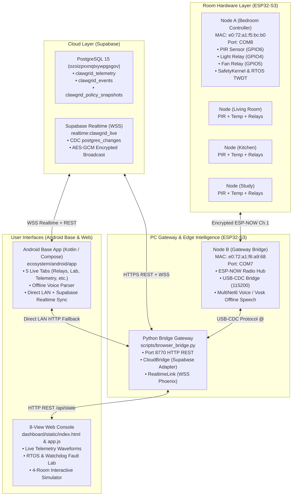
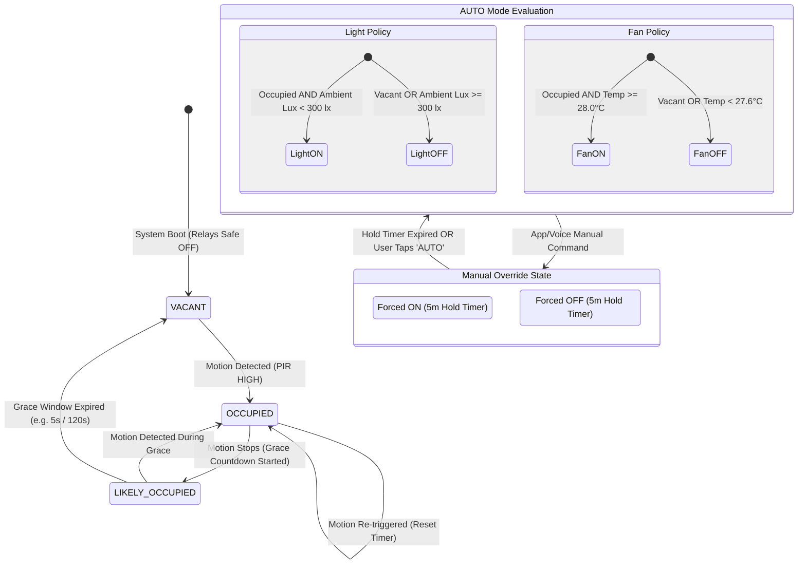

# Final saved checkpoint — 28 October 2026 IST

The declared LED demonstration has been implemented and observed. PIR and physical occupancy AUTO are excluded. Controller A uses active-HIGH light GPIO4 and fan GPIO5, each through its own series resistor to the LED anode, with cathode to GND. DHT11 DATA is GPIO7. Relays remain unused. The existing offline Vosk model is preserved.

## Installed artifacts

- Controller A: `2fad039a863ba65484e09cf761b8f1d3e4b598fb37a63bf95517922fb0ae9955`
- Gateway B: `60da71c68dce57a5e0f663ff25c53e7b0911008ac20562ec2dc3ce7063b4881c`
- Android: `1.0-voice-led-no-pir-20261028j`, SHA256 `c349a275575dd683b76be69db31ce99fde5900888db7adaae89fec4d276f9c92`

Both boards passed guarded application-only flash, readback and protected-system verification. B's model partition is unchanged. The installed APK was pulled and hash-matched; signing, alignment, model and client-boundary checks passed. Final APK j fixes only a stale reconnect message; its recognizer, parser, ViewModel, push-to-talk and model match voice-tested APK i.

Fresh ROM identities: A e0:72:a1:f5:bc:b0 / CH343 serial 5C37271524; B e0:72:a1:f6:a9:68 / serial 5C37271527. Last verified ports were COM10/COM9; re-enumerate before future hardware access. Credentials, provisioning, NVS formats and rollback copies are preserved. Normal application boot/policy writes still occur.

## Verification and ending state

Final endpoint: boot 62, last command 2, fresh authenticated light OFF / fan OFF, outputs enabled in the exact active-HIGH LED profile, DHT11 24.3 °C / OK. PIR is unavailable, motion is null, AUTO flags are zero. Essential tasks advance and watchdogs are active. Owned serial handles are closed; no test worker remains.

85 Android JVM tests passed, along with 65 focused firmware/GPIO/proposal/privacy cases and 51 final native firmware cases. User-observed manual control and two microphone trials per canonical command correlated with applied ACKs and fresh readback. Voice IDs: light ON/OFF #6/#7 and #11/#12; fan ON/OFF #9/#10 and #13/#14, all on boot 61. Extra OFF #8 remains in the record with unspecified provenance.

DHT timeout and recovery were observed on boards and Android: invalid readings became unavailable while control/link/sensor counters advanced and OFF commands still worked; valid temperature returned after DATA restoration. Restart advanced boot 61 to 62, held both outputs OFF, and replayed no old ON request. Final APK j showed UNKNOWN during Wi-Fi disconnection and fresh BOARD state on recovery without actuator requests. Real transport checks rejected wrong boot/room/nonce/target, duplicate confirmation and expired proposals; an unconfirmed phone proposal did not dispatch.

Four negative phrases and cancellation were user-reported as working. Their capture also contains deliberate extra ON #15 / OFF #16. The user explicitly corrected the mistaken report of unconfirmed dispatch. No confirmation defect was established, but the mixed capture is not isolated automated zero-dispatch proof for every negative. Earlier failed recognition evidence remains intact.

## Resume and documentation

Read `docs/VOICE_LED_DEMONSTRATION_20261028.md` for results, limitations and the short demo, and `docs/EMBEDDED_LED_REVIEW_20261028.md` for task/queue ownership. Machine state is in `benchmarks/review/voice-led-no-pir-20261028/FINAL_CHECKPOINT.json`.

Do not rebuild or reflash unchanged artifacts merely to resume. If stricter acceptance is needed, capture isolated negative/cancellation trials without extra positive actions. No four-hour endurance, oscilloscope transient, forced queue-saturation, calibration or hard real-time guarantee is claimed. This checkpoint concerns the declared low-voltage prototype, not cloud, multi-room or appliance project completion. Both indicators end OFF.

---

# CURRENT RESUME POINT — final integrated no-PIR verification, 28 October 2026 IST

Supersedes the stale preparation blocks below. Both no-PIR firmware images are DEPLOYED/readback-verified: A SHA2562fad039a863ba65484e09cf761b8f1d3e4b598fb37a63bf95517922fb0ae9955; B60da71c68dce57a5e0f663ff25c53e7b0911008ac20562ec2dc3ce7063b4881c. APK i installed/hash-verified and microphone positively demonstrated; final APK j is building a targeted stale-reconnect-message correction only.85 JVM tests pass. Existing offline model/parser/thresholds unchanged between i and j.

Current evidence: benchmarks/review/voice-led-no-pir-20261028. User verified light4/fan5 individual resistor/GND wiring and startupOFF; earlier0V OFF output measurements retained. DHT7 timeout was actually observed while tasks advanced/watchdogs stayed active and OFF-only commands succeeded. Android showed Unavailable/DHT11/TIMEOUT, then restored24.4C/statusOK without firmware changes. Boot61->62 startupOFF/no oldON replay observed; PIR unavailable, motionnull, auto_flags0 and hardwareAUTO disabled.

Two fixed microphone rounds user-confirmed, corresponding boot61 applied ACK/fresh readback: lightON/OFF#6/#7, fanON/OFF#9/#10; second round#11/#12/#13/#14. Extra#8OFF retained with unspecified provenance. Four negatives/cancellation user-confirmed working; capture also includes deliberate extra lightON#15/OFF#16. User explicitly retracted the mistaken unconfirmed-dispatch report: no confirmation safety defect established. Do not call the mixed window an isolated automated negative pass; exact limitations recorded in trial-results-current.json. Prior unrestricted-recognition failure retained, not overwritten.

Embedded final transport checks PASS: oldboot/wrongroom/zero nonce/wrongtarget rejected; light/fanOFF ACK+freshreadback; duplicate confirm rejected; expired proposal rejected; unconfirmed phone fan proposal no dispatch.3s dwell/4h limit and overload boundaries are actual-source host tested/inspected, not4h physical or queue-saturation endurance claims. Task review: docs/EMBEDDED_LED_REVIEW_20261028.md.

Next: finish j APK artifact/model/signature checks; install/hashverify; restore existing AP/token privately; verify corrected freshness message and temperature with final OFF/OFF; save final handoff/demo/results. Do not rebuild/reflash unchanged ESP images or restart voice/model investigations. PIR and physicalAUTO excluded. Current boot62 lastcommand2 (OFF-only transport checks), OFF/OFF. No ongoing ON campaign.

---

# CURRENT SCOPE - voice-controlled LEDs, PIR removed (28 October 2026 IST)

The user's latest pasted request supersedes physical PIR and occupancy-AUTO acceptance. PIR has been removed. This milestone is manual and offline phone voice control of A GPIO4/light and GPIO5/fan, real DHT11 DATA GPIO7, both LEDs with own series resistors and cathodes GND. Hardware PIR/occupancy/AUTO must be UNAVAILABLE; separately labelled simulation remains intact.

Current work/evidence: `benchmarks/review/voice-led-no-pir-20261028/`. Prior verified manual LEDs, electrical OFF0V checks, DHT, strict parser rejection and phone reconnect evidence remain in `benchmarks/review/gpio8-integrated-20261028/`. Prior microphone failure is genuine, not a pass: authorized local exact-word diagnostic saved there. No model replacement, threshold lowering, homophone aliases, cloud speech or new dependency.

Implemented in current source: explicit no-PIR LED build flag; no reading/configuring removed input; physical occupancy-AUTO denied while SafetyKernel/manual bookkeeping remain; authenticated radio availability flag and gateway null motion/UNAVAILABLE occupancy; Android hardware availability/disabled AUTO and preserved simulation. Added exact phrase patterns and conservative punctuation/case/spacing handling. Whole finalized utterances only; negation, ambiguity, unknown speech and missing targets/actions reject. Immutable boot/capture-bound proposal, explicit confirmation and ACK+fresh readback gates preserved. Memory-only preview now shows interpreted intent too.

Current grammar before this correction was unrestricted `Recognizer(model,16000f)`. Actual saved recognition mismatch justifies evaluating a bounded runtime phrase list with `[unk]` and negative utterances on the SAME bundled dynamic-graph English0.15 model. Candidate APK i built; final artifact/installation and two trials per canonical command plus four negatives/cancellation remain pending. Initial83 JVM tests and65 focused firmware/GPIO/parser/privacy cases passed; final bookkeeping/duplicate-confirm cases are being checked. Final A/B builds pending/finishing; no new-PIR-scope firmware deployed at this checkpoint. Installed images remain A a1a2dd04... / B9e7f6d9a... / APK h until new deployment receipts prove otherwise.

Next: finish final source checks/builds; fresh ROM identity/current image and protected-region checks; guarded app-only B then A update (A input marker unavailable), model/NVS/credential preservation, final APK i artifact/signature/hash checks and install; verify fresh manual OFF/OFF and unavailable PIR/AUTO/DHT; bounded trial ledger (no hiding failures); final restart/reconnect and OFF/OFF checkpoint. No physical PIR troubleshooting or AUTO motion tests in this milestone.

---

# RESUMED - GPIO8 LED prototype, 28 October 2026 IST

The user's explicit resume supersedes the pause blocks below. Current evidence: `benchmarks/review/gpio8-integrated-20261028/`.

Implemented: shared PIR assignment GPIO8 with compile-time conflicts checked against DHT7/light4/fan5/status48/microphone10-12/speaker16-18; native adapter now uses ESP-IDF gpio_config to select GPIO function and direction while preserving SafetyKernel's OFF latch. No SafetyKernel bypass. Updated active gateway, Android and wiring references; historical archived evidence remains historical. Vosk/model/parser/confirmation behavior unchanged.

HOST_MEASURED: 17 focused tests PASS, including actual native GPIO adapter and both polarities; 50 actual firmware policy/PIR/recovery cases PASS; 78 actual-source Android control/voice cases PASS. A build SUCCESS40.085s; B SUCCESS24.809s. APK f built SUCCESS1m47s, model contents/native16KB/ZIP alignment/signature/client configured-value checks PASS; installed base hash MATCH. Final g build corrects a stale settings sentence about five-minute hold; no control or recognition behavior change.

HARDWARE_MEASURED: fresh ROM identities A COM10/e0:72:a1:f5:bc:b0, B COM9/e0:72:a1:f6:a9:68; prior installed images and system regions MATCH. Existing dual rollback copies verified. Guarded application-only B then A update/readback/system verification PASS; B model region MATCH. NVS/table/model/credentials excluded from writes. New A SHA a1a2dd04a400e7b1557df4534171aa3f34cd8cb95a5062c04bda82e01a916837, new B SHA 1cbb912bd886ab9a72585e2059a926d8a64ce29d47546b4e75b830a05629b0f6.

Post-update boot56: fresh authenticated OFF/OFF, last_command0, exact active-HIGH enabled LED profile, HOME/manual_flags3/auto_flags1, actual vacancy grace120000ms, real DHT11 23.5C/statusOK, tasks advancing, sensor and gateway watchdogs active. PIR tracker arms after warmup with OUT isolated; this is NOT evidence of a connected working PIR. Phone local AP connection restored/mobile data disabled; UI Source BOARD/fresh OFF/OFF/outputs ENABLED/DHT11 observed.

USER_REPORTED: own10k series LED wiring checked; PIR isolated. Both indicators visibly OFF and GPIO4/GPIO5 OFF voltages0V. PIR identified as HC-SR501; middle OUT-to-GND measured3.9V. **PIR hardware step blocked: do not connect this OUT to GPIO8.** Need verified compatible output or suitable level interface and common ground. Exact module supply labels/common-ground observation remain unconfirmed. Never apply9V to ESP GPIO/3V3. Do not claim motion/AUTO physical acceptance.

Manual light/fan, final voice, cancellation/unrelated speech, restart/reconnect observations and final checkpoint are in progress. End OFF/OFF. No old ON request replay. No raw audio/transcript retention without the user's permission. Project end-to-end acceptance remains incomplete.

---

# PAUSED BY USER - 28 October 2026 IST

Resume only after an explicit user request. This checkpoint supersedes the status headings below; historical evidence is retained.

- Integration chat `01a168bb-f3c0-76d0-ba5e-05b76ef1772e` is idle; its last two turns were interrupted, including its attempt to save a pause checkpoint. Its review agents were interrupted in that chat. No build, test, flash, phone action, or hardware command was started for this checkpoint.
- Process inspection with Get-Process found no python/esptool/platformio/ninja/cmake/zig/java processes. Detailed CIM inspection was unavailable. No physical state or live board telemetry was remeasured.
- Last documented installed A: active-HIGH `native_voice_uart_led_high_bench`, SHA256 b7577f39afd72d09f2ffbbd8aa386e8f24a13dd36e2ae123de8047e243b87a7f. Last documented B: SHA256 79927efac36102177c57a7cbad081f8b46e727ac22469d518e40e7188410f19e. Phone: 1.0-led-high-20261027e, SHA256 a80b86a1ba5b92d21cc529ae502b5778d3ab83bc589a9b71077b13b77c9137c4. These are prior deployment records, not fresh device verification.
- Source work remains incomplete: native/main/native_hal.h pinMode still calls gpio_set_direction without explicit GPIO function selection. The interrupted turn discussed correcting it but the correction is absent at this checkpoint. Existing tests/unit/test_gpio_initialization.py compiles a SafetyKernel fixture; it does not establish that the actual native adapter was fixed or tested. No new validation result is claimed.
- Existing source, packages, backups, and evidence remain in place. This directory has no Git repository; no Git commit was made. Snapshot copies and hashes of the GPIO source/test files are saved beside this note.
- Physical LED/PIR/AUTO and final voice/recovery acceptance remain pending. The latest user statement in the integration chat says hardware is positioned as requested; exact current wiring, power, and output states were not independently observed. Older isolated-lead notes are historical and must be reconfirmed before hardware work.

Next executable step after explicit resume: inspect the GPIO initialization gap and actual-adapter test coverage, complete the source correction, then run focused host validation and update the master document. Review installed-versus-source differences before any separately authorized deployment or physical test. Never automatically replay an old ON command.

No automatic resume, new tests, builds, deployments, or hardware actions while paused.

---

# CURRENT — active-HIGH firmware deployed; isolated OFF voltage check pending

27 October 2026. This supersedes the earlier resume/preparation and pause blocks.

| Milestone | Status and evidence |
|---|---|
| Prepared firmware/APK | Implemented and host verified: exact mode, polarity, pair, UART/N16R8, offline model, signature, native/ZIP alignment and client-boundary checks PASS. No unchanged rebuilds. |
| A/B identity and recovery | Board verified: A COM10 e0:72:a1:f5:bc:b0; B COM9 e0:72:a1:f6:a9:68. Full installed 3MiB application and system backups read/board-hash verified in two locations. Existing full model backup verified against B. |
| New installed A | `native_voice_uart_led_high_bench`, 689456 bytes, SHA256 b7577f39afd72d09f2ffbbd8aa386e8f24a13dd36e2ae123de8047e243b87a7f. Guarded application-only flash PASS and application/system readback PASS. **LED-only outputs ENABLED; active-HIGH**, not inhibited. |
| New installed B | `speech_intelligence_uart`, 1215776 bytes, SHA256 79927efac36102177c57a7cbad081f8b46e727ac22469d518e40e7188410f19e. Guarded application-only flash PASS; application readback, unchanged system and unchanged model partition PASS. No NVS/table/model/key writes. |
| Installed phone APK | `1.0-led-high-20261027e`, code1; SHA256 a80b86a1ba5b92d21cc529ae502b5778d3ab83bc589a9b71077b13b77c9137c4, pulled installed base MATCH. Offline phone recognition unchanged; runtime voice acceptance pending. |
| Current real telemetry | Board verified boot52, authenticated/fresh OFF/OFF, no commands since update, DHT11 29.1°C/statusOK; samples/task counters advance. Exact `LED_INDICATORS_10K_ACTIVE_HIGH`, active_low=false, manual flags3, HOME, policy2, until_auto. AP192.168.4.1/channel1, controller channel1. Watchdog/sensor watchdog active, control not stalled, sampled gateway deadline misses0. |
| LED physical operation | **Pending.** Both signal leads remain isolated by user confirmation. Requested measured GPIO4/GPIO5 OFF voltages near0V before power-disconnected reconnection, one LED at a time. Previous LOW-profile mismatch evidence retained; no root-cause fix claimed from polarity change. |
| PIR / AUTO | **Pending physical supply identification/verification and wiring.** PIR/battery/relays disconnected. Do not infer broken5Vin from earlier reading. Check a verified5V source and sensor OUT voltage before GPIO6; no9V connection. Real motion/vacancy/manual-untilAUTO/per-deviceAUTO not demonstrated yet. |
| Final voice / recovery / package | Pending bounded phone test, visible LEDs, negative speech, safe boot and reconnect observations. Existing hardware ACK/readback and earlier user-correlated voice confirmation remain historical evidence, not new build acceptance. |

Exact next step: receive isolated GPIO4/5 OFF meter readings. If both near0V, unplug BOTH USBs, reconnect only light circuit GPIO4 -> own10kΩ -> anode / cathode -> GND (no LED3V3), then verify safe boot OFF before one proposal/Confirm ON/OFF trial with automatic transaction capture. Fan follows separately. DHT remains A3V3/DATA GPIO7/GND throughout. Do not connect PIR or replay an ON request.

New evidence: `benchmarks/review/led-active-high-20261027/{resume-backup.json,resume-artifact-guards.json,resume-apk-checks.json,verified-A/result.json,verified-B/result.json,B-compatibility-before-A.json,deployed-runtime.json}`. Read-only serial handles closed after each check. Guarded flash logs retained under benchmarks/raw/hardware. New dual backups identified in resume-backup.json; original rollback copies untouched. Project core physical acceptance remains incomplete.

---

# RESUMED — active-HIGH LED deployment preparation, 27 October 2026

This entry supersedes the pause below. The user authorized completion of the one-room local LED prototype. Cloud, extra rooms, appliance loads and further ESP speech experiments remain deferred.

- **Implemented / host verified:** A/B active-HIGH-compatible candidate hashes and exact output/fault/polarity/pair/UART/N16R8 guards PASS; cached binaries match sealed candidates. APK bundled-model, native alignment, ZIP alignment, existing debug signature and private-value/client-boundary checks PASS. No rebuild needed.
- **Phone package verified:** installed `1.0-led-high-20261027e`, code 1; pulled installed APK SHA256 `a80b86a1ba5b92d21cc529ae502b5778d3ab83bc589a9b71077b13b77c9137c4` matches. Runtime voice not yet tested on this build.
- **Board verified before update:** fresh ROM identities A COM10 / CH343 5C37271524 / e0:72:a1:f5:bc:b0; B COM9 / CH343 5C37271527 / e0:72:a1:f6:a9:68 match provisioning. Installed applications remain the documented LOW baseline until a successful flash receipt. Read-only state: boot49, light OFF/fan OFF, real DHT11 28.9°C/status OK, fresh authenticated reports. Outputs internally enabled with the old active-LOW profile; do not call this inhibited.
- **Physical checkpoint USER_CONFIRMED:** after initial report that LEDs were connected, both USBs were unplugged, both LED signal leads isolated and PIR disconnected; both ESPs then reconnected with DHT unchanged. No PIR/battery/relay wiring authorized. No active-HIGH LED physical test yet.
- **In progress:** read-only dual application/system backup with installed-prefix, partition-table and board-hash verification; existing dual model backup verification. No firmware write yet at this checkpoint.
- **Next:** complete backups, guarded B application-only update then A explicit active-HIGH LED-only update; verify protected system/model regions, fresh OFF/OFF/health/DHT, then require isolated GPIO4/GPIO5 OFF voltage near 0V before any LED reconnection. Investigate any Fresh/UNKNOWN category without replaying commands.

Evidence: `benchmarks/review/led-active-high-20261027/{board-identities.json,resume-before-state.json,resume-artifact-guards.json,resume-apk-checks.json,resume_backup.py}`. Prior failed LED and voice evidence preserved. Core LED/PIR/AUTO/voice physical acceptance remains pending; project is not complete.

---

# PAUSED BY USER —27October2026 IST; resume only on explicit return

**Safe to unplug both ESPs. No activeflashwrite or ownedserialconnection.** Userlastconfirmed bothUSBboardsconnectedwithonlyDHTonA andBOTHLEDsignalleadsdisconnected/isolated. Physicalpowerafterunplugmessageisnotindependentlyobserved. KeepLEDleadsisolated; doNOTreconnectnewGPIO→LED→GNDcircuitsunderinstalledactiveLOWfirmware. PIR/9Vbattery/relaysdisconnected. Noautomaticresume/job/reminder. Already-runninghostbuildsfinished; no owned serial/flash/build worker remains. No new test/deployment/wiring campaign while paused.

## Exact installed baseline (unchanged by HIGH preparation)

- **A controller:**MACe0:72:a1:f5:bc:b0,lastCOM10/CH3435C37271524; installednative_voice_uart_led_bench SHA742c371bc3904e60eb300deee5ce7d976615405fdb8aa5f290339cff80a28275/689456B. **ACTIVE-LOW LED OUTPUTS ENABLED internally**, not inhibited. Lastcapturedboot45/lightON/fanOFF/request1/appliedACK/status0/freshreadback duringinterruptedfantrial. Lastlogicalstateafterhumanpowercycleisnotremeasured; bootrestorepolicyforcesOFF but donotclaimfreshreadbackatpause. ExternalLEDsarenowuser-disconnected, isolatingGPIOactuationfromLEDloads.
- **B gateway:**MACe0:72:a1:f6:a9:68,lastCOM9/CH3435C37271527; installed30f42429c18876819a02d7c3ac0e74f682695e25402755d6772d2c67f189d828/1215776B. APClawGrid-Assistant/http://192.168.4.1/channel1matchingESP-NOW. EditableURL/tokenmemoryonly.
- **Phone installed:**1.0-local-demo-20261027d/code1/packagecom.aistudio.clawgrid.v2edge;100112968B/SHAfb1a8d138529476ab8895807d0a74ad5d3ce62bc9caaa0cad82cfb03ee299545; pulledinstalledbasehashMATCH earlier. ExistingbundledVosk0.3.75/JNA5.18.1/smallEnglish0.15/unrestrictedgraph/0.7eachword unchanged; noESP/cloud/PCspeechfallback/transcriptlogging.

## Completed and observed; limitations preserved

- DHT11VCC3V3/DATAprintedGPIO7/GND realchecksummedtemperaturetelemetryA→B~28.8–29.2°C/statusOK; userAndroid29°Cafterhardcodedtemperaturetile/diagnosticplaceholderfix. Sensor/control/linktasksadvance/watchdogactive/zero sampled gatewaymisses. Notcalibrationproof.
- Earlierinhibitedmanualactionsboot34 lightOFF#1/fanON#2/fanOFF#3 allmatchingACK+freshreadbackPASS. ManualuntilAUTO/per-deviceAUTO/persistmanualmode-as-heldOFF/health/dwell/maxrunimplemented andhosttested; actualPIRmotion/AUTOinactivity/notyetphysicallyverified.
- ActiveLOWlightbranch rebuiltoneatatime:knownGNDreturnlit;returnGPIO4atlogicalOFFoff; userobservedlightONafterconfirmedappaction, lightOFF#4/cleanupfanOFF#5matchingACK+freshOFF/OFFboot44 anduserlightOFFconfirmed. ExtraONcommands/provenancelimitsretained—notcontrolledsingletrial.
- Fanphysicalstage **NOT PASSED**: originallybothLEDsstayedONwhileboardOFF/OFF; wiringrebuildlaterbothsafeOFFuserreported. Laterrequestedfantrialboot45 insteadcapturedlightON#1/fanOFFwithappliedACK+freshlighttrue/fanfalse; userreportedbothLEDlit. NoGPIOpatch/polarityflipclaimedcausefix. NativeIOMUXinitializationomissionisasourceobservationonly; disconnectedGPIO4/5both~3.3Vusermeasured, notcausalproof.
- FirstUNKNOWNcausewasphoneonotherWiFi/mobiledataON; fixedbyjoinAP/mobileOFF. SecondFresh/UNKNOWNalternationoccurredwhileADBconfirmedAP/mobileOFF/appalive. **Rootcauseunresolved**, notclaimedfixed. Noactuationretries/thresholdrelaxation. Safe-stop/unplugandLEDremovalrequested/confirmed.

## User-approved new direction: active-HIGH LED-only (prepared, NOT deployed)

UserexplicitlyrequestsGPIO4/lightandGPIO5/fanwithGNDreturn. Newcircuit **GPIO4or5→own10kΩ→LEDanode/cathode→GND**, noLED3V3connections. BothLEDleadsisolatedforflash. Thisisanintentionalwiring/profilechange, NOTevidenceofrootcauseoffailure.

Sourcechanges: independentnative_voice_uart_led_high_bench/NODE_A_RELAY_ACTIVE_LOW=false/LED_ACTIVE_HIGHmarker, correctUARTdefaults; flashguardexplicit--bench--led-indicators--led-active-highwithpolaritymarkerchecks; gatewaytruthfulLOW/HIGHLEDprofilenamesfromauthenticatedAflag/polarity; schemaacceptsbothonlywithactualoutputs_enabled; existingSafetyKernellogicalmappingpreserved. AndroidexactHIGHprofilegateplusstaticlocalconnectionerrorcategories/clearonvalidreport/historicalrequestlabel; noautofreshnessrelaxation/replay/transcripts. Models/thresholdsunchanged.

- HOST62firmware/guard/GPIO/privacycasesPASS8.95s;78actualsourceJVMcasesPASS1.175s. Thesearehostonly, notactiveHIGHboard/LEDproof.
- BcandidatebuiltSUCCESS29.115s/SHA79927efac36102177c57a7cbad081f8b46e727ac22469d518e40e7188410f19e/1215776B; mode/pair/UARTguardsPASSandcandidatecopied. **Notdeployed.**
- APKe buildSUCCESS2m4s/83identicalsnapshotfiles;deliverables/ClawGrid-LED-High-debug-20261027e.apk,100112964B/SHAa80b86a1ba5b92d21cc529ae502b5778d3ab83bc589a9b71077b13b77c9137c4. SnapshotC:/Users/hares/Documents/ClawGrid-Android-build-led-high-20261027e. Existingdebugkeyreused/releasepreserved. **Notinstalled; finalAPKartifact/signature/clientboundarychecksNOTRUNafterpause** (doonresume, don'tclaimdone).
- AactiveHIGHhostbuildfinishedSUCCESS171.158s;689456B/SHAb7577f39afd72d09f2ffbbd8aa386e8f24a13dd36e2ae123de8047e243b87a7f;bin+ELFsealedincandidate/A,candidate-A.json. NoHIGHfirmwarewrite. Finalmode/pair/UART/exactHIGHartifactguardsNOTRUNafterpause; do them onresume. No candidateinstalled.

## Exact next executable steps AFTER human resume

1. Readthispauseblockandbenchmarks/review/led-active-high-20261027/PREPARATION.md; checkfinalAhostbuildstatus/artifactseals. Noautomaticresumenow. Re-enumerateports/MACsagainstprovisioningbeforehardwareaccess; verifyactualwiringLEDleadsisolated/DHTunchanged/batteryPIRrelaysunused. PreservecurrentfullLOW+inhibitedrollbackcopies. Noerase/NVSrestore/keyregeneration/modelpartitionwrite.
2. FinishrequiredHIGHartifact/pair/mode/UART/exactselectorchecksandAPKeoffline/signature/key/16KBchecks. Guardedapp-onlyBfirst(acceptsoldLOWA),verifyprotectedregions/compatibility; thenAexplicitHIGHprofilewithLEDleadsstillisolated. Readbackapplication/system/protectedmodelasappropriate; stop/rollbacknormalknownimageonfailure. Preservecredentials/NVS/replaycounters.
3. VerifyfreshOFF/OFF/savedmanualheldOFF/exactHIGHprofile/active_lowfalse/DHTOK/control-linkhealth. WithLEDsisolatedmeasureGPIO4/5OFF~0V. Install/hash-verifyAPKe,reapplytokenprivately/mobileOFF/APonly; diagnoseFresh/UNKNOWNusingnewstaticcategorywithnoactuation. Don'tcallcategoryadditionafixwithoutobservation.
4. PowerOFFoneLEDwireatonceusingGPIO→own10k→anode/cathodeGND; startupOFFhumancheck. TestonlylightON/OFFproposalConfirmACKfreshreport+humanvisibilitythenfanindependently/dwell3s; noothercommandextra/replay. CaptureIDsautomatically; stopmismatch, endOFF/OFF.
5. PIRexactmodel/supplyratingsstillunverified; boardonlymarkingN16R8(memorynotPCBpowerpath),5Vin0.67readingdoesNOTprovepinbroken. Battery9V6F22unconnected; no9Vwiringauthorized. Userapprovedbounded3.3Vsupply-onlydiagnosticlater,OUTinitiallyisolated; insufficientvoltagefailuredoesNOTprovePIRbad/reliableoperation. Confirmcompatiblesupply/OUTlevelbeforeGPIO6; thenreal60swarmup/200msLOWbaseline/filter/motion/vacancy/manualuntilAUTO/independentdeviceAUTO. Temperaturemonitoringonly.
6. Safe boot/stale/disconnect/reconnect/reboot/noONreplay/watchdogrecoveryandbriefexistingofflinephonevoice+confirmationlater; nofurthermodelinvestigation. FinalAPK/wiring/demo/results/gaps; cloud/extrarooms/relays/appliancesdeferred.

Evidence/preservation: led-active-high-20261027/{before/,rollback/,rollback-hashes.json,focused-tests.log,jvm-control.log,build-*.log,outside-build-receipt.json,pause-checkpoint.json}; earlierphysical-led-20261027/fan-control/fan-reconnected-ON-OFF.json retainsfailedtrial. Existingfullverifiedprivatebackupsincludingphysical-led-20261027/manual-auto-20261027/dht11-20261027 andoriginalMN7dualbackupsunchanged. NoGitHub/Downloadspublication/noDBchanges/nocredentialsprinted. **Paused; safeUSBunplug; nofurtherphysicalactionsuntilreturn.**

---

# CURRENT — user requested active-HIGH LEDs; builds in progress,27October2026

BothESPUSBsunplugged/bothLEDbranchesdisconnected explicitlyconfirmed; DHTunchanged/PIRbatteryrelaysdisconnected. Prepare conventionalGPIO4/5→own10k→LEDanode/cathode→GND; noLED3V3connections; keepLEDsignalwiresisolatedduringflash. CurrentinstalledactiveLOWfirmwaremustnotpowernewcircuit. No enabledflash/startupLEDtestbeforematchingHIGHprofileandisolationcheck.

ImplementedseparateHIGHenv/marker/explicitflashselector, truthfulgatewayLOW/HIGHprofile, exactprofileappgate; retainedLOW/inhibitedrollback. Staticlocalconnectionissuecategories/historicalrequestlabel added to diagnoseFresh/UNKNOWNwithoutthresholdrelaxation/replay ortranscriptlogging. HOST62firmware/guard/GPIO/privacyPASS8.95s+78JVMcasesPASS1.175s;A/B/APKbuildsinprogress. NeitherHIGHfirmwarenorAPKeinstalledyet. Details benchmarks/review/led-active-high-20261027/PREPARATION.md. Previousfantrialnotpass: actualboot45lightON#1/fanOFFwhileuserbothLEDlit; fancommandnotcaptured. Rootcauseunresolved; user-directedcircuitchangeisnotclaimedcausefix. InstalledA742c371.../B30f424.../phone1.0-local-demo-20261027d preserved.

---

# CURRENT — phoneAP restored/dataOFF; bounded fantrial pending,27October2026

Userreportsdashboardreturned. IndependentADBchecks phoneonClawGrid-Assistant/mobile_data0. Read-onlysameadapter/MACbindingdiagnostics withoutresetverifyboot45/freshOFF/OFF/lastcommand0/DHT29.0°COK/LEDprofileenabled. Evidence fan-control/reconnected-ready.json. Startednew120sread-onlyobserverfan-reconnected-ON-OFF; priorwindowcorrectlyNOTRUN(nofancommand)ratherthanfailure. UseraskedONLYfanONproposalConfirmREPORTED/humanonlyfanLEDlit/lightOFF, wait3s, fanOFFConfirmREPORTED/bothLEDsOFF. Awaitactualresults; noagentcommand/replay/build/flash. Do notresetboard/networkmidtrial. ExistingDHT/lightresults preserved; PIRbatteryrelaysdisconnected.

---

# CURRENT — fantrialNOTRUN; phone switchedWiFi, reconnectpending,27October2026

UserreportsappUNKNOWN/controlsdisabledbeforefantrial. ADBWiFi status independentlyshowsphoneconnectedtoanotherWiFi(notClawGridAP), mobile_data=1. NoSSID/password/tokenretainedinprojectreport. Gatewayread-onlydiagnostics confirm **boot45/freshknownauthenticated/lightOFF/fanOFF/lastcommand0/DHT29.0°COK/exactLEDprofileenabled/APclients0**; noreset/flash/ONcommand. Prior120sfanobserverclosed/errornone/no newcommand. This is phoneconnectionfailure, NOTfanSafetyKernelrejection/physicalfanresult.

AskedturnmobiledataOFF/joinClawGrid-Assistant/StayconnectedwithoutInternet/disableautoswitch/appforeground, reapplyexistingprivateapi_token/http://192.168.4.1onlyifneeded; waitfreshandreply, NOcommandsyet. NextverifyphoneAP/data0andfreshboardwithoutROMreset, thenboundedfanON→humanonlyfanLEDlit/lightOFF→3sdwellfanOFF→bothOFF withproposalConfirmACKreadback. Don'trepeatalreadyattemptedcommands. Evidence fan-control/unknown-phone-network-diagnosis.json. Allserialconnectionsclosedafterfiniteobserver/readcheck; firmwareunchanged/DHTpreserved/PIRbatteryrelaysdisconnected.

---

# CURRENT — lightLEDON/OFF observed; fanON/OFF trial pending,27October2026

Physical lightLEDON confirmed byuser afterappconfirmation, lightOFFACK#4/readbackPASS, fanOFFcleanupACK#5/readbackOFF/OFFPASSboot44, and userexplicitlyconfirmedphysicallightOFF. ExtraearlierONcommands/provenancelimits preserved—notformalcontrolledsingletrial. Fan wiredpowerOFF3V3→separate10k→anode/cathode→printedGPIO5, existinglightGPIO4/DHTGPIO7unchanged; userreportsBOTHLEDsOFFafterpowerup. This succeeds currentrebuiltbranchsafeOFFcheck; earlierbothONfailure/rootcauseunproven remainsretained.

FreshMACverificationA COM10/e0:72:a1:f5:bc:b0,B COM9/e0:72:a1:f6:a9:68PASS; normalresetsadvancedAboot45. FreshOFF/OFF/manual3/exactLEDprofileenabled/DHT29.0°COK/sensorwatchdogverified. Finite120sread-onlyfanobserverstarted, useraskedONLYfanONproposal→explicitConfirm→REPORTED/humanonlyfanLEDlit/lightstaysOFF, wait3s thenfanOFFConfirmREPORTED/bothLEDsOFF. Awaitresult; noagentcommands/replays/noAUTOvoice. Evidence physical-led-20261027/{light-completed-fan-safe-boot.json,fan-control/board-identities.json,before-fan-ON.json,fan-ON-OFF.json/.log}. InstalledA742c371.../B30f424.../phone1.0-local-demo-20261027d unchanged, outputsENABLED_LED_ONLYnotinhibited.

PIR/battery/relaysremain disconnected. AfterLEDpass: boundeduserapproved3.3VPIRsupply-onlycheck withOUTinitiallyisolated, validitylimits; exactmodulerating/board5Vinpathunresolved/no9Vconnectionauthorized. CompletePIRmotion/AUTOvacancy/manualoverride onlywithactualobservations.

---

# CURRENT — cleanupOFF/OFF verified#5; fan wiring pending physical lightOFF confirmation,27October2026

LightLEDON userexplicitlyobserved/correct10kseriespathconfirmed/fanLEDdisconnected. ExtraONcommandsbeforeACK#3mean notcontrolledsingletrial; preservecount/provenancelimits. LightOFF#4 appliedACK/freshreadbackPASS. InitialcleanupcheckranbeforefanOFFarrived and correctlyfailedOFF/OFFassertion (no commandretry). UserthenreportedFanOFFREPORTED; latestread-onlycheck confirms **boot44/fanOFF#5 phase2/status0/oneattempt/RTT18756us/processing65us/freshOFF/OFFlast5/DHTOK**. Noagentactuation/replay. Physical lightLEDout confirmation stillpending; do notinventitfromlogicalOFF.

Nexthumansteprequested: ifphysical lightLEDnowOFF, unplugBOTHUSB and addfan3V3→ownsecond10k→anode/cathode→printedGPIO5, workinglightGPIO4/DHTGPIO7unchanged/PIRbatteryrelaysdisconnected; keepOFFandack. If lightstilllitstopnofanwiring. Candidate/installedA742c371... LEDoutputsenabledinternally/B30f424.../APK1.0-local-demo-20261027d unchanged. Nextafterfanwiringackpoweredboth safeOFFcheck then onefanON/OFFproposalConfirmACKreadback+humanvisibility, dwell3s. PriorsteadybothONfailurepreserved; onebranchrebuildlightpasssuggestsactualcircuitconnectionissuebutrootcausenotindependentlyproven; noGPIOpatch/polarityflipdone.

Evidence light-control/{after-user-ON.json,cleanup-after-extra-commands.json,after-user-cleanup.json,fan-OFF-reported-check.json,light-stage-result.json}. Allserialhandlesclosed afterfinitechecks. PIRsupplyteststillpending/9Vbatteryunused.

---

# CURRENT — extra app commands observed; light/fanON cleanup pending,27October2026

After user replied ambiguously “done i am getting also i have wires in3.3v and4” to the ONE-lightON request, read-only gatewaycheck shows boot44/lastcommand3/appliedACK#3phase2status0/lighttrue/fantrue; freshsample217998ms/age201ms, DHTstatusOK/profileLED_INDICATORS_10K_ACTIVE_LOW/outputsENABLED. Earlierobserverwindow hadlast0; **threecommands occurred, not the single requestedtrial**. Prior#1/#2 payloads/provenance notcaptured inthischeck; don'tclaimcontrolledone-commandpass. PhysicalLEDvisibility/resistorpath and secondLEDdisconnected status requireuserclarification. No commandreplayed byagent. Evidence light-control/after-user-ON.json.

Requested STOPON/AUTO/voice; returnviaapp lightOFF→review→Confirm→REPORTED, thenfanOFF→review→Confirm→REPORTED onceeach. Requested actualexternalLEDlitafterON/nowOFF and10kseriespath; noIDsneeded. Finite read-onlyLEDobservercleanup-after-extra-commands75sstarted; no agentactuation/replay. Awaituserandgatewaycleanupobservations; lastverifiedlogicalstate is ON/ON, NOTOFF. Ifrejecttimeout/mismatchstop, don'tretry orclaimphysicalsuccess. All wiringchangespowerOFF; PIRbatteryrelaysremainunused.

---

# CURRENT — lightON app trial pending on boot44; observer read-only,27October2026

User connectedB after singlelight passiveOFFcheck. FreshROMMACs match ACOM10/e0:72:a1:f5:bc:b0/CH3435C37271524 and BCOM9/e0:72:a1:f6:a9:68/5C37271527. NormalidentityresetsadvancedAboot44. Freshknown/authenticatedOFF/OFF/manual3/profileLED_INDICATORS_10K_ACTIVE_LOW/physical_outputs_enabledtrue/DHT28.8°COK/sensor+gatewaywatchdogs verified. No firmwarewrite/build/recognitionchange.

Finite scripts/observe_led_control.py added: GETstate/transaction/rtosonly, requires exactLEDprofile/freshness/sameboot, stoponrejecttimeout/profilechange; no commands/replay. Evidence physical-led-20261027/light-control/{board-identities.json,before-light-ON.json,light-ON.json/.log};90sread-onlyobserver running. Userasked ONE BedroomlightONproposal→explicitConfirm→REPORTED+humanLEDlit/notlit. Awaitresult; do not duplicateON merelyforID. SecondLEDfullydisconnected/DHTunchanged/PIRbatteryrelaysdisconnected. NextaftercorrectONvisibility/ACKnewreport: cleanupOFF after3sdwell, observehumanOFF. If LEDmismatchorerrorstop/diagnosebeforefanstage. InternallyenabledLEDprofile—notinhibited; no applianceclaim.

**Light observer window ended:**90sread-onlywindow completed/errornone/serialclosed; no newcommandobserved, finalboot44/lastcommand0/OFF/OFF/LEDprofileenabled/DHTstatusOK. PhoneAPclientcount0atobservation. This is NOT a failedONtransaction or a physicalONpass; useraction/resultstillpending. Instructed reconnectClawGridWiFi/freshappthenONEONproposal/Confirm; do notrepeatifalreadyattempted. Evidence light-control/observer-window-result.json. Later finaltransaction can be read without reissuingcommand.

---

# CURRENT — single-light passive OFF check passes; controlled ON/OFF pending,27October2026

User completed knownreference circuit3V3→own10k→oneLEDanode/cathode→GND: **LEDlit**. Then AUSBunplugged, movedONLYcathodereturn fromGND toprintedGPIO4, poweredONLYA, waited10seconds/noappcommands: **LEDoff**. This is USER-OBSERVED passive electricalOFF, not a confirmed commandedON/OFF transaction. SecondLEDfullydisconnected/DHT3V3/GPIO7/GNDunchanged; BPIRbatteryrelaysdisconnected. EarlierbothLEDsteadyON failure/currentpath remains unexplained and preserved; no firmwarepatch/polaritychange made. NativeIOMUXsourceobservation is not causalproof.

InstalledALED742c371... still outputENABLED throughSafetyKernel, not inhibited; B30f424... lastverified/phone1.0-local-demo-20261027d unchanged. Current hostenumeration onlyA-associatedCOM10/CH3435C37271524. Next physicalstep requested: leaveA/light/DHTunchanged, connectONLYBUSB, noactuatorcommands yet; then freshMACverification/freshlogicalOFF+profile/savedholds/DHThealth, followedby one lightON/explicitConfirm/ACK+freshreadback/humanLEDobservation, cleanupOFF after3sdwell. Fanbranchwillbeadded/tested separately afterlightpass. Exactevidence physical-led-20261027/single-light-reference-results.json. No build/flash/ONcommand in thisdiagnostic.

PIRpower/exactmodulerating stillunresolved; userapproved bounded3.3Vcheck later, not9Vbatterywiring. Donotassume5Vinbroken. CompleteLEDstagefirst, preserveDHT andSafetyKernel.

---

# CURRENT — LED branches removed; one known-GND reference circuit pending,27October2026

User acknowledges unplug/completeLEDbranchremoval and says priorconnectionwasgood, but does not explicitly distinguish previousGPIO5versusloosecathode position. Record as user wiringassessment, not independentverification/rootcause. Current requested POWER-OFF stage: onlyoneLED3V3→own10k→anode/cathode→printedGND onA, noGPIO. SecondLEDfullydisconnected, DHTunchanged, BPIRbatteryrelaysdisconnected. Await wiringack; keepUSBsoff until separatepowercheck. Purpose is knownONreference then later movingONLYreturnfromGND to sameprintedGPIO4 forOFF comparison, withpoweroff betweenchanges. No firmware/polarity changes or actuator commands. LEDprofile742c371... remainsinstalled/enabledinternally; physicalLEDonGPIOcontrolfailed/unresolved. PIR3.3Vtrialnotstarted.

---

# CURRENT HARDWARE STOP — actual LED setup differs from isolation test,27October2026

User reports BOTH ESPs powered/BOTH externalLEDs lit instead of intended onlyA/singlelight/fancathodeisolated setup. Whether fan cathode was reconnected is unknown; cannot conclude software or wiringcause. NoONcommands/firmwarepatch/thresholdchange since initialsafe-bootfailure. **Requested unplugBOTHUSB and disconnect bothLEDbranches completely from supply/GPIO/breadboard**, retain verifiedDHT3V3/GPIO7/GND onA; PIRbatteryrelaysdisconnected. Await acknowledgment and fan-cathode clarification; powerOFF. Do not proceed to actuation or callphysicalOFFverified.

User proposes tryingPIR3.3V before another supply. A reversible/bounded3.3Vsupply-only diagnostic may be considered after LEDfaultisolated, withOUTinitiallydisconnected and readingschecked; under-voltagefailure would NOT provePIRfault or successful/reliablemotionoperation. No9Vbatterywiringauthorized. ActualHC-SR501-stylefamily normally expects~5Vinput; exactmodel/ratingremainsunverified. NoPIRtrialstarted. ResolveLEDbranchcurrentpath first, onepower-disconnectedstep atatime; preserveDHT andinstalledLEDprofile742c371... (internallyenabled, not inhibited).

---

# ACTIVE — finish physical LEDs and PIR; awaiting single-light observation,27October2026

User asks to finish LED indicators/PIR now. Preserve DHT11 and native app; no voice-model investigation/relay/appliance wiring. Current installedALEDprofile742c371bc3904e60eb300deee5ce7d976615405fdb8aa5f290339cff80a28275 is OUTPUT-ENABLED internally through SafetyKernel; currentB30f42429.../phone1.0-local-demo-20261027d remain last verified. No activePython/esptool/build workers found; fresh Windows enumeration shows only A-associatedCH343 COM10/5C37271524 plusBluetooth; physical role must be MAC-reverified before further diagnostics/deployment, not assigned byLEDcolour.

Confirmed latest human observations: bothLEDs originally stayedlit afterboot with lastlogicalOFF/OFF, not juststartupflash; afterGPIOcathodesdisconnected/isolated, bothLEDsOFF; user confirms BOTHprintedGPIO4and5 measure~3.3V-toGND in that isolated condition. User then unpluggedA and reconnectedONLYlightcathode to SAMEmeasuredprintedGPIO4, fanisolated/DHTunchanged/BPIRbatteryrelaysdisconnected. Singlelight10secondpowered result was requested but not yet answered. NoONcommands/firmwarepatch/polarityflip sincefailedcheck; IOMUXsourceomission is not establishedcause. Actualwiringcurrentpath remainsunresolved.

Next pendinghumaninfo: actualcurrentsetup and singlelight OFF/briefFLASH/steadyON after10seconds (do not movepoweredwires); exactPIRmodel/inputrating or readablemodule/regulatorphoto.9V6F22battery NOTconnected/authorized; N16R8notPCBpoweridentity; no5Vin damage assumption. If singlelightsteadyON, powerOFF and isolate branch, then verify actual rail/eachLEDterminal voltage and printedpin mapping before anyactuation. If steadyOFF, freshMAC/healthyreports + boundedlightON/OFF with confirmation/ACK/readback and humanvisibility, then fanseparately; returnOFF/OFF beforePIRwork. Never convertlogicalACK into physicalsuccess.

Master checklist: implementedDHTrealtelemetry/manualfan/manual-untilAUTO/persistentmanualheldOFF/explicitAUTO capability and guardedLEDprofile; hosttests77JVM+59focusedpassed; boardmanualinhibited#1lightOFF/#2fanON/#3fanOFFallPASS; actualDHTA→BstatusOK~29°C and user-observedAndroid29°C; LEDsafe-bootphysicalcheckFAILED/unresolved; PIRsupply/motion/AUTOinactivityphysical/recovery/finaldemo remainpending. Existingfullrollbackdualbackups/privatecredentials/models/NVS/partitionspreserved. Earliercheckpointsbelowretainhistory.

---

# CURRENT LED DIAGNOSIS — reported GPIO~3.3V; light-only reconnection pending,27October2026

User reports “around3.3V” in response to measuring printedGPIO4/5-toGND with cathodesisolated, onlyApowered. This is consistent with expected activeLOWOFF, not support for flippingpolarity/flashingaGPIOpatch. Asked confirmation BOTHpins were measured and whether originalBOTHON was steady or a briefstartupflash. Previous nativeIOMUX omission remains a source observation, **not proven causal**; no GPIOpatch/build/deploy performed.

Next one physicalstep queued: unplugAUSB; reconnectONLYlightLEDcathode to the SAMEmeasured printedGPIO4, keep3V3→own10k→anode, fancathode loose/isolated; DHTunchanged/BPIRbatteryrelaysdisconnected. Await wiringacknowledgment; keep powerOFF until deliberate light-only bootcheck. NoONcommands, no physicalswitching pass. InstalledALED742c371... remains internallyenabled; electricalmeasurement/userobservation limits retained.

---

# CURRENT LED DIAGNOSIS — isolated cathodes bothOFF; voltage measurements pending,27October2026

User reports BOTH externalLEDsOFF when onlyAUSBpowered and LEDcathode wires disconnected from GPIO4/5/isolated; DHT unchanged, B/PIR/battery/relays disconnected. Previous failed physicalsafe-boot BOTHON with GPIOconnections is preserved, not dismissed. This narrows the current path but does not establish software polarity/pin-selection/wiring cause. No appONcommand has been sent. Current next requested observation: DCvoltage each printedGPIO4/5-toGND with LEDcathodes still isolated; activeLOWOFF expects~3.3V. Do not reconnect LEDs until cause/electrical levels resolved.

PinnedIDFsource review: gpio_set_direction enables output/matrixroute but does not select GPIOIOMUX; gpio_config explicitly selects it. native_hal.pinMode presently lacks fullGPIOconfiguration. This is a concrete initialization omission, possible contributor, NOT confirmed rootcause of the two litLEDs. No patch/build/flash since reportedfailure. InstalledALED742c371... remains enabled internally, physically isolated from cathodes; no inhibited claim. Readingspending before corrective deployment. All serial handles remainclosed.

---

# STOPPED LED ACTUATION TEST — physical safe-boot mismatch,27October2026

User reports BOTH externalLEDsON after LED-profile deployment while last authenticated board samples boot39 report OFF/OFF/manual3/lastcommand0. **Safe-boot physical check FAIL; no ON/actuator command was sent.** Immediately asked unplug both USBs; user confirmed unplugged/LEDsout. Then user confirmed only LEDcathode wires removed from GPIO4/5, loose/isolated; DHT unchanged, PIR/battery/relays disconnected. Current pending isolation check: powerONLYAUSB with LEDcathodes separately isolated and observe whether eitherLEDlights; no commands/wire movement. B remainsunplugged. Do not resume ON tests or flip polarity to force success.

A remains flashed LED-enabled742c371...; powerdisconnection/removedcathodes is the current physical stop boundary, not an inhibited firmware claim. Rollback75d668... and fullapplication dualbackup preserved. Cause unresolved. Source review found native_hal.pinMode only calls gpio_set_direction, which in pinned IDF4.4.7 does NOT select GPIOIOMUX whereas gpio_config does; this is a real initialization omission/possible contributor, not yet causal proof. No source fix/build/flash after this failure yet. First distinguish an unintended breadboard current path from pin routing/output level with isolated branches. BothLEDon cannot be accepted as logicalOFF or switching success.

Evidence physical-led-20261027/safe-boot-physical-failure.json; prior enabled-profile readbacks/systemchecks remain valid historical artifacts but do not prove physicalOFF. Preserve failed result.

---

# CURRENT — LED-only outputs ENABLED on A, safe-boot human check pending;27October2026

**Output inhibition status changed by explicit user-authorized LED stage:** controllerA now runs guarded native_voice_uart_led_bench SHA256742c371bc3904e60eb300deee5ce7d976615405fdb8aa5f290339cff80a28275 (689456B), physical_outputs_enabled=true, profileLED_INDICATORS_10K_ACTIVE_LOW, activeLOWGPIO4/5/defaultfaults. Do not call current outputs inhibited. Only LEDs/separate10k resistors are user-confirmed connected; relays/PIR/battery unused/disconnected; DHT3V3/GPIO7/GND preserved. Independent wiring photo/electrical inspection was declined and remains unverified.

Fresh MACs ACOM10/e0:72:a1:f5:bc:b0 and BCOM9/e0:72:a1:f6:a9:68 matched before hardware actions. Before enabling: boot36/OFF/OFF/inhibited/savedmanual3/DHT29.0°C/statusOK; user bothLEDoff on inhibited image. Full current inhibitedAapp0 read/board-verified and preserved twice in benchmarks/backups/physical-led-20261027 and Documents/ClawGrid-private-backups/physical-led-20261027, systemverified. Existing guarded script with explicit --role A --uart-console --app-only --bench --led-indicators wrote app0 only; afterward applicationSHA/system readbacksPASS. No B write/model/NVS/table/key changes. B remains30f42429c18876819a02d7c3ac0e74f682695e25402755d6772d2c67f189d828; phone remains installed1.0-local-demo-20261027d/SHAfb1a8d13... . Rollback inhibited artifact75d668... remains independently saved.

Postdeployment board observations boot39/samples3998→6998→9998ms/controljobs788→1389→1987/sensorjobs1→2→4; sensor/gatewaywatchdogtrue, gateway0sampledmisses, DHT29.0°C/statusOK. **Logical lightOFF/fanOFF/manualflags3/lastcommand0**; no ON/actuator command sent since deployment. These are board-state observations, not physical LED proof. Current user question queued: confirm BOTH external LEDsOFF before any ON test. Stop if unexpectedly lit; no further command until answer. All owned serial handles closed after finite checks.

Evidence benchmarks/review/physical-led-20261027/{board-identities.json,before-enable-runtime.json,deployment/preflight.json,deployment/deployed.json,after-enable-runtime.json,enabled-profile-summary.json}. Prior three inhibited manual actions allPASS#1OFF/#2fanON/#3fanOFF, no physical claim. PIR exactinput/boardpower unresolved;9V6F22 onlyidentified, battery notconnected/authorized; no5Vin damage assumption. Next safe-boot humanLEDcheck, then one lightON→humanvisibility+ACK/freshreadback→OFF, then fan similarly, respecting3sdwell and no automaticreplay.

---

# CURRENT — both LED circuits user-confirmed; inhibited power-up pending, 27 October 2026 IST

User acknowledged light and fan activeLOW circuits on printedGPIO4/5, each with its own10k resistor, and explicitly declined a photo. Proceed based on USER_REPORTED pin/polarity/resistor wiring; **independent visual/electrical wiring inspection is unverified**, not completed. Respect no-photo preference; no additional photo approval gate. DHT3V3/GPIO7/GND remains unchanged; PIR/battery/relays disconnected.

Queued physical action: connect both UART/CH343 USBs without moving wires, observe/report either externalLED lit and stop/unplug for heating/repeatedUSBdropouts. Current port enumeration shows noCH343 (still unplugged). Must fresh-MAC verify and check normal inhibited OFF/OFF/DHT state and stored manual holds before enabled-profile deployment. Built/sealed LED candidate742c371bc3904e60eb300deee5ce7d976615405fdb8aa5f290339cff80a28275 remains **not installed**; normalA75d668.../B30f424... remain last verified installed. Authorization to enable LED-only comes from user's explicit physical-LED request; no relay/appliance loads or model/credential changes. Report human LED observations separately from ACK/board-report evidence. Earlier photo-gate wording below is superseded by this explicit user preference.

---

# CURRENT — three manual actions PASS; physical LED wiring gate, 27 October 2026 IST

User now prioritizes actual GPIO4/light and GPIO5/fan LED demonstration with two separate10kΩ resistors; keep relays unused/DHT working. PIR/external9V battery remain disconnected until exact supply/module compatibility is verified. **Do not infer5Vin damage from earlier readings.** N16R8 is memory configuration, not PCB power-path identification.

| Checklist | Actual status |
|---|---|
| Implemented |Real DHT11 GPIO7/task/checksum/validity/telemetry; hardware temperature tile/diagnostics placeholder fixed. Manual-untilAUTO/per-device AUTO/persistence with safeOFF boot, schema5 controller capability, simulation hold isolation. Separate guarded LED-only environment/selector/profile prepared; no recognition-model/parser/.7 threshold change. |
| Host/build verified |Latest77actual-source JVM cases PASS1.173s;59focused host cases PASS8.40s (50C/C++,6LED guards,3privacy). Manual/AUTO firmware A final inhibited SUCCESS22.757s/B29.101s; built/rebuilt only for changed sources. APKd assembled and artifact/signature/offline-model/alignment/private-key checks PASS. LED-enabled profile build is currently in progress; NOT deployed. |
| Installed firmware / phone |A inhibited75d668711108bdbd5db5ecd03060eb85bf9fd9883420f77a90405d8804105b72,689440B; B30f42429c18876819a02d7c3ac0e74f682695e25402755d6772d2c67f189d828,1215776B. Guarded app-only B-first/A deploy+readback and protected system/model checks PASS. Installed phone1.0-local-demo-20261027d/code1/SHAfb1a8d138529476ab8895807d0a74ad5d3ce62bc9caaa0cad82cfb03ee299545,100112968B, pulled-base hashMATCH. c was built but never installed; prior b/a rollback preserved. |
| Board verified / manual results |Boot34 policy2/until_auto and DHT~29.2°C/statusOK observed. User completed lightOFF#1, fanON#2, fanOFF#3: all appliedACK phase2/status0 plus fresh sameboot report/lastcommand matches. Exact samples274996/290996/441996ms and ages746/496/246ms. OFF/OFF final, outputsINHIBITED. No physical switching claim. Stored manual flags3 confirmed by read-only P diagnostic after successful NVS commit; control/link/sensor jobs advance/watchdogs active. |
| DHT phone display |User explicitly reports29°C after APKd fixed the hardcoded Hardware Unavailable tile and stale diagnostics. Board/gateway sensor values independently observed. RAM-only UI inspection did not independently extract the displayed digits; label this USER-OBSERVED Android display, not an automated pixel/value match. Temperature monitoring only, no calibration claim. |
| Awaiting physical LED connection |Current requested step: both USBs OFF, preserve DHT wires, locate printed4/5 (not header index) on physical A, identify LED anode/cathode; await acknowledgment. Circuit will be activeLOW:3V3→own10k→anode; cathode→GPIO4 or5. Each separately staged and inspected before power/output enablement. Low brightness expected/accepted. |
| Blocked / remaining |Actual LED wiring/polarity/ONOFF observations pending; outputs must remain inhibited until checked. PIR model/input rating and board5Vin path unresolved; battery only identified9V6F22, not a regulated5V source; no battery wiring authorized. AUTO motion/vacancy/manual override and reboot/stale/recovery/brief existing phone-voice acceptance remain pending. Cloud/extra rooms/model investigation deferred. |

Evidence: benchmarks/review/manual-auto-20261027/{manual-three-actions-verdict.json,after-manual-batch.json,manual-mode-saved-before-auto.json,first-policy-runtime.json,deployment/}; temperature UI fix evidence benchmarks/review/temperature-kpi-fix-20261027/installed-receipt.json. Working policy bin/ELF preserved separately in benchmarks/review/physical-led-20261027/inhibited-baseline before LED build. Full working prior DHT app recovery copies in benchmarks/backups/manual-auto-20261027 and Documents/ClawGrid-private-backups/manual-auto-20261027 were both verified against complete board flash before policy writes (host reconstruction is now board verified). No NVS erase/restore/key regeneration/model/partition write. Preserve all credentials/baselines/failed evidence.

**Next:** wait for power-off/printedGPIO4+5/LED-polarity acknowledgment; guide light circuit first, then fan, verify actual wiring/photo. Build/hash/guard LED profile without deployment until gate met; then freshly MAC-verify/check OFF/saved holds, app-only guarded A --bench --led-indicators, verify explicit LED declaration/safeOFF/DHT/link health. Obtain human LED observations together with captured ACK+fresh reports, endOFF/OFF. Then solve PIR supply from actual hardware, not assumptions, before motionAUTO. Previous checkpoints below are history.

## Physical LED milestone started —27October2026

All three captured app actions independently reviewed PASS on boot34: lightOFF#1,fanON#2,fanOFF#3 each phase2/status0 ACK plus fresh sameboot board report/lastcommand/output matches; see manual-three-actions-verdict.json. FinalOFF/OFF/inhibited; these do not establish LED operation.

User confirmed both USBs unplugged, controllerA printedGPIO4/5 identified (not header indices), LED anode/cathode identified; DHT wires unchanged/PIR,battery,relays disconnected. Current **pending single wiring step**:3V3→one10k resistor→lightLEDanode; lightLEDcathode→printedGPIO4. FanLED remains disconnected; power remainsOFF. Await acknowledgment then guide fan separately and inspect photo/wiring before enablement.

LED profile build attempt1 FAILED53.567s at native_hal compile-time UART guard (new _led_bench environment absent from CMake's explicit UART defaults regex), not a flash failure. Updated native/CMakeLists.txt regex to include only intended _led_bench; saved/moved failed generated SDK configs to benchmarks/review/physical-led-20261027/*.failed-console, no deletion of baselines. Six selector checks PASS. Rebuild build-led-profile-uart.log in progress; do not claim candidate built/installed until success and guards. Current inhibited A/B bin+ELF saved independently under physical-led-20261027/inhibited-baseline because PlatformIO can purge sibling environment caches.

No output-enabled flash, diagnostic-fault image, actuator command, model/NVS/partition/credential change in this physical-preparation step. Exact ESPPCB and PIRinput rating remain unresolved; no9Vbattery connection authorized and no5Vin damage diagnosis.

**LED candidate build complete, not deployed:** native_voice_uart_led_bench SUCCESS120.259s after explicit CMake UART-default correction;689456B/SHA256742c371bc3904e60eb300deee5ce7d976615405fdb8aa5f290339cff80a28275; linkedRAM69396B (build size, not runtime measurement). Enabled/default-fault/board-pair/UART0/explicitLEDselector guards PASS. Candidate bin/ELF sealed separately in physical-led-20261027/candidate; candidate-identity.json deployed=false. No COM board currently visible (both unplugged as requested), no flash write/serial handle. Await user's light-only activeLOW circuit acknowledgment; then fan circuit/photo inspection before power/deploy. Installed inhibited policy A75d668.../B30f424... unchanged.

**Light wiring acknowledged:** User confirms the requested power-disconnected light circuit (A3V3→own10k→LEDanode/cathode→printedGPIO4). This is USER_REPORTED wiring, not independent visual/electrical verification. Next requested single step: fan circuit A3V3→second10k→fanLEDanode/cathode→printedGPIO5, bothUSBsOFF, DHT/light unchanged; PIR/battery/relays disconnected. Await acknowledgment and clear photo of both circuits/pin labels before power or LED-profile deployment. Candidate742c371... still built-only/not flashed; no physical LED result.

---

# CURRENT — real DHT A→B verified; Android value pending; manual/AUTO source prepared, 27 October 2026 IST

| Completion category | Current observed status |
|---|---|
| Board verified |DHT11 on A3V3/printedGPIO7/GND returns28.9→28.8°C/statusOK;6fresh gateway reports, controller boot31, samples2998→17998ms. Control jobs571→3570/sensor1→7/link19955→22955; sensor/link watchdogtrue/0gateway sampled misses/channel1/AP192.168.4.1. OFF/OFF/inhibited/lastcommand0. No actuator commands/recordings. |
| Installed firmware |Guarded app-only B-first/A deploy and application readbacks PASS: A2b59eab9af0b05367d0e503682998d868ea0df1c9c6e98102b720ce2eb6ed64b; Be549037e0093829bfa02882c0141ca1c7db0eac05cafed1f986334649e29d7b8. A/B system regions and original Bmodel unchanged; exact current pre-DHT full apps board-verified/two copies in benchmarks/backups/dht11-20261027 and Documents/ClawGrid-private-backups/dht11-20261027. No NVS erase/restore/key regeneration. B-new/A-old compatibility was board verified before A update. |
| Phone verified / pending |1.0-dht11-20261027b installed/pulled SHA59b6b2423992bc3c1f6cfd2b080da8d6abd0a173b437a94f0db72cd8dee12fac MATCH. User reapplied private token and replied done. RAM-only UI inspection sees app/fresh report, but Bedroom temperature line wasn't captured while visible; navigation/scroll only/no raw UI/transcript/actuator calls. Asked user for exact temperature line; **do not claim Android temperature display verified yet**. |
| Implemented next source milestone |Manual until explicit AUTO, independent device AUTO enabling and occupancy reevaluation through SafetyKernel; saved manual modes restore heldOFF, no oldON/timer replay. Separate CRC/versioned NVSmanual key preserves existing V1policy format; commits remain5s-coalesced/outsideControlTask (ACK does not prove durability). AWAY explicitly rejects AUTO; HOME explicit global enables both. Payload5 advertises actual controllerpolicy2; Android gates AUTO on capability+HOME/fresh and requires selected mode ACK+fresh report. Details/semantics documented BEFORE changes in docs/MANUAL_AUTO_CONTRACT_20261027.md. |
| Host/build verified next source |76actual-source JVM tests PASS1.196s;58focused tests PASS6.15s =49C/C++ +6LEDflash guards +3privacy. Initial policy48cases PASS7.13s/75JVM PASS1.144s preceded added LED gate checks. A text-edit helper initially failed Windows CP1252 decode before any edits; rerun explicitUTF8 succeeded. New APK deliverables/ClawGrid-Manual-Auto-debug-20261027c.apk/version1.0-manual-auto-20261027c/100112972B/SHA179e7e94dc4a74a36115f27469c0b8a4a0ba2482e850702bc701e4c8e8fc3b1b built and model/ABI/signature/16KB/client-key checks PASS; **not installed**. New normal inhibited firmware builds in progress/completed logs; no policy firmware deploy yet. |
| Awaiting hardware / blocked |PIR disconnected: user reports5Vin~0.67 and3V3 working; units/meter/actual board power path not independently verified, pin failure NOT established. Board model/5Vin-area photo requested; no3V3 substitution for HC-SR501. LEDs/relays disconnected. LED-only future source profile prepared (GPIO4/5activeLOW, separate10k): requires explicit A/UART/bench/LED selector and declared/authenticated profile for voice; normal remains inhibited. No enabled profile built/deployed/physically verified. |

Evidence: benchmarks/review/dht11-20261027/{deployment-complete.json,sensor-summary.json,first-sensor-runtime.json,deployment/,phone-*.json}; guarded manifests flash_native_voice_uart_20261027T133017Z.json and flash_speech_intelligence_uart_20261027T132818Z.json. Source/rollback for next policy milestone: benchmarks/review/manual-auto-20261027/before/ and baseline/ (working DHT2b/E5 bin+ELF). **Physical sensor values are not calibration proof, LED/appliance switching, PIR motion or watchdog recovery verification.**

Next: capture the exact Android Bedroom temperature line; finish/hash/guard the new normal inhibited policy candidates, preserve operational DHT rollback and deploy/test per-device modes without generated occupancy or physical output enablement. Then actual PIR supply identification and one-at-a-time LED wiring/guarded LED-only stage, independent manual/AUTO/motion/recovery and bounded unchanged on-phone recognition checks. No model migration, thresholds, transcript logging or cloud dependency. All old observations below are history.

---

# CURRENT — DHT wiring resolved; inhibited deployment preflight in progress, 27 October 2026 IST

User confirmed DATA is on the pin **printed7/IO7/GPIO7**, resolving physical-header-index ambiguity, then confirmed both USB boards powered. DHT VCC3V3/DATAGPIO7/GND on physically MAC-identified A; PIR/LEDs/relays disconnected. DHT power indicator is user-reported power only, not sensing proof. Fresh MAC verification ACOM10/e0:72:a1:f5:bc:b0, BCOM9/e0:72:a1:f6:a9:68. Before deployment: boot28/fresh authenticated OFF/OFF/outputsINHIBITED/channel1/watchdogtrue/0 sampled misses, lastcommand0. Evidence before-deploy.json.

**Phone update now installed:**1.0-dht11-20261027b/code1; installed base pulled SHA25659b6b2423992bc3c1f6cfd2b080da8d6abd0a173b437a94f0db72cd8dee12fac matches new APK. No uninstall/data clear/recording; prior a preserved. Token/manual proof will need private restoration after firmware/wiring stabilizes.

Normal inhibited candidate images remain A2b59eab9.../Be549037e...; app-only guarded B-first/A deployment is authorized and pending completion of baseline/protected-region/full-A-backup preflight. Two original full private B backup copies reverified. No output-enabled/diagnostic/model/NVS/partition write. Do not claim candidate firmware installed until receipts/readback succeed. All source/tests/build evidence in docs/DHT11_AND_LED_WIRING_20261027.md and benchmarks/review/dht11-20261027/.

**PIR remains blocked separately:** bare-board5Vin reading0.67 and working3V3 reported by user; units/exact meter setup/board power path unverified. This does not establish a damaged5Vin pin. Board model/5Vin-area photo requested; do not feed HC-SR501 from3V3 or wire OUT by assumption. DHT3V3 stage proceeds independently. Prior hardware-hold notes below are history superseded for DHT only.

---

# CURRENT HARDWARE CHECK — bare-board5Vin measurement pending, 27 October 2026 IST

User confirms controllerAUSB unplugged/PIR supply wires removed/all components disconnected/B unplugged. Reports0.01 and0.00 and says original supply connection was labelled5Vin/GND. Exact units/meter setting and whether these latest readings were taken powered are still unconfirmed; near-zero is expected if measured after the requested unplug, so do not diagnose a defective rail/sensor from this report.

Queued next physical action: with every component disconnected and B unplugged, set meter DCV/20V or autorange (COM and VΩ leads), connect only AUSB, probe GND→5Vin without bridging adjacent pins; report reading/units and powerLED. No sensor signal wiring or output enablement until supply/logic checks pass. No serial probe/build/test/flash for this clarification; driver candidates remain built-only/not deployed, phone remains last verified local-led-a. Prior readings and context remain history below.

---

# HARDWARE HOLD — PIR voltage report, 27 October 2026 IST

User reports approximately0.67 and0.6 for requested PIR VCC/GND and HIGH OUT/GND checks. Units/range and exact measurement mapping are not yet confirmed; this is USER_REPORTED, not independently measured or proof of a faulty module. If voltsDC in requested order, supply is far below expected5V. PIR OUT remains disconnected; do not connect GPIO6, DHT or LEDs, enable outputs, flash or infer motion success from these readings.

Immediate single physical step requested: unplug controllerAUSB and remove both PIR supply wires, B unplugged/all components disconnected; await acknowledgment before repowering. Also requested meter DC range/display units and exact source pin label5V/VBUS versus5/GPIO5. Check meter setup and bare-board rail at the next deliberate stage; don't assume a resistor, voltage or module fault or move VCC to another rail blindly. All source/build artifacts and installed baseline remain unchanged. Latest code candidates remain built-only/not deployed; last verified installed phone1.0-local-led-20261027a. No new host/board tests, serial connection, firmware write or output enablement for this follow-up.

---

# CURRENT — DHT11 software built; staged wiring pending, 27 October 2026 IST

User confirmed actual PIR labels VCC/OUT/GND, DHT labels VCC/DATA/GND, free controllerGPIO7/board-label check and corrected inventory **two10kΩ resistors**. This supersedes earlier unreadable-label/10MΩ assumptions. Relays stay unused. Detailed implementation, exact checks, staged wiring table, recoverable deployment order and identities: [DHT11_AND_LED_WIRING_20261027.md](docs/DHT11_AND_LED_WIRING_20261027.md).

| Completion category | Actual status |
|---|---|
| Implemented |DHT11 DATA GPIO7; bounded static GPIO edge capture in separate SensorTask/core0/priority1/watchdog, no frame-long IRQ mask or ControlTask waits. Checksum/range/status/10s expiry, schema4/56byte telemetry A→B→Android; B reads legacy3 during B-first rollout; Android shows real value or unavailable. Temperature monitoring only. Prior fan/manual/voice path preserved. |
| Host/build verified |45actual C/C++ cases PASS40.45s (initial pytest temp-dir WinError5/setup failure retained; fresh isolated temp resolved);72Android cases PASS1.156s. A inhibited UART build SUCCESS69.443s; B SUCCESS24.466s; APK SUCCESS1m36s/83identical source files. Mode/provisioning/console guards and model/nativeABI/signature/alignment/client-boundary checks PASS. Legacy RMT RX avoided after official IDF4.4.7/S3 issue13419; onboard RGB TX unchanged. |
| Board verified |No new board probe/deploy after power disconnection. Last observed boot24/OFF/OFF/outputsINHIBITED and advancing AP/channel/watchdog baseline retained below. New driver/telemetry **not board verified**. Installed firmware remains A8f028bd9.../B97daa84e... pending guarded deployment. |
| Built vs installed |CandidateA687280B/SHA2b59eab9af0b05367d0e503682998d868ea0df1c9c6e98102b720ce2eb6ed64b; candidateB1214352B/SHAe549037e0093829bfa02882c0141ca1c7db0eac05cafed1f986334649e29d7b8; neither flashed. New deliverables/ClawGrid-DHT11-debug-20261027b.apk/1.0-dht11-20261027b/100112964B/SHA59b6b2423992bc3c1f6cfd2b080da8d6abd0a173b437a94f0db72cd8dee12fac built, **not installed** (ADB phone unavailable). Last verified installed phone remains1.0-local-led-20261027a/SHA365ee5e6... from prior milestone. |
| Awaiting physical connection |Only step queued: with both USBs unplugged, PIR VCC→A5V/GND→AGND; OUT, DHT, LEDs and relays remain disconnected. Completion acknowledgment pending. Then actual supply/OUT check before GPIO6. Later DHT VCC3V3/DATAGPIO7/GND; later active-LOW LEDs3V3→own10k→anode/cathodeGPIO4or5 after inspection/guarded output stage. Do not wire later stages at once. |
| Blocked / next |Await PIR supply-only step acknowledgment; reconnect deliberately, re-enumerate/MAC-verify before hardware access, deploy inhibited B-first/A app-only with rollback/protected checks, verify unavailable sensor/task health, install b when ADB available; then real PIR/DHT reports. No physical LED/appliance/voice acceptance claim. Manual-untilAUTO vs existing5min/HOME-AWAY semantics and existing voice inhibited-output gate remain pending separate milestones. |

Existing baseline bin/ELF/source preserved separately from candidate artifacts in benchmarks/review/dht11-20261027/. Credentials/NVS/models/partitions unchanged; no new flash, actuator command or phone recording. No GPIO output enablement. **Next action is the pending one-step physical acknowledgment, not an automatic power-up or flash.** Earlier checkpoints below remain history.

**Physical identity checkpoint:** User acknowledged the PIR supply-only step, then asked whether blue- or green-blinking board is A/B. Physical association of the wired board is therefore unresolved; do not record these wires as definitely on A. Blink colours are activity indicators, not a role identifier. Fresh Windows enumeration shows no CH343 ports. Requested connecting ONLY the board carrying PIR VCC/GND via its UART/CH343 socket, other board unplugged/OUT disconnected; await acknowledgment, then enumerate and ROM-MAC verify it and label physically before further wiring. No flash/serial probe/new test for this clarification.

**Physical A identified:** After user connected only the PIR-supply board, fresh enumeration found only CH343 COM10/adapter5C37271524. ROM MACe0:72:a1:f5:bc:b0 matched provisioned controllerA; normal reset, no write. Evidence benchmarks/review/dht11-20261027/physical-single-board-identity.json and .log. The user-reported PIR VCC/GND wires are therefore associated with A; requested physical A label. B is unplugged, must freshly verify when connected. Blink colour is not used. Next queued action is DC-voltage measurement at PIR VCC/GND and HIGH OUT/GND with OUT still disconnected; await readings or explicit no-meter report before signal wiring. No new firmware deployed, sensor/LED readings not yet observed.

---

# ACTIVE — one-room local LED prototype due TODAY, 27 October 2026 IST

The user resumed and superseded the study pause/two-day schedule: finish the local one-room prototype today, preserving the native Android app, bundled offline phone recognition and verified manual path. **Two external LEDs represent light/fan; relays and appliance loads stay unused.** Cloud, extra rooms, redesign and voice-model experiments are deferred. No physical success is claimed before observation.

Detailed current changes, exact checks, identities, hardware-photo limitations and next steps: [LOCAL_LED_PROTOTYPE_20261027.md](docs/LOCAL_LED_PROTOTYPE_20261027.md). Previous pause/checkpoints below remain historical evidence.

| Completion category | Actual current evidence |
|---|---|
| Implemented | Android manual fan ON/OFF joins light through immutable device proposal/explicit Confirm/matching device ACK/newer same-boot report; fan cannot borrow light readback or unlock voice. Actual device shown in confirmation/status; screens/navigation/offline recognition unchanged. AUTO hardware integration and real temperature driver still pending. |
| Host/build verified |70 actual-source Kotlin tests PASS1.288s +3 privacy tests PASS0.66s. New APK build SUCCESS1m53s/83 identical snapshot files. Bundled model/native ABI/alignment/client-key checks PASS; debug signature unchanged (initial unset-JAVA_HOME verification failure corrected with existing JDK21; both logs retained). No firmware build/flash. |
| Board verified today |Fresh ROM MACs A COM10/e0:72:a1:f5:bc:b0 and B COM9/e0:72:a1:f6:a9:68 match provisioning. Read-only verify-flash matched complete current app images A8f028bd9.../683008B and B97daa84e.../1213232B. After normal identity/verification resets: boot24/OFF/OFF/last_command0/outputsINHIBITED; fresh samples78997→81997ms/control jobs15672→16295/gateway jobs14480→15080/AP192.168.4.1/channel1/watchdogtrue/0 sampled misses. All observer serial handles closed; no control command issued in today's baseline checks. |
| APK built vs installed |New laptop deliverables/ClawGrid-Local-LED-debug-20261027a.apk /1.0-local-led-20261027a/100112968B/SHA365ee5e60193b6bd70ce6aa237ba0587a64b495ba09393f2f398cd517ce53ebe. **Installed on phone:** adb install-r SUCCESS, pulled installed-base SHA MATCH and dumpsys1.0-local-led-20261027a/code1 verified. Initial no-device/unauthorized state resolved by human authorization. Prior previewc APK/source preserved for rollback. |
| Awaiting sensor/LED connection |Source GPIO4light/GPIO5fan/GPIO6PIR; active_low=true; inhibited outputs are registered as pin-1. Photos show DHT11-style breakout/HC-SR501-style PIR, but model/header labels obscured/blurred and ESP labels unreadable. Requested close-ups with jumpers removed/power disconnected before final wiring table. User reports resistor bands brown-black-blue-gold: nominal10MΩ±5%, NOT measured and unsuitable for visible LED indicators; verify colour/value and obtain two suitable series resistors (target1kΩ brown-black-red-gold). No guessed pin order/wire colours; temperature pin/driver absent in current firmware. |
| Blocked / remaining |Sensor/pin identity and resistor information block wiring; new fan APK installation is complete; its fresh phone/manual-fan proof is pending. Manual hold currently5min vs required untilAUTO; per-device Resume does not enable disabled auto; HOME/AWAY interactions need explicit resolution. No new sensor/LED/fan-on-board/voice acceptance/recovery demonstration yet. Prior intermittent phone voice with explicit Confirm/ACK/readback remains historical, no accuracy claim. |

**Next executable step:** obtain readable sensor header/model and ESP pin labels, identify unknown-value LED resistors, then give the final table and guide power-disconnected PIR wiring first. Implement the confirmed temperature driver and versioned report without blocking ControlTask. New APK installed/hash-verified; reapply private token after wiring power context is stable and validate inhibited manual fan before a guarded, inspected LED-only output-enabled stage. Then AUTO/manual policy, safe recovery, brief unchanged offline voice check and final package. Relays remain unused; appliance switching will remain untested. Credentials/provisioning/NVS/models/backups remain preserved; no cloud mutation.

---

# PAUSED for lab finals — 25 October 2026 IST

**User-requested pause. Resume only when the user returns on Tuesday, October 27; target a complete one-room local prototype by Wednesday, October 28 (India time). No automatic resume, recordings, tests, builds, investigations or hardware actions while paused.** The dates are a completion target, not a claim that unresolved hardware/voice work is finished.

Safe point: host process inspection found **no active flash write, build or serial worker**. All serial handles owned by completed scripts were already closed; no new COM connection or hardware probe was opened for this pause. No write needed finishing. Only documentation was updated. **It is safe to unplug both USB-powered ESPs.** Keep sensors/relays/loads disconnected and outputs inhibited. The state below is the last verified observation, not a new live measurement.

## Saved installed baseline and evidence

| Item | Saved identity / actual verification |
|---|---|
| Android on phone and laptop | `deliverables/ClawGrid-Phone-Preview-debug-20261025c.apk`; version **1.0-phone-preview-20261025c**, code1, packagecom.aistudio.clawgrid.v2edge;100,112,968bytes; SHA256 **29c295701e6ba7235f4265b960f45602915968da2e7efafa27185f6cbb876a87**. adb update succeeded; installed base pulled/hash MATCH. Same debug certificate71ce1bf6f415db7a355e7c63d941c53e7b52fba6a4c33c25042582af0a464bf9; release signing preserved. |
| Controller A | Provisioned MAC **e0:72:a1:f5:bc:b0**; last verified COM10/CH343 serial5C37271524. Last recorded installed image SHA256 **8f028bd90f65a55a72b09f4b886db7a3fa851f8a2108c6b79659136db8713cdf**, normal inhibited controller; not flashed during phone-recognition work. This image identity is historical, not a fresh flash readback during pause. Latest observed controller boot21. |
| Gateway B | Provisioned MAC **e0:72:a1:f6:a9:68**; last verified COM9/CH343 serial5C37271527. Normal inhibited/default-fault UART gateway app SHA256 **97daa84e9865a0df09c550387051d401b6d7cc98f547c808bd6734b13a35cbc4**,1,213,232bytes; previously guarded app-only deployed/verified. No firmware build/flash in the preview or pause step. |
| Embedded models/system | Original full6MiB model SHA256 **49b9215a315a06e900e1a2f4538b2513611253cc30a243802a5a58aedf9dbc7e** and system **d28eefba296d74ff2d0980f05fed1e5ee717f6161ff6be3a365ee297c55a5d01**, last verified before/after the earlier B app-only deployment. ESP speech investigation CLOSED; assets/source/failed evidence retained. No fresh model dump or modification during pause. |
| Local network / voice | Gateway AP ClawGrid-Assistant, http://192.168.4.1, channel1 matching existing ESP-NOW link. Editable app URL; token memory-only. Vosk Android0.3.75/JNA5.18.1, bundled small-en-us0.15/archive SHA30f26242c4eb449f948e42cb302dd7a686cb29a3423a8367f99ff41780942498. On-phone recognition with embedded control; no cloud/PC/default Android recognizer fallback. |
| Last verified outputs | **Boot21 / last_command4 / lightOFF / fanOFF / physical_outputs_enabledfalse**; sample1,621,000ms/age459ms when observed. AppliedACK4/status0/RTT19,047us/processing35us. LinkTask324,697jobs/watchdogtrue/0sampled misses/APchannel1. GPIO outputs INHIBITED; physical loads not measured and no physical switching tested. |

Verified manual OFF1 and cleanup OFF4 each have matching ACK/fresh board readback on boot21. User-correlated voice ON included a speech proposal and the user's explicit Confirm; gateway ACK3/status0 and fresh ON report/lastcommand3 were observed. Recognition was intermittent and the user made multiple informal attempts: exact count/command2/nonce-to-request trace unverified. No accuracy claim or controlled ON/OFF/negative-control pass. All6displayed phrases share the parser table and their words exist in the actual phone model; no normalization/stale-list/OOV defect demonstrated. Reported substituted words are recognition errors, correctly rejected by strict parsing. No aliases, grammar/model switch or0.7threshold relaxation.

Memory-only preview shows exact final segments, normalized text, allowed phrases and specific reason; clears on Dismiss/new recording/background/context loss/expiry. No verbatim transcripts stored. Automated raw/normalized comparison was not captured while visible. Details: [preview report](docs/PHONE_TRANSCRIPT_PREVIEW_20261025.md), evidence benchmarks/review/phone-preview-20261025/execution.json. Host/build verified:66actual-source Android cases PASS,3privacy/pipe cases PASS; APK build SUCCESS2m12s/model/signature/private-value/16KB alignment checks PASS. These are separate from board/load verification.

## Prioritized two-day completion plan — execute only after return

The goal is **one room operating locally without Internet/Supabase**: native app, authoritative light/fan control, independent per-device AUTO/manual behavior, real PIR and temperature monitoring, timers/scenes through SafetyKernel, bounded local voice and recovery. Keep wider cloud/multi-room work in the backlog; do not let it block this local target. No privileged client key or deployed-database mutation.

| Priority / day | Exact remaining task and exit evidence |
|---|---|
| P0 — Tuesday Oct27, first | Read this pause block, handoff and preview report. Re-enumerate USB ports and verify MACs against provisioning before role assignment/access; do not assume COM9/10 or boot21 persist. Check fresh inhibited OFF/OFF telemetry, progressing samples/tasks, AP/IP/channel, watchdog and installed APK identity. Discard old request/voice context; never replay ON. Reapply token privately if needed. Collect the hardware IDs/photos below before selecting any wiring. |
| P1 — Tuesday | Finish Android **fan ON/OFF and per-device AUTO** using immutable target/proposal → explicit confirmation → matching ACK + newer authoritative report. Implement the user's manual override until the selected device returns to AUTO. First document/resolve the existing **five-minute manual hold and HOME/AWAY interaction**; do not silently alter persistent policy. Preserve independent device behavior, dwell/max-run/fault guards and safe reboot behavior; no automatic restoration/replay of an old ON. Add focused host checks and inhibited-board checks only for the changed behavior. |
| P2 — Tuesday, bounded | Address voice consistency as recognition configuration, not another ESP/model investigation. Review a shared room/device command grammar with explicit unknown/non-command handling; preserve unrestricted rollback, canonical phrases, confidence gate, confirmation and boot/expiry checks. Freeze any approved configuration before one finite reviewed acceptance set: OFF/cancel, OFF/confirm, ON/confirm, OFF/confirm, silence, non-command, negation, conflict (maximum8clips; stop first failure). No unbounded retries/tuning, error-form aliases or default/cloud recognizer. If it fails, record voice as blocked and continue independent software; do not claim complete voice support. No recording campaign is authorized by this pause plan alone. |
| P3 — Tuesday | Integrate **timers and scenes** through existing firmware SafetyKernel/queues, with target/boot/expiry binding, explicit confirmation and real result/readback. Expose dwell denial, partial scene application and timeout honestly; do not mark HTTP acceptance as switching. Finish reconnect/stale/unknown/expiry/controller-reboot cancellation for every command type and voice context; no automatic ON replay. |
| P4 — Tuesday, after sensor identification | Implement the **actual temperature driver** and versioned A→B→Android telemetry with validity/freshness/error handling; temperature is monitoring only. Keep missing/invalid readings unavailable, never generated. Reuse existing PIR startup/warmup/filtering/vacancy behavior. Prepare confirmed pin map/BOM/power plan and firmware/app compatibility before wiring. Run only necessary focused checks/builds, preserve model/NVS/keys and maintain rollback. |
| P0 — Wednesday Oct28, hardware | With power disconnected, identify/verify **one component at a time**: PIR first, then identified temperature sensor, then relay interface. Check rails, pin labels, voltage/logic levels and required pullups/level shifting against the actual modules. Verify real sensor reports/startup/fault cases before combined automation. Keep output inhibition and loads disconnected during initial wiring/relay-interface review. No mains wiring. |
| P1 — Wednesday, gated load stage | After relay trigger/polarity/safe startup and low-voltage load supply are confirmed, explicitly agree the guarded output-enabled bench phase before enabling GPIOs or attaching powered loads. Test light then fan independently; document human-observed load operation separately from ACK/board reports. **Do not enable outputs merely to meet the deadline.** If this approval/hardware check is not reached, finish the inhibited prototype and mark physical switching pending rather than complete. |
| P2 — Wednesday, integration | Verify motion-based light/fan AUTO, independent manual override → selected-device AUTO, real temperature monitoring only, vacancy/startup behavior, timers/scenes and approved voice set. Test with Internet/mobile data off; close phone to verify autonomous controller behavior. Exercise disconnect/reconnect, stale/expired command, reboot and recovery without ON replay; inspect real RTOS/watchdog/link counters and bounded queue/timeouts under combined operation. End logical light/fan OFF. Require observed evidence for each feature; no accuracy/physical/cloud claim from software-only checks. |
| P3 — Wednesday, delivery | Package the actually built/installed APK, source checkpoint, confirmed low-voltage wiring/BOM, private-credential setup/USB install guide, measured results and concise implemented/host/board/load/unverified checklist. Keep known-good rollback. Report remaining blockers explicitly if the full target is not met. Authorized Supabase/home-scoped synchronization, additional-room deployment and full product completion remain later work; local operation must remain independent. |

## Hardware identification and wiring information still needed on return

- Exact **PIR model/module**, clear board/pin-label photos, supply and OUT logic levels, any onboard timing/retrigger settings. Do not assume a common module model. Reuse the saved GPIO assignment only after checking physical pin labels/reserved pins.
- Exact **temperature sensor model/module** and pinout/photo: bare sensor versus breakout, supply voltage, interface/address, onboard pullups and any existing wiring. This blocks selecting the driver and data-line components. No temperature readings or temperature-based fan control are implemented by assumption.
- Exact **relay/interface module** model/photos and terminal/pin labels; number of channels, coil/module supply, trigger voltage/current, active-HIGH/LOW behavior, optoisolation/JD-VCC arrangements, contacts versus transistor/MOSFET output and startup state. Existing active-low flag is an assumption until physically checked; do not wire by assumption.
- **Light and fan low-voltage load** type, rated voltage/current, startup current if known, connector/polarity and intended regulated supplies. Confirm any external switching protection/driver/flyback arrangement required by the actual interface. No mains AC stage.
- Available regulated rails/supply ratings, multimeter, jumper/terminal wiring, resistors/level shifter/driver parts as required by identified modules. Confirm grounding/isolation plan before connection, not a blanket shared-ground assumption for unknown optoisolated modules.
- Reconcile existing project pin map with the actual ESP32-S3 board silkscreen/available GPIOs and reserved flash/PSRAM/boot/USB/UART pins. The verified runtime console currently uses the CH343/UART connector; identify boards by MAC/adapter identity, not cable position or old COM number.

These IDs/photos are genuinely needed before driver/wiring work. **No user action, photo collection or testing is requested during the study pause.** Hardware readiness and resolution of voice/policy blockers are critical-path dependencies for the Wednesday target.

## Preservation and resume boundary

Working Android/firmware/source snapshots, failed evidence and credentials are left in place. Private provisioning is local_credentials.json/private_config.h; api_token is for the app and ap_password for the AP, never paste values in chat. Two existing verified private baseline backups remain at benchmarks/backups/mn7-20261025T072239Z and C:/Users/hares/Documents/ClawGrid-private-backups/mn7-20261025T072239Z. App-only rollback is available; no NVS erase, key regeneration, partition/model overwrite, release-signing change or cloud mutation was performed.

**Next executable step on Oct27:** the P0 baseline/identity and hardware-inventory step above, after the user explicitly resumes. No automatic jobs/reminders/resume were created. Until then the project is paused and both ESPs may be unplugged.

---

# Previous checkpoint — visible transcript preview; recognition inconsistency identified, 25 October 2026 IST

The existing Android app now shows a **memory-only exact final transcript, normalized parser input, shared allowed phrases and specific rejection reason**. It is built/installed. No stale grammar/parser list or out-of-vocabulary configured word was found. The user reports substituted words and intermittent accepted commands: this is recognition inconsistency with expected strict-parser rejection, not a demonstrated normalization bug. No aliases, model change or threshold relaxation were made.

Actual source changes, checks and limitations: [PHONE_TRANSCRIPT_PREVIEW_20261025.md](docs/PHONE_TRANSCRIPT_PREVIEW_20261025.md). Evidence benchmarks/review/phone-preview-20261025/. [Frozen one-recording request](experiments/phone-transcript-preview-v1.json) is preserved; execution.json honestly records informal multiple user attempts/unknown count, NOT a controlled pass. **No additional recording is queued.** No verbatim transcript is retained in reports/logs/cloud.

| Completion category | Actual status |
|---|---|
| Implemented | Exact final text/all segments, actual normalized text, six allowed Bedroom/light phrases generated from the parser, specific reason and Dismiss in existing PTT panel. Preview only in foreground RAM; redacted toString; clears on Dismiss/new recording/context/background/stale/reboot/60s expiry. Activity FLAG_SECURE and pipe-only UI inspection prevent ordinary pixel/UI-dump persistence. Explicit confirmation, boot/expiry/SafetyKernel/ACK+fresh readback remain intact. |
| Host/build verified |66actual-source Android control/parser tests PASS1.431s;3synthetic privacy/pipe tests PASS0.65s. APK build SUCCESS2m12s from83byte-identical Android source files outside OneDrive; model14file hashes/native4ABIs/64bit16KBELF+ZIP/signature/configured-private0/privileged-field0 PASS. Same debug identity/release signing unchanged. No firmware rebuild/flash or model experiment. |
| Board verified |Fresh ROM MACs match A COM10/e0:72:a1:f5:bc:b0 and B COM9/e0:72:a1:f6:a9:68. Identity resets advanced controller boot20→21; firmware not written. Fresh authenticated OFF/OFF/inhibited telemetry and link jobs advance; AP192.168.4.1/channel1/watchdogtrue/0sampled misses. Final cleanup OFF4 has appliedACK and fresh boot21 readback/lastcommand4/sample1,621,000ms/age459ms. Physical load not measured. |
| Phone verified / limits |Installed/pulled-hash MATCH1.0-phone-preview-20261025c. Public native model vocabulary lookup succeeds for all6configured words; UI displays all6phrases. Manual OFF1 proof passed. User made multiple unscripted attempts, reports recognition substitutions, explicitly attributes ON to voice and confirms tapping Confirm. Gateway ACK3+fresh ON report observed; final OFF4 verified. Latest retained recognition metadata ACCEPTED/capture2822226236/boot21/2words/displayed minimum confidence1.000. Exact raw/normalized RAM comparison not captured while preview visible; user-reported wording is not reproduced. No formal accuracy/controlled ON-OFF/negative-control pass. |
| Awaiting sensor/load connection |Both bare ESPs only; sensors/relays/loads disconnected, outputs INHIBITED. TemperatureUnavailable expected. No physical sensing/switching, additional-room or integrated-cloud success. Wiring deferred. |
| Remaining / next executable step |Parser canonical mappings and model word support agree; no parser repair supported by current findings. Recognition consistency remains unresolved. If continued, review an opt-in room/device Vosk grammar generated from the same list with explicit unknown/non-command handling, preserving unrestricted rollback and defining negative/negation rejection criteria before any activation/test. This is proposed configuration work, NOT a model migration or a queued recording campaign. Later fan/AUTO/manual-hold/timers/scenes/sensors/cloud milestones remain pending. |

**Current APK on laptop AND phone:** deliverables/ClawGrid-Phone-Preview-debug-20261025c.apk, version1.0-phone-preview-20261025c/code1/packagecom.aistudio.clawgrid.v2edge,100,112,968B,SHA25629c295701e6ba7235f4265b960f45602915968da2e7efafa27185f6cbb876a87. Source snapshot C:/Users/hares/Documents/ClawGrid-Android-build-preview-20261025c; JDK21/SDK36.1/buildtools36.1.0/wrapper9.3.1 retained. Previous APKs/ESP investigation/failed evidence/dual private backups remain preserved.

Phone native word IDs: bedroom101349/light4326/off107349/on106591/the152188/turn58832. Word availability and synthetic canonical parsing do not guarantee acoustic recognition. Vosk0.3.75/small English0.15/unrestricted default graph/minimum each-word confidence0.7 are unchanged. No new synonym, private-ABI patch, ESP model/firmware/partition/NVS/key write. Controller/gateway source and private-input hashes match prior checkpoint; normal identity-reset boot counter advancement is not provisioning regeneration.

Observed informal chain: user-confirmed voice ON correlates with gateway appliedACK3/status0/lighttrue/RTT17,696us/processing34us and fresh boot21 report sample1,328,000ms/lastcommand3/outputsfalse. This is user-correlated provenance, not a captured nonce-to-request trace; command2 and exact speech-attempt count are unverified. Cleanup OFF4 appliedACK/status0/RTT19,047us/processing35us and final boot21 OFF/OFF/inhibited report verified. LinkTask324,697jobs/watchdogtrue/0sampled misses/channel1/1APclient. Mobile data0/ClawGrid AP observed. No physical switching claim.

All owned serial handles close after bounded observers; no flash/build/recording worker or command queued. No transcript/UI XML/screenshot file created for this diagnostic. No database/cloud mutation or GitHub/Downloads publication. Existing five-minute manual hold versus until-AUTO requirement remains an explicitly documented later policy mismatch, unchanged here.

---

# Historical pause — 25 October 2026, 15:30 IST (superseded by return/authorization above)

User is disconnecting both ESPs for approximately three hours. **Continue only when the user returns; no timed/automatic resume.** Changes and evidence are saved locally. Host process check found no Python/esptool worker; no flash write was active. All owned serial connections were already closed. No new build, recognition test, hardware probe or flash was started for this pause.

Last hardware-verified checkpoint remains the restored inhibited baseline: B appf30b10cf.../model49b9215a..., A boot18/lightOFF/fanOFF/last_command0; exact app/model/system restoration verified. This is the earlier observation, not live state after disconnection. LIGHT ON/OFF phrase experiment remains **closed**, with only LIGHT ON attempted/failed; the other3references and all phone recordings were not run. Credentials, NVS/model assets, backups and failed evidence preserved.

On the user's return, read this master, current handoff and preflight report. Re-enumerate current ports and verify identities/fresh inhibited OFF state before any newly authorized hardware work; do not assume COM numbers or reuse old boot/request context. Do not automatically reopen speech experiments, replay ON, start recording, migrate/train models or proceed to wiring. Remaining architecture/one-room software review is the next decision.

---

# Last completed result: LIGHT ON/OFF preflight failed; experiment closed, baseline restored — 25 October 2026 IST

**ONLY the approved reference preflight ran. LIGHT ON failed the accepted-command gate, so the first-failure rule stopped after1clip. LIGHT OFF, silence and non-command were NOT RUN.** No phone recording, proposal, actuator command, threshold/fixture replacement or additional decoder work. The phrase experiment is closed; do not start40phone clips or another synonym/model search.

Actual results, source changes, exact checks, preservation and architecture choices: [LIGHT_REFERENCE_PREFLIGHT_20261025.md](docs/LIGHT_REFERENCE_PREFLIGHT_20261025.md). Separate frozen manifest [light-on-off-reference-preflight-v1.json](experiments/light-on-off-reference-preflight-v1.json), SHA256ccf13855ed05da117b3d4d8ecbe92cb89007db454bd9ec92b0aef000b4fe9104. Original proposal/failed experiments unchanged. Evidence benchmarks/review/light-on-off-preflight-20261025/.

## Current concise completion checklist

| Category | Actual status |
|---|---|
| Implemented / preserved |Opt-in normal inhibited MN6/raw/0.7 reference-only image, exact4fingerprint/order/quota contract, explicit Bedroom/boot/capture binding, control/proposal dispatch blocked; guarded app-only deployment and saved-baseline restoration. Baseline restored; no Android/SafetyKernel/persistent-policy change. |
| Host/build verified |10focused cases PASS47.65s, including first-failure/negative/fifth-job/no-proposal/no-replay checks. Candidate build SUCCESS180.883s. Two Zira positives prepared once with fixed16kHz mono PCM16/rate0/volume100; predefined negatives unchanged; manifest/source/image sealed before target inference. |
| Board verified |Fresh ROM identities match A COM10/e0:72:a1:f5:bc:b0 and B COM9/e0:72:a1:f6:a9:68. A normal identity reset advanced boot17→18; A firmware not flashed. LIGHT ON job1:23,280samples/CRC1936402414 MATCH;TIMEOUT198/no accepted ID/score unavailable/error0/engine_errors0. Diagnostic text LIGHT ON did not satisfy acceptance. Other3clipsNOT RUN. App/model/system rollback verify and fresh baseline runtime PASS; OFF/OFF/inhibited/AP192.168.4.1/channel1/watchdog/zero sampled misses. |
| Awaiting sensor/load connection |Only two bare boards reported; no sensor/load wiring, physical switching or multi-room result. Hardware stage deferred. |
| Blocked / next |Voice remains blocked; this exact pair experiment is closed. Phone40+5stages were not authorized or begun. Retain manual native Android and review remaining one-room software. Any different local-voice architecture needs a separate decision; no training/migration/decoder loop is queued. |

Current B restored exact baseline app prefix SHA256f30b10cfb74a4dd79ff28588de2d3be9f6c760c934b48cf1475bf6f7c271b9a4; full6MiB model49b9215a315a06e900e1a2f4538b2513611253cc30a243802a5a58aedf9dbc7e and system verified. Candidate1e912904... is retained but NOT installed. Candidate app-only flash manifestT082648Z and restoreT082737Z under benchmarks/raw/hardware/. No model/NVS/table/key writes or regeneration; normal boot-counter increments are not an erase/restore. Both private backup copies and all62pinned/private-input hashes verified intact; tested source/manifest hashes unchanged.

Final baseline probe: A boot18/sample634,996ms/age880ms/lightOFF/fanOFF/last_command0/physical_outputs_enabledfalse; B AP192.168.4.1/channel1/watchdogtrue/zero sampled deadline misses, originalMN6ready16commands/job0/error0/APclients0. Serial connections closed; laptop Wi-Fi restored and owned temporary XML/profile removed. Physical load not measured. Android unchanged, no new APK/build/install or GitHub/Downloads publication; historical installed phone version1.0-speech-capture-20261024b is not a new verification.

Remaining architecture choices: (1) continue native Android/local control with voice explicitly unavailable; (2) retain ESP-only voice as blocked pending an independent vendor-supported solution, with no new experiment authorized; (3) separately reconsider local inference placement, which changes the approved ESP-recognition architecture and requires an explicit user decision. No option was started here. **Next executable step is review of remaining one-room software with the restored baseline, not another speech test or wiring.**

---

# Historical fixture/G2P audit and conventional-pair proposal — 25 October 2026 IST

Read [LIGHT DISABLE audit and bounded proposal](docs/VOICE_PHRASE_AUDIT_20261025.md). User playback confirms the complete retained LIGHT DISABLE phrase. File/hash/levels/tail checks find no obvious truncation/clipping/delivery loss. The unchanged pinned official G2P tool returns LiT DgSdBcL, an exact match to retained MN7 ID2 registration. This supplies no demonstrated fixture-wording/G2P/ID repair. It does not distinguish phrase/rendering-specific acoustic matching from a broader model/frontend limitation; neither conclusion is established. Prior independent actual-phone full-room failure also remains evidence, not a reason to label every conventional phrase unusable.

## Historical audit checklist (superseded above)

| Category | Actual status |
|---|---|
| Implemented / preserved |Restored native Android/manual-control and firmware/model baseline preserved. No runtime/UI/provisioning change in this review. Prior MN6/MN7 failed configurations remain closed. One proposed exact vocabulary LIGHT ON / LIGHT OFF with explicit Bedroom, no synonyms or model migration. |
| Host verified |User confirmed full saved-fixture audibility; PCM27,200samples/CRC3370348365 unchanged, no clipping/about0.73s trailing zeros. Pinned official converter/blob26b0bff... ran locally; DISABLE and ENABLE phonemes exactly match retained MN7 registration.3,760retained text files plus separate100MBlog search found no exact LIGHT ON/OFF recognition result. These are review/G2P checks, not new speech-recognition tests. |
| Board verified |No new board observation/access/reset/flash/test. Last verified result remains exact restored inhibited baseline/A boot17/OFF/OFF with successful app/model rollback. Historical reference passes/failures stay separate from phone results. |
| Awaiting sensor/load connection |Only bare boards reported; no sensor/load wiring or physical switching verified. Hardware stage remains deferred. |
| Blocked / next |Voice is not usable under the existing gate. Proposal not implemented/run:4reference preflight, conditional40phone screening, then5normal-app checks; retain0.7,>=9/10each positive,zero wrong/negative accepts,strict early stops. No training/migration/decoder loop. Remaining one-room software, policy/sensor/cloud milestones pending. |

Proposal [light-on-off-proposal-v1.json](experiments/light-on-off-proposal-v1.json), SHA85488688e7cfbb03d37f3b78c44e2abba2df598bd031ef8af7024fa50f7174aa, status PROPOSED_NOT_IMPLEMENTED_NOT_RUN. It uses the current MN6 model/raw frontend; a future reversible app-only grammar and Android explicit-room/screening UI change would be needed. No such changes or recordings occurred. Require actual phone ON/OFF, negatives and explicit confirmation/matching ACK/fresh readback before any limited usability claim; physical outputs stay inhibited. See the report for exact fixed prompts/limits/stopping condition. One failed conventional-pair gate closes that test; no new synonym/model search.

This review left both boards, baseline images/model assets, provisioning and backups untouched; no serial connection, new APK, custom training or model migration. Host-only G2P dependencies are isolated in the ignored audit directory. The assistant cannot listen directly; the audible-completeness check is explicitly the user's playback observation. No fresh telemetry is claimed. Prior rollback/version receipts below remain the last hardware-verified checkpoint.

---

# Historical bounded MN7 evaluation and verified rollback — 25 October 2026 IST

**The approved MN7 evaluation is closed: FAILED_STOP_NO_PHONE_COLLECTION.** Pinned official support/phoneme API was verified; separate assets, constructor JSON threshold configuration, AFE runtime and dual-backup guarded migration were implemented. Mandatory preflight: official reference accepted0.75179; LIGHT ENABLE accepted0.85891; LIGHT DISABLE TIMEOUT/no accepted candidate. Frozen first-failure stop ended testing after3jobs. Silence/non-command controls and every phone/control-confirmation test were **not run**. No acoustic/threshold tuning, new phone clip, host/cloud recognition or physical switching claim.

Actual changes, commands, failures, memory/timing measurements, backup locations and exact rollback receipts: [MN7 evaluation](docs/MN7_EVALUATION_20261025.md). Frozen [MN7 plan](experiments/mn7-eval-v1.json) SHA2563039cf68c3f6e6d15260f37cab2432e9e499cd32719e3634e6e6fa9ebc671b7d. Raw evidence benchmarks/review/mn7-eval-v1-20261025/. Both prior MN6 full-room and short-v1 experiments remain closed; failed results and original plans preserved.

## Historical MN7 evaluation checklist (superseded by review status above)

| Category | Actual status |
|---|---|
| Implemented | Separate pinned MN7 assets/configuration, public internal-FLITE phoneme registration, official AFE runtime without MN6 ABI patches; guarded B-only backup/deployment/one-rollback procedure; frozen5reference+conditional40+5phone plan. Experiment closed after failed prerequisite. Native Android/manual baseline retained; new explicit-room/finite-screening Android UI remains unimplemented because neither preflight passed. |
| Host/build verified |16focused cases PASS1.62s, including acoustic-byte preservation, fixed threshold, backup/tamper/range checks and one simulated rollback. MN7 build SUCCESS114.474s after a recorded compiler-indentation fix. Packed model2,758,776bytes fits; preferred co-pack6,539,556bytes does not. No new APK/build/install. |
| Board verified |Fresh B MAC e0:72:a1:f6:a9:68/COM9 matched. Full original app/model/system/NVS/OTA read and board-verified with2local backup copies. Guarded candidate deploy PASS;3reference jobs with matching source/ESP PCM; mandatory OFF recognition failed. Resources measured: internal minimum41,367B/largest36,864B, post-job PSRAM5,289,375B, speech stack2,672B; A control/link and B watchdog/channel healthy/zero sampled misses. Exact full app/model rollback and baseline runtime PASS; A boot17 unchanged/lightOFF/fanOFF/inhibited. |
| Awaiting sensor/load connection |Only two bare boards, sensors/relays/loads user-reported disconnected. No physical sensing/switching, additional-room or end-to-end cloud success. Wiring deferred. Sensor models still unidentified. |
| Blocked |Voice feasibility for this MN7/short-command/AFE configuration failed; no silence/non-command result or phone-voice/control chain. No further audio campaign queued. Remaining manual/AUTO/HOME/AWAY policy resolution, fan/timers/scenes, sensors, routing/cloud and integrated completion remain pending. |

**Current installed B is the original inhibited MN6 baseline**, image prefix SHA256f30b10cfb74a4dd79ff28588de2d3be9f6c760c934b48cf1475bf6f7c271b9a4, full app0fdabd4bc40c6cbb2ae3fe20daad638c23c83105f16cb2c09226281104053e249 and full6MiB model49b9215a315a06e900e1a2f4538b2513611253cc30a243802a5a58aedf9dbc7e restored/board-verified. Experimental app23c223b9.../model packf07b20e7... are preserved but **not installed now**. Migration logs in benchmarks/backups/mn7-20261025T072239Z/deploy-20261025T073700081471Z and rollback-20261025T074217410430Z. Guard never wrote NVS/table/bootloader/OTA; protected-region comparisons passed. Existing blank-model guard unchanged.

Both full backups remain verified: benchmarks/backups/mn7-20261025T072239Z and C:\Users\hares\Documents\ClawGrid-private-backups\mn7-20261025T072239Z. They are private and must not be published/overwritten. All62pinned component hashes and local credential/private-header/partition CSV hashes unchanged. A was neither flashed nor reset; last-known image8f028bd9..., observed boot17 throughout. Final read-only sample3,083,998ms/age265ms/OFF/OFF/last_command0/inhibited; B AP192.168.4.1/channel1/watchdogtrue/zero sampled misses/speechready MN6/job0/error0/APclients0. Serial handles closed; laptop Wi-Fi restored.

Threshold note: MN7's public setter has independently confirmed probability/log-unit incompatibility. The candidate instead used its constructor-supported native JSON det_threshold=ln(0.7), preserving every acoustic byte outside that original same-length JSON span and all other config keys. Runtime reads/writes no private offsets, calls no threshold setter and retains the final0.7 probability gate. See audit/receipts; this is an explicit model-configuration variant, not a claim that upstream weights or the old MN6 patch were silently reused. Phone/audio failures did not change these frozen settings.

Android source/signing unchanged. Last independently verified installed phone build24October1.0-speech-capture-20261024b/SHA5c932d62..., not freshly inspected today. No new APK or source publication. Recognition success on two reference clips is not successful phone voice control or an accuracy result.

**Next executable step:** retain manual native Android control and review continuing remaining one-room software while voice is explicitly blocked. Reopening speech needs a separately bounded, evidence-backed change/vendor-supported decision; do not restart either closed MN6 experiment, repeat MN7 recordings, switch models, lower thresholds or proceed to wiring automatically. The current deployment manifest is marked CLOSED_FAILED_PREFLIGHT and the guard refuses it for automatic reuse.

---

# Historical short-v1 milestone before approved MN7 evaluation — 25 October 2026 IST

The user approved explicit Bedroom selection plus LIGHT ENABLE / LIGHT DISABLE and a finite experiment. **Mandatory preflight failed before phone collection. Stop MN6 short-v1 feasibility as predefined.** Exactly four fixed synthetic/reference clips ran once on ESP: ENABLE acceptedID1/0.73673; DISABLE no detection/TIMEOUT198; silence and non-command no detections. All source/ESP samples+CRC matched; no speech control proposal, confirmation or actuator command. No threshold/phrase/frontend tuning or repeat of the closed full-room investigation. No phone clips requested.

Full changes, exact commands/failures/results, rollback receipt and supported MN7 migration prerequisites: [short-v1 preflight report](docs/VOICE_SHORT_V1_PREFLIGHT_20261025.md). Frozen plan: [voice-short-v1.json](experiments/voice-short-v1.json), SHA256e9369a25f9ff6583fb7023cf492326ceb187f2025642836934d126435f3cc700. Raw private evidence: benchmarks/review/voice-short-v1-20261025/.

## Historical short-v1 checklist (superseded above)

| Category | Actual status |
|---|---|
| Implemented | Opt-in normal inhibited two-phrase B environment; explicit guarded image selection; firmware room/boot/capture/expiry/screen-only binding checks; recognition-only preflight harness; frozen40-clip plan. Android room-selection/screening UI and ledger were not implemented because preflight failed first. Existing Android/manual baseline retained. |
| Host/build verified | Experiment firmware SUCCESS165.775s after an identified UART-default build correction. Focused8cases PASS31.73s, including compiled binding fail-closed tests. Earlier build/temp errors retained. Android unchanged; no APK build/install or rerun of its historical tests. |
| Board verified | Current ROM MACs matched A COM10/e0:72:a1:f5:bc:b0 and B COM9/e0:72:a1:f6:a9:68. Four preflight jobs: ENABLE passes, mandatory DISABLE fails,2negative controls rejected. No new command/physical switching. Guarded B baseline restoration PASS; fresh advancing A boot17/lightOFF/fanOFF/last_command0/outputs inhibited; AP192.168.4.1/channel1/watchdog active/zero sampled deadline misses. Serial connections closed. |
| Awaiting sensor/load connection | User reports only two bare boards; sensors/relays/loads disconnected. Wiring remains deferred to Milestone3. Sensor models, physical sensing/switching, additional rooms and cloud end-to-end behavior unverified. |
| Blocked | Milestone1 failed its reference gate: no finite phone screening, recognized proposal/confirmation/ACK/readback or post-pass OFF→ON→OFF/UI negatives. Proposed next model is mn7_en, not installed or assumed successful. Milestones2–4 remain pending; persistent manual/AUTO/HOME/AWAY mismatches are unresolved. |

Installed B is restored exact SHA256f30b10cfb74a4dd79ff28588de2d3be9f6c760c934b48cf1475bf6f7c271b9a4, normal inhibited/UART0; restoration manifest benchmarks/raw/hardware/flash_speech_intelligence_uart_20261025T070448Z.json. Experimental437917d7.../manifestT070249Z is saved separately and is **not current installed firmware**. A was not flashed; last-known image8f028bd9..., now boot17 after identity reset. Final bounded readback sample768,998ms/age124ms/OFF/OFF/inhibited; no sensors or physical load measured. All62pinned component hashes and private credential/header/partition hashes match. NVS/models/provisioning/credentials unchanged; app-only0x10000 writes only. Baseline source/bin/ELF snapshots retained. Laptop Wi-Fi restored.

Phone version is distinct: last independently verified installed on24October remains1.0-speech-capture-20261024b/SHA5c932d6299a3e8bb76f4098fc685b8273f553894a91fadcf561794db00d174b4. No phone was visible to ADB today; no new APK exists from this experiment. Android source/signing unchanged. No new GitHub/Downloads publication.

**Next executable step:** review the separate MN7 readiness/migration requirements in the report, then perform an off-board asset/ABI/packing audit if that direction is selected. Pinned ESP-SR1.7.0 supports mn7_en on S3, but its assets are absent locally and its phoneme registration, frontend, threshold semantics, resource budget and reversible model deployment need verification. No MN6 private-offset shim reuse, silent model download/write, partition change, new phone recording or physical wiring. The40+5 cap and failure stop remain frozen; do not reset the failed experiment or search new MN6 synonyms.

---

# Historical decision before the approved short-v1 experiment — 25 October 2026 IST

The user requested a finite decision, not continued recognition research. The bounded BEDROOM investigation is complete. **No evidence-backed implementation fix is supported. Treat MN6 with the current spoken full-room phrases as unsuitable for this prototype's intended voice experience.** This is a provisional engineering acceptance decision, not a general model/accuracy or accent conclusion. No further full-phrase instrumentation, repeated phone recordings or parameter search is scheduled.

Decision, confirmed/ruled-out/uncertain findings, tradeoffs and a finite proposed experiment: [VOICE_DECISION_AND_BOUNDED_EXPERIMENT_20261025.md](docs/VOICE_DECISION_AND_BOUNDED_EXPERIMENT_20261025.md). The alternative is a proposal only; room-selection architecture, vocabulary and model assets have not been changed.

## Historical checkpoint checklist (superseded by current status above)

| Category | Actual status |
|---|---|
| Implemented | Existing native Android/local PCM/ESP recognition/proposal-confirmation/SafetyKernel pipeline and bounded diagnostic baseline preserved. No new persistent product-code or architecture change in this bounded decision task. |
| Host/build verified | One temporary dense-sampler build SUCCESS47.989s; planned trace capacity<=48 and actual17/17frames per window verified. Original source/image/ELF hashes restored; private inputs and all62pinned component hashes unchanged. Prior10portable/49Android results are historical and were not rerun unnecessarily. |
| Board verified | Exactly2saved clips replayed once: phone8 still no detection; Zira accepted0.86229. Dense frames show phone TURN OFF0.915→BE0.633→BEDRO0.377; full path0.2945 fails0.7. Guarded baseline restoration succeeded; A boot16/OFF/OFF/last_command0/inhibited, advancing authenticated telemetry/channel1/watchdog active/zero sampled misses. |
| Awaiting sensor/load connection | Only two ESP boards connected. No physical sensor/relay/load switching or additional-room/cloud result claimed. Hardware wiring deferred. |
| Blocked / decision | Current full-room MN6 voice is not accepted for the prototype. Voice-confirmation chain, ON→OFF and phone negative UI check remain unverified. Next is review of one finite alternative experiment, not continuation of the old debugging loop. Other software/policy milestones remain pending. |

## Findings and baseline receipt

Confirmed: earlier probability/log-unit defect was repaired without changing the0.7 gate; reference controls pass. Actual phone8 has matching complete PCM and the correct completed command2 FST token sequence. The model's low score is the measured rejection mechanism. Dense capture localizes the loss at BE and subsequent BEDROOM expansion; scores are cumulative path scores, not phoneme posteriors. Captured competitors provide no supported registration/configuration fix. Transport/format loss, missing FST/command binding, merely longer inference, fresh-model reset, startup indication, tested AFE/smaller grammar and BED ROOM spelling do not sufficiently explain/fix this retained failure. Detailed caveats and remaining acoustic/model uncertainties are in the decision report; no accuracy claim from a few clips.

Bounded run evidence: benchmarks/review/speech-decision-20261025/bedroom-token-analysis.json, phone8-dense.json, zira-dense.json, run-status.json and preservation-final.json. Exactly phone64–80 and control40–56 were traced at every frame; no new phone clip, proposal, confirmation or control POST. Temporary source sampler was restored byte-for-byte. Dense image and logs remain private review evidence.

**Restored installed B baseline** normal inhibited/UART0 SHA256f30b10cfb74a4dd79ff28588de2d3be9f6c760c934b48cf1475bf6f7c271b9a4, fresh-MAC-guarded app-only restoration manifest benchmarks/raw/hardware/flash_speech_intelligence_uart_20261025T063431Z.json; temporary dense manifestT063337Z. B MACe0:72:a1:f6:a9:68/COM9. A unchanged, last-known image8f028bd90f65a55a72b09f4b886db7a3fa851f8a2108c6b79659136db8713cdf/MACe0:72:a1:f5:bc:b0/COM10, boot16. No model/NVS/partition/credential/database writes or output-enabled/diagnostic-fault image. Last readback sample3,823,997ms/age78ms/lightOFF/fanOFF/last_command0/outputs inhibited; AP192.168.4.1/channel1/watchdog/zero sampled misses/speech ready/job0/error0/AP clients0. Serial handles closed; laptop Wi-Fi restored. Physical switching untested.

APK unchanged: last independently verified installed1.0-speech-capture-20261024b/SHA2565c932d6299a3e8bb76f4098fc685b8273f553894a91fadcf561794db00d174b4. No APK build/install or new phone-version observation in this task. Original baseline/evidence, models and existing GitHub/Downloads publication preserved.

## Proposed next experiment — not started

Recommend explicit Bedroom selection in the Android app plus a frozen two-phrase vocabulary: LIGHT ENABLE / LIGHT DISABLE. This intentionally changes how the room is supplied and must be reviewed before implementation. Selected room/controller boot must be frozen at PTT start and included in the complete validated proposal; missing/changed/stale context cancels. Existing explicit user confirmation, job/boot/expiry binding, matching ACK/fresh readback, dwell and no automatic ON replay remain mandatory. Only the provisioned Bedroom is eligible; additional rooms stay unverified.

Freeze vocabulary/settings/criteria before collecting fresh data; no cropping/tuning to phone8. If preflight fails, stop before phone collection. One recognition-only batch:10fresh examples per phrase across2sessions and20fixed silence/background/non-command negatives. Pass>=9/10per phrase, zero wrong accepted targets/directions, zero accepted negatives at unchanged0.7. Stop immediately on any wrong acceptance/false positive or when a second miss makes a phrase's9/10unreachable; maximum40clips, no retuning or retries. If it passes, at most5normal-app clips for OFF→ON→OFF with explicit confirmation/ACK/readback and two negative UI checks, always inhibited and obeying>=3s dwell. Any error stops; no automatic replay. Counts demonstrate limited feasibility, not production accuracy.

If the experiment fails, close MN6 short-command feasibility rather than starting another phrase search. Supported mn7_en in pinned ESP-SR1.7.0/ESP32-S3 is a separate candidate experiment, not a promised improvement/drop-in replacement: verify phoneme registration, threshold semantics, resources and reversible asset deployment while preserving the current model pack. Never reuse the MN6 private-layout adapter blindly. No alternative model or room-selection architecture has been implemented, deployed or started. The old next-step token-debug instruction is superseded by this decision.

---


# Current result: reference fixed; actual phone recognition still blocked — 24 October 2026 IST

**End-to-end phone voice has NOT passed.** The pinned MN6 threshold-unit repair is verified with the official reference and normal synthetic OFF control. Actual phone job6 failed on APK69d95b55; retained phone job8 failed on the new installed APK5c932d62 despite complete matching PCM and the user's clear full-phrase playback report. Replaying that exact saved clip through raw, ESP AFE and two-command diagnostic grammars still yields TIMEOUT/no accepted candidate/error0. Known Zira OFF control continues to return command2/confidence0.86229. None of these diagnostic replays issued proposals/confirmations/control. Do not request another phone repetition without a tested correction; do not lower0.7 or claim accuracy/physical switching.

Full actual results, files, exact checks and next step: [phone clip diagnosis](docs/PHONE_CLIP_DIAGNOSIS_20261024.md). [Earlier threshold repair evidence](docs/VOICE_THRESHOLD_FIX_AND_PHONE_TEST_20261024.md) remains preserved.

**Verified separately:** manual OFF request1 and, after the necessary APK update, request2 each received matching ACK plus fresh inhibited OFF readback. IDs were captured automatically. Latest manual2 ACK status0/attempts1/RTT17,275us; A boot14/last_command2/OFF. Phone job8:32,000samples at16kHz mono S16LE, CRC679739021/SHA78d4ceff..., source/ESP MATCH, first buffer127ms, peak17,472/no clipping, TIMEOUT198frames/no proposal. Job7 completion evidence was not retained; do not invent it. Host local Vosk diagnostic text is not product recognition or authorization. The old startup indicator was corrected, but this did not resolve recognition.

**Installed phone APK:** version1.0-speech-capture-20261024b, absolute delivery path C:\Users\hares\OneDrive\Desktop\ESD-imp\ClawGrid-physical-integration-prep\deliverables\ClawGrid-Speech-Capture-debug-20261024b.apk,18,364,818bytes,SHA2565c932d6299a3e8bb76f4098fc685b8273f553894a91fadcf561794db00d174b4. adb install -r SUCCESS; pulled installed base APK hash independently matches. Debug signer71ce1bf6... unchanged; no uninstall/data clearing/release-signing change. Debug-only last-clip private retention is disclosed, bounded and does not export audio; release saving is disabled. Original d12778de, intermediate69d95b55 and current5c932d62 phone evidence remain distinct.

**Latest firmware:** A COM10/MACe0:72:a1:f5:bc:b0 remains normal inhibited8f028bd9.../boot14. B COM9/MACe0:72:a1:f6:a9:68 freshly matched by the guarded app-only flasher, latest normal inhibited/UART0 SHA256b2ae88b9e93a1a37987b9d2047143f0d543271007994302304d45c5d78b3b7cf; manifest benchmarks/raw/hardware/flash_speech_intelligence_uart_20261024T172229Z.json. Only application0x10000 written. No NVS/models/partition/provisioning/credentials/database changes, diagnostic-fault or output-enabled image. Final bounded probe: A sample6,080,999ms/age569ms/OFF/OFF/last_command2/inhibited; B AP192.168.4.1/channel1/watchdog/zero sampled misses. AP clients0 at final observation. B counters reset during deliberate gateway updates: latest job2 is a host synthetic control, not phone8; gateway transaction0 is after reset, not evidence erasing manual ACK2 or permission to replay. All serial handles released. Loads/relays/sensors remain user-reported disconnected; physical switching untested.

**Source/checks:** first-buffer readiness plus debug private clip retention in Android recorder/viewmodel/PTT/new PhoneVoiceDiagnostic.kt and4 tests; debug version suffix changed. Firmware adds exact-fingerprint non-authorizing AFE/two-command diagnostics, restoring normal16 grammar afterward; normal phone path remains raw because AFE did not improve this clip. Host scripts support correct actual-phone input labeling, explicit isolated APK scans and validated fresh build directories. HOST_MEASURED49Android control/voice/retention cases PASS1.142s; latest9portable cases PASS5.23s; final firmware build SUCCESS57.988s, APK SUCCESS16s/39tasks. Earlier build/cache/Windows-lock/JAVA_HOME failures are preserved with fixes; full Robolectric remains blocked. Signature/private-value scan passes; all62pinned component hashes and private credential/header/partition hashes unchanged. Exact commands/logs in the detailed report. No new GitHub/Downloads publication.

**Remaining blocker / next executable step:** identify why pinned MN6 does not accept the clear saved phone clip, using read-only token/FST alignment and best-path qualification tracing at the unchanged0.7 gate, compared with the preserved successful Zira clip. Use retained PCM under benchmarks/review/speech-fst-20261024/phone-last-clip; no new phone audio required. A correction must pass saved-clip/reference/negative target checks before a new phone trial. Voice-recognized proposal/user confirmation/matching ACK/fresh readback, voice ON→OFF and phone silence/non-command UI check remain unverified. Never inject host text, map unverified words, relax thresholds, replay old ON or enable outputs to finish the test. Historical sections below do not override this result.

---


# Current result: ESP reference fixed; new phone job6 failed recognition — 24 October 2026 IST

**Reference recognition now passes on gateway B.** The same pinned audio/model is DETECTED at frame69/probability0.90041 through both the literal upstream and portable PCM paths. Normal-path local synthetic `TURN OFF BEDROOM LIGHT` is accepted as command2/confidence0.86229. Host silence and a non-command clip return command0. These are recognition-only target checks, not a new phone or command-confirmation pass.

Identified root cause: the pinned ESP-SR1.7.0 MN6 setter wrote positive probability0.7 into a field consumed as mean log probability. The hash-guarded private-ABI adapter stores equivalent ln(0.7), preserving the final probability>=0.7 gate. No model/phrase confidence relaxation or confirmation bypass. See [repair, exact checks and evidence](docs/VOICE_THRESHOLD_FIX_AND_PHONE_TEST_20261024.md).

Latest installed B normal OUTPUT-INHIBITED/UART0 SHA256: `f7b31d41910156965d6fe38355501962072aa7c415bfff322e5f78ed348a75cd`; guarded app-only manifest `benchmarks/raw/hardware/flash_speech_intelligence_uart_20261024T163210Z.json`, B MAC e0:72:a1:f6:a9:68/COM9 freshly matched. A MAC e0:72:a1:f5:bc:b0/COM10, unchanged8f028bd9... image, boot14. Latest read-only preflight: advancing samples3,282,999→3,284,999ms/age366ms, OFF/OFF,last_command0, outputs inhibited. AP192.168.4.1/channel1 matches A, watchdog active/zero sampled misses. This is a bounded observation; refresh before phone testing. Sensors/relays/loads remain user-reported disconnected; physical switching untested. Provisioning, credentials, NVS, partitions and model assets preserved.

HOST_MEASURED: final B build SUCCESS51.224s; 9focused portable/adapter/capture cases PASS4.91s; actual Android control/voice adapter45cases PASS1.003s. Full Robolectric blocker remains. All earlier failed reference and real phone results are retained below and in the review directory; they are not relabeled successful.

Latest diagnostic APK remains `deliverables/ClawGrid-Speech-Diagnostics-debug-20261024.apk`, version `1.0-speech-diag-20261024`, SHA256 `69d95b5552f1ece7c0d11f41710cd3ffe202d92e95dc97b778877cb4716efa8e`. The user now confirms installation and displayed version1.0-speech-diag-20261024. ADB is now authorized; the pulled installed base APK hash independently matches the delivery APK (installed-phone-identity.json). No uninstall/data clearing or ADB install occurred. Last confirmed failed phone trials used d12778de...; do not conflate built and installed versions.

The app connection is now fresh after the user reapplied gateway settings. Read-only diagnostics already show **manual OFF request1, matching ACK/status0/phase2/attempts1/RTT11,631us, and fresh boot14 OFF readback/last_command1/outputs inhibited**. The phone UI independently shows REPORTED. Voice unlocked and a new actual phone job6 was observed before another recording was requested. **It failed recognition:** 26,560 samples (1.660s), AudioRecord16000Hz/monoPCM16, phone and ESP CRC0x82b5f84e=2192963662 MATCH;198frames/TIMEOUT/command0/confidence0/error0, peak16,317/RMS3,738/no clipping. Diagnostic text DO OF BEOM LATE is untrusted and did not create a proposal. UI says No confident ESP recognition/nothing proposed/no automatic retry or confirmation. Source arrays were zeroed by existing finally blocks; original PCM was not retained, so intelligibility/onset cannot be established. See benchmarks/review/speech-fst-20261024/phone-job6-result.json and phone-job6-ui.json; raw read-only probe phone-reconnected-preflight-20261024.json. User wording/timing clarification requested without another recording. No voice confirmation, ON or phone negative trial is claimed. Do not request another manual proof or identical clip merely to repeat the failure. Next: diagnose the actual phone path before another justified recording. Physical outputs remain inhibited; switching untested.


---

# Voice FST follow-up IN PROGRESS - 24 October 2026 IST

This supersedes the earlier boot13/current-image notes below while work continues. Fresh ROM identities both matched provisioning again: COM10 A e0:72:a1:f5:bc:b0, COM9 B e0:72:a1:f6:a9:68. A is now boot14 after identity read, OFF/OFF/inhibited. No control commands or phone recordings have been requested in this follow-up. Both user-reported loads/sensors disconnected. No model/NVS/partition/provisioning write.

New evidence directory: benchmarks/review/speech-fst-20261024. Original image41df... and source/master/handoff snapshots backed up before changes. Six installed-pack constituent files match pinned sources individually (installed-pack-files.json). Pinned MN6 interface ELF proves open_log slot is NULL (mn6-interface-slots.json). Initial diagnostic called it and captured InstrFetchProhibited/PC0 panic; call is now guarded. The failed capture then hit cp1252 UnicodeEncodeError, interrupting aggregate save; UART panic and child stderr were retained. UTF8 journal/text logging and finally cleanup fixed, with two focused failure-injection cases. Eight host cases pass; latest2.80s. No claim that older unexplained restart had this same cause.

Fresh-factory same-audio/model paired comparison: literal pinned memcpy loop vs portable PCM loop each601frames/no accepted candidates,88recorded fingerprints/state traces identical and all match host expected frames (frame-comparison.json). These controlled differences did not resolve reference recognition. sdk-heap16384 experiment:601frames/10,504,138us/no detection; all-PSRAM loader: switch successful/freePSRAM4,066,347bytes,601frames/10,978,800us/no detection. Raw speech_decoder_safe_compare_20261024.json, speech_sdk_heap_20261024.json, speech_psram_loader_20261024.json. Authenticated exact-reference jobs always command_id0; normal16 vocabulary and original heap preference restored after each. Threshold0.7 remains unchanged; watchdog/RTOS/security preserved.

Current experiment: fixed non-clipping1.5x gain on public reference and independent Zira Desktop local TTS TELL ME A JOKE (padded44,829samples,CRC2905759910,SHAac05fd695174e1919fd2a8fa0e7f8c6cdbf02a5fbbed518130a049f4c6ff9035); also generated a normal TURN OFF BEDROOM LIGHT fixture. Fixtures are SIMULATED, target processing is HARDWARE_MEASURED. No new phone recording. Source adds isolated gain15/synthetic modes, keeps reference input fingerprints separate and cannot authorize control. Normal phone raw path unchanged. New build24.727s SUCCESS; guarded normal app-only B update currently pending/completing, see flash-B-acoustic-reference.log. Do not claim any recognition pass yet. Next run gain15 public-reference, synthetic fixed-reference, then normal Zira OFF through actual AP HTTP and preserve all results before considering phone testing.

Latest new APK remains69d95b55.../version1.0-speech-diag-20261024, host-built only; installation unverified. No Android source change this follow-up yet. End-to-end phone recognition/confirmation/ACK/readback and silence check remain untested until reference success; old manual/phone evidence remains historical. See detailed earlier master sections below for SDK/APK/backup paths. No subagents unless explicitly requested. Never lower threshold, bypass confirmation, enable outputs, erase or regenerate credentials.

---

# Current result: USB recovered; ESP reference recognition still fails - 24 October 2026 IST

**No new phone trial is requested. Recognition has not passed.** This section supersedes earlier pending USB-recovery, boot9/12 and not-deployed notes below. User changed the cable/wiring; ROM communication recovered. Fresh MAC reads matched existing provisioning: **A COM10 e0:72:a1:f5:bc:b0**, **B COM9 e0:72:a1:f6:a9:68**. A is now **boot13** after identity reads. Sensors, relays and loads are user-reported disconnected; physical switching remains untested. Native Android supersedes the old browser-only AGENTS rule. No subagents were used.

Full source changes, official pinned references, earlier failures and exact checks are recorded in [the speech diagnosis](docs/SPEECH_PIPELINE_DIAGNOSIS_20261024.md). Existing evidence is preserved. Original workspace is not Git; previous GitHub/Downloads publication remains unchanged and this new work has not been republished.

## Hardware and installed firmware

Latest B is normal OUTPUT-INHIBITED/UART0, **41dfec0a3c0adb4637722fb566737dd696582254f9e0147b40c3cbb918ce44a6**,1,203,920bytes; guarded app-only manifest **benchmarks/raw/hardware/flash_speech_intelligence_uart_20261024T153041Z.json**. Guard freshly matched B MAC before writing **0x10000 application only**. Earlier successful normal app-only variants/manifests remain in raw hardware evidence. No diagnostic-fault or output-enabled image was deployed. A remains **8f028bd90f65a55a72b09f4b886db7a3fa851f8a2108c6b79659136db8713cdf**. NVS, partition table, speech models, credentials and deployed database were not written or regenerated. Installed model/partition readback matched the pinned assets earlier today; final local private-input hashes and all62pinned component file hashes still match.

Final HARDWARE_MEASURED read-only probe: A boot13 **OFF/OFF,last_command0,physical_outputs_enabled=false**, fresh authenticated sample **1,322,996ms/age989ms**; samples/task counters advance. B AP **192.168.4.1/channel1**, same as A, watchdog active/no sampled deadline misses/reset_reason1. No reboot in the final full-window/AFE campaigns. Earlier unexplained B restart has no retained panic/watchdog cause; cable replacement does not retrospectively establish its cause. B restored the normal16-command registry after diagnostic jobs (registration/update/cache verification succeeded); API command_count1 describes the last reference job's vocabulary. No proposal, confirmation or control POST was issued today. Serial handles are released.

## Recognition evidence and corrections

Pinned ESP-SR1.7.0 commit07b0a4d0f6b5de755874d5405150ee0a8eec9865 and installed mn6_en assets verified. Model reports English/16000Hz/chunk512. Normal16uppercase phrases/IDs remain unchanged. Registration now verifies update and every cached ID; redundant command allocation/free around model-owned lifecycle removed. Clean/reset-first/fresh-model/factory-vocabulary variants were tested without accepted detection. Threshold remains **0.7**, explicit proposal/confirmation, boot/expiry/freshness, SafetyKernel, no-replay and output inhibition preserved.

Identified premature termination corrected: original phone clips stopped97/157frames; initial extension195still preceded observed198-frame timeout. Normal source now allows601calls and handles terminal state. Isolated pinned reference mode follows the upstream loop through TIMEOUT and its partial-frame behavior. These changes were built/deployed/target-tested; **they did not resolve recognition**.

| HARDWARE_MEASURED final reference/normal checks | Actual result |
|---|---|
| Pinned public clip through factory49-vocabulary601-call loop |44,829samples/CRC330285049 match;601frames/10,395,154us; no detection. |
| Same clip, custom17reference vocabulary/terminal-state loop |198frames/3,207,426us; TIMEOUT, diagnostic TELL ME A JOKEK, no accepted candidate. |
| Normal synthetic02 after window correction |34,880samples/CRC491911642 match;198frames/2,963,736us; diagnostic TURN OFF BED ROOM LIFE, command0/confidence0/error0. |
| First isolated AFE experiment |Stopped before preprocessing (error17); new format diagnostic proved pinned AFE feed160/fetch512. This exposed an assumption in the new experiment, not a proven original phone defect. Failure retained. |
| Corrected AFE160-to512 public reference |511feed frames,151fetch frames,77,312processed samples including lead/tail padding; outputCRC3451230078/peak16,583/RMS1676. Model198frames/3,223,588us/TIMEOUT/error0, diagnostic TELL ME A JOKEK, no accepted result. |
| Raw reference immediately after corrected AFE |198frames/3,222,738us/TIMEOUT/error0, same diagnostic/no detection. |

All these actual-Wi-Fi uploads matched the complete original input counts/CRC. AFE output CRC is a board measurement of transformed data, not an independent expected checksum. Source public clip is mono signed PCM16LE/16kHz, Git-blob/PCM-SHA verified. Raw reference already fails without phone capture, so further identical phone utterances are not justified. Original phone PCM was not retained: phone source CRC, acoustic quality and intelligibility cannot be retrospectively established. Existing source/ESP level and independent local Vosk diagnostic results are in the detailed report; they never supplied commands. Diagnostic text is untrusted and is not successful recognition. AFE and longer window are **not sufficient fixes**; underlying decoder/model/configuration cause remains unidentified.

Evidence: benchmarks/raw/hardware/speech_pinned_final_20261024.json, speech_synthetic_full_window_20261024.json, speech_afe_reference_20261024.json, speech_afe_init_20261024.json, speech_afe160_reference_20261024.json. Final runtime: benchmarks/review/physical-phone-20261023/speech-final-afe-state-20261024.json and speech-pipeline review/final-afe-runtime.log. Actual-AP helpers restored laptop Wi-Fi and deleted only their temporary private profiles/XML. UART large-clip upload failure and all failed hypotheses remain recorded separately.

## Files and host checks

Firmware: firmware/common/runtime/{speech_feed.h,speech_runtime.h,pcm16.h}, speech/main/speech_runtime.cpp, new **speech/main/speech_reference_afe.h**, firmware/node_intelligence/src/main.cpp. Authenticated reference endpoint accepts only exact pinned public PCM while A is fresh/inhibited; reference IDs always remain command_id0. The bounded AFE is **reference-only**; normal phone path remains raw PCM because no improvement was demonstrated. It uses actual160-sample feed/512-sample fetch sizes, preserves samples across leading-silence boundaries and restores normal vocabulary after failure/success. No AFE model assets were added.

Scripts: speech_pipeline_probe.py, with_gateway_ap.py, prepare_speech_reference.py, android_isolated_build.gradle. Tests: test_speech_feed.py, test_speech_probe_pcm.py and LocalVoiceTest additions. Android: app/build.gradle.kts; data/remote/LocalVoiceRepository.kt and PhonePcmRecorder.kt; ui/ClawGridViewModel.kt and ui/components/PhonePushToTalk.kt. New app diagnostics validate actual capture encoding/channels, show capture/build identity and compare phone/ESP count+CRC **before** confidence, including failed jobs; diagnostic reference results cannot propose controls. Screens/navigation and persistent policy semantics preserved.

Exact recent checks, firmware Python from handoff:

- `python -m platformio run -d speech -e speech_intelligence_uart`: pinned build45.213s; AFE full rebuild183.464s; added init-log build initially failed14.242s (NativeSerial has no println), corrected to printf and passed21.601s; final AFE160 build **SUCCESS23.652s**. Logs build-B-*.log in speech-pipeline review.
- `python -m pytest tests/unit/test_speech_feed.py tests/unit/test_speech_probe_pcm.py -q --basetemp=benchmarks/review/speech-pipeline-20261024/pytest-afe160 --junitxml=benchmarks/review/speech-pipeline-20261024/host-afe160-feed.xml`, TEMP/TMP=review/tmp: **6passed2.93s**. Includes actual160/512 planning, delayed-frame signed-LE boundaries, full reference fingerprint and input-format rejection. Earlier41existing portable firmware cases passed; initial Temp/setup/compiler-timeout failures and fixes retained.
- `python scripts/check_android_control_jvm.py`: **45adapter/voice cases passed1.066s**. No full Robolectric pass claimed; prior uncached dependency blocker remains.
- Android `.\gradlew.bat --offline --init-script ../../scripts/android_isolated_build.gradle :app:assembleDebug --console=plain`, JDK21/existing SDK/caches: **SUCCESS1m7s**,39tasks/25executed/14fromcache. Default build failed Windows BuildConfig AccessDenied; old artifacts/ACL preserved. APK signature/badging/configured-private-value scan passed; signing unchanged.
- `python scripts/flash_native.py --role B-speech --port COM9 --uart-console --app-only`: successful guarded writes documented by individual manifests. Final manifestT153041Z above; no model-install/bench/diagnostic flags.
- Reference tests used `python scripts/with_gateway_ap.py --output <session.json> -- <firmware-python> scripts/speech_pipeline_probe.py --node-a COM10 --node-b COM9 --url http://192.168.4.1 --identities benchmarks/review/speech-pipeline-20261024/board-identities.json --wav benchmarks/review/speech-pipeline-20261024/tell_me_a_joke.wav --reference --feed afe window --output benchmarks/raw/hardware/speech_afe160_reference_20261024.json`. Exit1 reflects no detection; harness errors[] and input checks match. Other exact feed variants/results above. Final `phone_probe.py --gateway COM9 --seconds 4 --name speech-final-afe-state-20261024` exit0.

## APK identity and remaining work

HOST-built delivery APK: **C:\Users\hares\OneDrive\Desktop\ESD-imp\ClawGrid-physical-integration-prep\deliverables\ClawGrid-Speech-Diagnostics-debug-20261024.apk**,18,364,814bytes,SHA256 **69d95b5552f1ece7c0d11f41710cd3ffe202d92e95dc97b778877cb4716efa8e**,version **1.0-speech-diag-20261024**. Build output: .android-tools/speech-diag-build-20261024/app/outputs/apk/debug/app-debug.apk. No agent installation/on-phone test occurred; installation is **unverified**. Last confirmed two real phone trials used d12778de7b8ecab0d141f71bf26dea4919c458a068aa7ee79453e045c98b0bfd. Yesterday's A44 laptop build is separate/installation unconfirmed. Existing debug key/signer and release signing preserved. USB/Android Studio/APK sideload instructions remain in ecosystem/android/PHONE_INSTALL_AND_LOCAL_VOICE.md. No update or repeated manual command is needed merely to recover IDs.

**Next executable step:** instrument the pinned MultiNet decoder/FST path on the exact public clip, recording per-window candidates/terminal transitions and active model vocabulary, while preserving0.7 and isolated command_id0. Compare runtime/library configuration against the pinned official test; do not change models, regenerate assets or assume AFE solved recognition. Obtain an accepted reference result before another phone trial. Current USB/telemetry is working; remaining blocker is unaccepted ESP recognition, not phone association or Supabase. No recognition-root-cause fix or voice-confirmation pass is claimed. Voice confirmation, physical switching, manual-until-AUTO versus five-minute hold, temperature transport and full Gradle suite remain unresolved/out of scope as previously recorded.

---

# Current result: manual control passed; two real phone recognition trials failed — 23 October 2026 IST

**Distribution follow-up:** the requested source snapshot is prepared against the existing `Haresh-Selvakumar/ClawGrid` main history, with a Git checkout in `C:\Users\hares\Downloads\ClawGrid-integration-2026-10-23`. See `DISTRIBUTION.md` for source ZIP/APK locations, exclusions and verification limits. `.gitignore` protects additional signing/archive/cache files; README points to current native Android status. Selected original phone/runtime/build/test/signature evidence is copied verbatim into `benchmarks/raw/phone_integration_20261023/`, with byte hashes. The bounded source credential scan found no matches; original private files and review/flash backups remain untouched. This publication does not rerun hardware tests, install the new APK, fix recognition or change output inhibition. The local distribution receipt records the actual published commit and archive verification after completion.

This section supersedes earlier staged/pending voice notes below. Existing evidence is retained as history. The user's native Android requirement supersedes the older browser-only AGENTS rule.

**HARDWARE_MEASURED:** the inhibited Android manual light ON/OFF milestone remains passed. After both phone speech trials, fresh authenticated A readback is **boot9, light OFF, fan OFF, last_command12, physical_outputs_enabled=false**. Latest bounded probe advances sample11,063,999→11,068,999ms, final age282ms. Gateway transaction12 is phase2/status0/outcome_known=true/attempts1, lightfalse, RTT16,724us/processing37us. No further OFF is needed to recover an ID. User later described screenshots OFF11/ON12; those historical screenshot IDs cannot be independently correlated to the retained captures and are not proof of a subsequent OFF. The current OFF conclusion comes from API/board evidence, not an inferred UI sequence. Do not ask the user to repeat commands or copy IDs merely to repair correlation gaps.

Current pair remains **A COM10 / e0:72:a1:f5:bc:b0 / native_voice_uart / SHA256 8f028bd90f65a55a72b09f4b886db7a3fa851f8a2108c6b79659136db8713cdf**, **B COM9 / e0:72:a1:f6:a9:68 / speech_intelligence_uart / SHA256 a225740aa6af9445f9959994141dfc5723944c7f59daa957d039638cafbaf2b2**. These identities were ROM-MAC verified during the guarded deployment recorded below; this follow-up did not reset either board or repeat loader entry. Runtime B remains AP192.168.4.1/channel1/watchdog=true/zero sampled deadline misses. A channel1/boot9/task progress/diagnostic_faults_enabled=false/output inhibition persist. All relays/loads are user-reported disconnected. **Physical switching has not been tested.**

## Real phone audio results, separate from command confirmation

The app's manual-verification gate **did unlock while outputs were inhibited**: real phone audio reached B and generated speech jobs1/2. This corroborates operational microphone capture/permission and upload; the exact Android grant dialog was not observed through ADB. No cloud recognition, host audio fixture, typed substitute or automatic retry was used.

| Actual ESP diagnostic | Phone trial1 | Phone trial2: instructed leading pause and full four-second cap |
|---|---|---|
| Job / samples / mono PCM16LE bytes | 1 / 33,280 / 66,560 | 2 / 64,000 / 128,000 |
| Input duration at app's 16kHz contract | 2.080s | 4.000s |
| Peak / nonzero / clipped samples | 15,349 / 32,313 / 0 | 15,392 / 62,932 / 0 |
| Board PCM CRC32 | 3561804158 | 1757513135 |
| Inference / frames / maximum frame time | 1,438,407us / 97 / 22,644us | 2,382,320us / 157 / 22,715us |
| Chunk / padded samples / detecting frames | 512 / 16,384 / 97 | 512 / 16,384 / 157 |
| Phase / terminal state / initialization and engine errors | 4 / DETECTING(0) / 0 | 4 / DETECTING(0) / 0 |
| Accepted command / confidence / candidate / decoder text | 0 / 0 / none / empty | 0 / 0 / none / empty |
| Recognition outcome | FAIL_NO_DETECTION | FAIL_NO_DETECTION |
| Proposal, confirmation, resulting control transaction | NOT_EXERCISED; none proposed | NOT_EXERCISED; none proposed |

Both user reports say voice stopped with no confident ESP recognition, nothing proposed and no automatic retry/confirmation. Capture/upload and ESP processing were observed; recognition did **not** pass. The second, full-length clip rules out merely releasing the first clip early as a sufficient explanation; it does not identify the model/pipeline failure. Nonzero amplitude and no clipping do not prove intelligible audio, exact spoken wording or a correct acoustic pipeline. Original phone PCM was not retained, so these board CRCs cannot be compared independently with original phone bytes. These two diagnostic attempts at one prompted phrase are not a held-out accuracy evaluation. Existing 0/16 synthetic recognition evidence remains intact and distinct.

During trial2 passive capture, 30 A health reports retain boot9, control/link jobs2,160,585→2,172,179, output inhibition and diagnostic faults disabled. Both capture/probe report error=null. Fresh readback after inference remains OFF12; no voice command reached actuation. Threshold0.7, job binding, expiry, boot/freshness checks, explicit confirmation, SafetyKernel, security, policy and models were not weakened or changed. No flash was performed during these phone trials or the UI correction. Supabase CONNECTING is unrelated to local testing.

## Request IDs made explicit in the Android source

Added `ecosystem/android/app/src/main/java/com/example/ui/components/HardwareRequestStatus.kt` and rendered it in `MainActivity.kt` immediately below the hardware mode banner on every hardware tab. It prominently shows **REQUEST ID #N**, request phase and requested direction, with proposal ID separately before command assignment. Independent fresh board last_command, light/boot and output inhibition appear on separate lines; stale/disconnected board state remains UNKNOWN. Updated `ui/screens/RoomsAndRelaysScreen.kt` to include the actual request ID in Bedroom request text. No controls, navigation, authorization, replay behavior or persistent policy semantics changed.

**HOST_MEASURED only for this UI change:** debug APK built successfully; the newly built APK is not installed or layout-tested on the phone. All actual phone control/audio results above used the previously installed APK SHA256 `d12778de7b8ecab0d141f71bf26dea4919c458a068aa7ee79453e045c98b0bfd`, preserved at `benchmarks/backups/android-before-request-id-20261023.apk`. Before-change source snapshots are retained under `benchmarks/review/physical-phone-20261023/request-id-before/`.

Updated APK: `C:\Users\hares\OneDrive\Desktop\ESD-imp\ClawGrid-physical-integration-prep\ecosystem\android\app\build\outputs\apk\debug\app-debug.apk`, **18,570,202 bytes**, SHA256 **a44b9cc4dc3571c71b334b95049d4ab2221af10f1da8b04f6f1b13d1a4366119**. Existing debug signer SHA256 remains `71ce1bf6f415db7a355e7c63d941c53e7b52fba6a4c33c25042582af0a464bf9`; local debug keystore hash remains unchanged. Release signing was untouched. USB/Android Studio and APK sideload instructions remain in the phone guide. An app update/process restart clears its in-memory token/manual gate; do not install solely to obtain old IDs or repeatedly send commands for that purpose.

## Exact checks run and actual results in this follow-up

Firmware Python is `C:\Users\hares\Documents\Codex\2026-10-21\i-h\work\clawgrid-env\Scripts\python.exe`. Commands below run from this project unless noted. Logs are under `benchmarks/review/physical-phone-20261023/`.

| Check actually run | Result and evidence |
|---|---|
| Firmware Python `passive_phone_capture.py --name phone-voice-recognition-1 --event speech_job --min-id 1 --seconds 240`; then bounded read-only `phone_probe.py` capture named `voice1-diagnostics` | HARDWARE_MEASURED job1 diagnostics above; capture completed without error; A advancing/inhibited. Detailed JSON/UART logs retained; exact first probe duration is not reconstructed here. |
| Firmware Python `passive_phone_capture.py --name phone-voice-recognition-2 --event speech_job --min-id 2 --seconds 240`; then `phone_probe.py --gateway COM9 --seconds 4 --name voice2-diagnostics` | Both exit0, error=null; HARDWARE_MEASURED job2 and final OFF12 evidence above. Passive capture closed before probe opened COM ports. No command/audio POST issued by these observers. |
| In `ecosystem/android`: JDK21 Android Studio jbr, existing local Gradle/Android user caches; `.\gradlew.bat --offline :app:assembleDebug --console=plain` | HOST_MEASURED **BUILD SUCCESSFUL in1m35s**, 39 actionable tasks:7 executed/32 up-to-date; `android-request-id-build.log`. Existing deprecation warnings were nonfatal. |
| Firmware Python `scripts/check_android_control_jvm.py` | HOST_MEASURED **42 tests passed**, JUnit0.963s; actual control/voice adapter tests, `request-id-control-tests.log`. |
| Firmware Python `scripts/check_android_wire_jvm.py` | HOST_MEASURED **3 tests passed**, JUnit0.226s; `request-id-wire-tests.log`. |
| SDK36.1.0 `apksigner.bat verify --verbose --print-certs <absolute APK above>` | Exit0, v2 verified/one existing debug signer; `request-id-apk-signature.log`. |
| Firmware Python `scripts/check_android_client_boundary.py` | Exit0; zero exact configured private-value matches and zero privileged BuildConfig fields; `request-id-client-boundary.json`. This bounded scan is not a general secret audit. |
| SHA256 checks of `local_credentials.json`, `firmware/common/config/private_config.h`, `partitions_n16r8.csv` and debug keystore | Match pre-change records; values were not printed. No provisioning/credentials/NVS/model/partition/database changes. |

Full Gradle/Robolectric suite was **not** rerun: its prior uncached `nativeruntime-dist-compat:1.0.18` dependency blocker remains; these 45 focused JVM checks and the APK build do not claim that full suite passed. No ADB phone was attached at the retained enumeration, so new APK installation/layout/instrumentation remain unverified.

New evidence: `benchmarks/raw/android_phone_voice_trial1_20261023.json`, `android_phone_voice_trial2_20261023.json`, `android_request_id_build_20261023.json`; detailed review logs referenced above. Updated files this follow-up: the three Android source files, this master, `NEXT_CHAT_HANDOFF.md`, `docs/VOICE_ASSISTANT.md`, and `ecosystem/android/PHONE_INSTALL_AND_LOCAL_VOICE.md`. Existing verified evidence was preserved.

## Remaining blockers and next executable step

Recognition is blocked by reproducible **no detection**, not a demonstrated transport or engine-initialization failure. Voice proposal/confirmation/ACK path remains untested on real recognized speech because neither trial produced an accepted result. Do not request more identical utterances without a new diagnostic reason; do not lower thresholds, inject a successful transcript, automatically retry, enable outputs or flash blindly.

Next executable engineering step: compare the current `speech/main/speech_runtime.cpp` PCM/model/decoder setup against the **pinned ESP-SR1.7.0 reference pipeline**, using the existing independently labelled diagnostic clips in a bounded recognition-only harness. Inspect command registration and model/frontend requirements, preserve threshold0.7, and isolate an actual difference before proposing a normal inhibited firmware update. A paired original-phone-PCM comparison would require a separately agreed diagnostic capture; current clips were deliberately cleared. AFE remains an unproven hypothesis. Keep recognition results separate from control confirmation.

The new request-ID APK is ready for a user-controlled update following the phone guide; its on-phone layout remains to be checked. No additional manual command is needed now: authoritative state is OFF/inhibited. Physical relay switching is untested/out of scope. Existing five-minute manual hold versus manual-until-AUTO requirement, temperature transport and full Gradle test dependency remain separate blockers; their semantics were not silently changed.

---

# Historical: App manual ON/OFF milestone PASS; voice recognition-only stage — 23 October 2026 IST

**Native Android → B → authenticated ESP-NOW → A → matching ACK + fresh readback passed for both manual directions, with outputs inhibited.** User confirms OFF#5 and ON#6 REPORTED; independent gateway pairs match phase2/status0/outcome_known/attempts1, same A boot9 and output inhibition. OFF#5: sample9,900,999ms/age91ms/RTT19,665us/lightfalse. ON#6: sample9,908,999ms/age341ms/RTT18,311us/lighttrue. Earlier app-owned OFF#4 also passed. These are radio/software logical results, not physical switching.

Additional observed commands #7 OFF and #8 ON have matching ACK/readback; #9 ACK/actuation reported ON. Do not silently describe the earlier OFF as the final state. User's subsequent OFF reply had a placeholder ID, so actual state was queried independently: **latest command#12 is OFF**, successful ACK/status0/outcome_known/attempts1/RTT16,724us/processing37us, matched fresh **boot9 sample10,300,999ms, age94ms, last_command12/lightfalse/physical_outputs_enabled=false**. IDs10/11 were not captured in the bounded gap; no invented reconstruction. Agent sent no command POST in these phone stages. Explicit final OFF is now established in board evidence. User reports loads disconnected throughout.

Current firmware remains normal inhibited A COM10/base MAC e0:72:a1:f5:bc:b0/image8f028bd..., B COM9/base MAC e0:72:a1:f6:a9:68/image**a225740aa6af9445f9959994141dfc5723944c7f59daa957d039638cafbaf2b2**. A boot9 unchanged. B AP192.168.4.1/channel1, task/watchdog health and speech ready/zero errors preserved. No NVS/model/credential/security/threshold/policy changes in these tests. The Supabase CONNECTING label does not participate in local control and is not a blocker.

## Current staged voice test

The app-owned inhibited REPORTED result satisfies the manual-verification condition without enabling physical GPIOs. Actual visible voice readiness and microphone permission are now requested: stop/report if “First verify one manual light command” remains. Otherwise grant microphone While using app, close the Chrome gateway tab, remain on ClawGrid AP/app foreground, hold push-to-talk and say **TURN OFF BEDROOM LIGHT** once within4s, release. This **first clip is recognition-only: CANCEL any speech proposal, do not Confirm**. User should report permission and exact voice message/job/error. Keep recognition result separate from any later confirmation/command result; no cloud speech, fixture audio or threshold reduction.

A passive capture is active: firmware Python `benchmarks/review/physical-phone-20261023/passive_phone_capture.py --name phone-voice-recognition-1 --event speech_job --min-id 1 --seconds 240`, exec session58485 at dispatch. It occupies COM10/COM9 until the first speech_job completes or timeout; **poll/wait it before opening another serial client**. It does not issue HTTP/control/audio requests; A q health queries and passive A/B task/link/speech logs permit observation without competing with phone audio for B's two HTTP sockets. It saves `phone-voice-recognition-1.json`, `-uart.log` and stdout log. Then read `/api/speech`, `/api/state`, `/api/rtos` once over the normal bridge to capture actual job, samples/CRC/peak/confidence/command/errors and continuing authenticated fresh inhibited telemetry. No recognition/capture pass is claimed yet. Permission is user-observed unless a real upload corroborates it.

If recognition succeeds for the intended target at unchanged0.7 threshold with valid job/CRC, a **fresh separate** spoken clip can test user-reviewed confirmation and matching ACK/readback; first cancelled proposal must not be replayed. If recognition or transport fails, record the actual engine/PCM/error evidence and keep outputs inhibited. No new firmware/APK change is needed merely to unlock voice. Keep app settings/process unchanged; applying connection settings or restarting process resets manualVerifiedBoot and requires a new app manual proof.

Evidence: aggregate `benchmarks/raw/android_phone_manual_20261023.json`; `phone-manual-5-to-8-verified.json`, `phone-OFF-4-verified.json`, `phone-return-off.json` (ACK#9 ON), and `return-off-current.json/log` (final OFF#12) under physical-phone review. Phone guide/root-page fixes and original verified evidence remain below. Remaining: actual first microphone/recognition result, subsequent voice confirmation path, physical switching (out of scope/inhibited), persistent manual-until-AUTO mismatch and temperature transport.

---

# Phone manual OFF #4 verified — 23 October 2026 IST

**First app-owned inhibited command PASS.** User reviewed/confirmed Bedroom/light/OFF in native Android and reports “Matching ACK + fresh board report #4. Physical load not measured”, Requested Light OFF · REPORTED, outputs inhibited and board-reported OFF. Gateway capture independently matches transaction **id4/phase2/status0/outcome_known=true/attempts1**, RTT16,875 us/processing28 us; same-boot9 advancing report sample **9,552,999 ms**, age90 ms, **last_command4/light=false/physical_outputs_enabled=false**. This is logical inhibited actuation only; relays/loads remain user-reported disconnected and physical switching untested.

The app-owned manual gate can be satisfied by inhibited ACK/readback without enabling outputs. Its actual visible Hold-to-talk readiness/permission remains to be checked after manual ON/OFF; no microphone/upload/recognition trial has occurred. Keep the app process/settings and current boot; applying connection settings again resets manualVerifiedBoot and requires another app-owned manual pass. Supabase CONNECTING remains optional and is not involved in direct control.

Next staged test: user verifies Outputs inhibited, taps Bedroom Ceiling Light **ON**, inspects Bedroom/light/ON proposal and Confirms once, waits for REPORTED/ACK+readback and replies with id/state. Stop on rejection/timeout; do not replay. Read-only `phone_probe.py --gateway COM9 --seconds 240 --name phone-manual-on-off` is capturing; no agent control POST is sent. After matched ON, wait at least3s and guide a new explicit OFF to leave logical output OFF. Then check app voice gate and grant permission/record real PCM for ESP recognition with threshold0.7 and explicit proposal confirmation intact. No further firmware or APK changes needed for this staged test.

Evidence: `benchmarks/review/physical-phone-20261023/phone-OFF-4-verified.json`, complete `phone-manual-off.json/log`, running ON/OFF observer and aggregate `benchmarks/raw/android_phone_manual_20261023.json`. App UNKNOWN was resolved by applying the existing token and retaining AP connection; current app/browser reachability is confirmed. Earlier records are historical below.

---

# Native app now fresh; inhibited manual OFF test staged — 23 October 2026 IST

The user applied the existing API token and kept the phone on ClawGrid-Assistant. Android now reports **Fresh board report; physical load not measured**, Fresh report health, Loads0/2/Relays Guarded, occupancy UNKNOWN and temperature/lux unavailable. This resolves the prior app UNKNOWN blocker at this stage; no Android source/APK change was needed. Prior token/AP-retention contributions were not isolated individually. Supabase CONNECTING is an optional display status and is not used by the direct gateway control path; it must not block local tests.

Fresh read-only preflight (`phone_probe.py --gateway COM9 --seconds 5 --name app-fresh-preflight`, exit0) verifies A **boot9**, sample **9,476,999 → 9,481,999 ms**, maximum age339 ms, all known/authenticated and **physical_outputs_enabled=false**, light/fan logically OFF, B AP clients1/channel1, watchdog active and ESP speech ready. Occupancy UNKNOWN is distinct from unavailable board telemetry; do not fabricate sensor state. No outputs were enabled.

Started read-only `phone_probe.py --gateway COM9 --seconds 180 --name phone-manual-off`. User is instructed to request **Bedroom Ceiling Light OFF**, inspect proposal Bedroom/light/OFF, Confirm once, and wait for matching ACK plus fresh report/REPORTED. Baseline controller last_command=3 and B transaction idle after its page-fix restart. No agent POST/control was sent in this step. Await phone request ID/status and corresponding gateway ACK/readback before claiming an app command pass or voice unlock. Keep all loads disconnected. Next after verified manual command: validate app manual gate and real mic capture/PCM upload/ESP recognition at unchanged threshold0.7. No physical switching claim and no cloud dependency.

Evidence: `benchmarks/raw/android_phone_manual_20261023.json`, detailed preflight/observer under `benchmarks/review/physical-phone-20261023/`. Earlier records remain historical below.

---

# Native app connection follow-up — 23 October 2026 IST

During the read-only `phone-manual-session` observer, B's AP client count changed **1 → 0**, while A remained fresh/inhibited and B speech stayed ready/job0. The laptop had already returned to home Wi-Fi. Thus the phone was no longer associated at the end of this capture; this is evidence to investigate no-Internet AP retention, **not proof of an Android parser/firmware defect or a demonstrated root cause at the exact earlier app failure time**. Asked user to reconnect, choose Stay connected/Use without Internet, disable automatic switching to better Wi-Fi/mobile data temporarily, and keep native app foreground20s. A fresh `phone-app-connection` read-only observer is running. Exact app status/HTTP scheme/API-token-field confirmation remains requested; values stay private. No further flash or speculative Android change was made, and no app control/audio result exists yet.

---

# Chrome HTTP and simulated landing page corrected — 23 October 2026 IST

**User now confirms the phone opens the new hardware-status page with fresh telemetry and outputs INHIBITED.** Gateway reachability is established. The remaining blocker has moved to the **native Android app reporting UNKNOWN/controls unavailable**; no app-owned manual command or phone audio test has succeeded yet.

## Identified causes and changes

The user reported phone IPv4 **192.168.4.2** before B's later restart (gateway/prefix not shown), Chrome upgrading the explicit HTTP URL to HTTPS, and the gateway root opening with simulated values. Actual B HTTP80/Wi-Fi/DHCP had already passed laptop tests. Chrome's HTTPS upgrade is separate from a server redirect: the gateway returns HTTP200 and has no configured TLS listener. Guided Continue to site, or the relevant Chrome Privacy and security → Always use secure connections setting. Where offered, warnings for public sites permit private HTTP sites. Official Android Chrome reference: https://support.google.com/chrome/answer/10468685?co=GENIE.Platform%3DAndroid&hl=en. No DNS/certificate/credential regeneration is required. The native app URL stays **http://192.168.4.1**.

Source inspection found the other cause: the deployed root served legacy `dashboard.h`, whose AppState starts `virtual_rooms` and seeds temperatures, task counters, uptime and synthetic policy events. Merely labelling that UI live would be misleading. Changed only the gateway root to new **read-only `hardware_status.h`**, fetching real `/api/state` and `/api/rtos`. It shows temperature unavailable, controller-reported logical light/fan, actual boot/age/output inhibition and measured gateway diagnostics. No generated temperatures/counters/policies, command controls, speech upload or token field exist on this page. Stale/unknown/invalid/frozen/regressing reports show UNKNOWN. Duplicate samples cannot reset age, including after a failed poll/reconnect; old boots and changed duplicate contents are rejected. Gateway diagnostics also expire. Physical load state remains not measured. The existing `/simulation` lab remains explicitly separate; legacy dashboard sources and original Android screens/navigation are preserved.

Root now returns Cache-Control:no-store. A scoped, **normal inhibited B app-only** deployment corrected this confirmed page bug; it was not a blind connectivity reflash. A firmware was not changed. Current B image SHA256 **a225740aa6af9445f9959994141dfc5723944c7f59daa957d039638cafbaf2b2**, environment `speech_intelligence_uart`, ROM-MAC verified on COM9 as **e0:72:a1:f6:a9:68**. Current A stays COM10, MAC e0:72:a1:f5:bc:b0, image 8f028bd90f65a55a72b09f4b886db7a3fa851f8a2108c6b79659136db8713cdf. B's only write range was app0 at 0x10000; models/NVS/partitions/credentials remained outside writes. Existing private file hashes and compiled SSID/password/token were rechecked unchanged. Speech/SafetyKernel/radio security/watchdog/thresholds were not modified.

## Exact checks and results

| Check actually run | Actual result / classification |
|---|---|
| `node scripts/check_gateway_status.cjs` | Exit0, **HOST_MEASURED** tests against shipped JavaScript: initial UNKNOWN, fresh/inhibited, age expiry, frozen duplicate, advancing/regressing report, changed duplicate, reconnect aging, reboot/old boot, simulation rejection and invalid types. Initial mock did not render HTML defaults and failed its first assertion; calling actual render in the harness fixed that test setup. Final log `root-status-tests.log`. |
| `node scripts/check_frontend.cjs` | Exit0, **HOST_MEASURED** syntax across legacy/simulation/new hardware pages plus existing PCM/confirmation checks; `root-frontend-tests.log`. |
| Firmware Python `-m platformio run -d speech -e speech_intelligence_uart` | **SUCCESS 53.270 s**; `build-B-hardware-root.log`. |
| Firmware Python `scripts/flash_native.py --role B-speech --port COM9 --uart-console --app-only` | PASS, normal inhibited/fault-default/console/pair/MAC guards, written app hash verified. Manifest `benchmarks/raw/hardware/flash_speech_intelligence_uart_20261023T165614Z.json`. |
| `phone_probe.py --gateway COM9 --seconds 15 --name root-fixed-runtime` | Exit0, **HARDWARE_MEASURED** A/B self-tests pass, A boot9 still advancing and inhibited, B channel1/AP192.168.4.1/watchdog active/no sampled deadline misses; speech supported/ready/zero errors. B's restart here is expected from this deliberate application update, not evidence of a watchdog failure. |
| `laptop_ap_probe.py --name laptop-ap-hardware-root` | Exit0, **HARDWARE_MEASURED** real AP TCP80 and GET `/`, `/api/state`, `/api/rtos` → HTTP200. Root **5,864 bytes**, SHA256 **e8f73c74c9631fca7a3746e1390732affcc05d4624a9dce57ceb442b929e9fd6**, byte-identical to new hardware source and no-store. State age45 ms, outputs inhibited, channel1. Laptop DHCP now 192.168.4.2/24 after B restart; client addresses can change, so do not infer current phone IP or coexistence from that address. Original laptop Wi-Fi restored, temporary profile/private XML removed. |
| Phone browser after update | **USER_REPORTED:** “New hardware status; fresh and inhibited.” This confirms the phone-side page result, not Android app operation or microphone capture. |
| `adb devices -l` during subsequent app diagnosis | No Android device attached; no on-phone logs/instrumentation available through ADB. No phone settings/data were altered by ADB. |

Firmware Python/core paths remain as documented below. Detailed evidence/helper/logs: `benchmarks/review/physical-phone-20261023/`; aggregate `benchmarks/raw/android_gateway_root_fix_20261023.json`. Original laptop/network and old root response evidence are preserved in their earlier files. Files changed this correction: new `firmware/node_intelligence/src/hardware_status.h`, root include/response in `firmware/node_intelligence/src/main.cpp`, new `scripts/check_gateway_status.cjs`, updated `scripts/check_frontend.cjs`, phone installation guide, this master and handoff. The bounded laptop helper gained distinct evidence names/byte comparison so old verified evidence was not overwritten. No Android source/APK was changed by the root-page correction.

## Current blocker and next executable step

After the successful phone browser check, guided native app Hardware settings → explicit HTTP gateway + existing api_token privately → fresh inhibited Bedroom → manual Ceiling Light OFF → proposal/Confirm. User instead reports **app UNKNOWN/controls unavailable**, so no control or voice result is claimed. Existing app source permits local HTTP and binds calls to Wi-Fi without Internet; inspected polling/binding/settings paths. Requested the exact Bedroom status message, URL scheme and confirmation they used `api_token` rather than `ap_password` (values must stay private). Do not assume a firmware failure or weaken freshness/authentication to make the app appear connected.

Read-only observer: `phone_probe.py --gateway COM9 --seconds 120 --name phone-manual-session`. Continue diagnosing the applied app settings/transport from the user reply, using ADB only if a phone is deliberately connected/authorized. Once the app itself is fresh/inhibited, perform its own manual OFF proposal/confirmation and matching ACK plus advancing same-boot last_command readback. Only then test permission/real phone PCM upload/ESP recognition with the unchanged 0.7 threshold. No old ON replay, no physical outputs to unlock voice. Manual-until-AUTO semantics and temperature transport remain earlier separate blockers; physical switching remains untested.

---

# Gateway reachability diagnosis — 23 October 2026 IST

**Direct laptop Wi-Fi testing confirms B's AP, DHCP and HTTP server work. The phone-browser timeout is not yet resolved; no blind reflash or credential change was performed.** The user now reports the phone connected to ClawGrid-Assistant but browser http://192.168.4.1 times out. App/manual/voice tests remain paused pending reachability diagnosis.

## Fresh HARDWARE_MEASURED evidence

| Check | Observed result |
|---|---|
| Current serial connections | Same CH343 COM10/COM9 adapter identities as verified deployment; read-only self-tests return A/B respectively, both PASS. No reset or loader entry issued. |
| B AP before laptop test | `/api/rtos`: IP 192.168.4.1, channel 1, one associated client. One client is consistent with the user's phone, but association count alone does not prove that phone's DHCP address. |
| Laptop association | Temporarily joined ClawGrid-Assistant using preserved credentials; BSSID `e0:72:a1:f6:a9:69`, 2.4 GHz/channel 1, WPA2/AES. This is B's AP interface, distinct from provisioned base/station MAC ending :68. |
| Actual DHCP/network | Windows DHCP enabled; received **192.168.4.3/24**, subnet **255.255.255.0**, gateway and DHCP server **192.168.4.1**. No static IP was set. This measures the AP's DHCP-supplied network; phone IPv4/lease details are still requested. |
| TCP listener over AP | TCP **port 80** opens from local socket 192.168.4.3. No proxy was used. |
| Registered root route | Direct Wi-Fi **GET /** → HTTP **200**, **155,404 bytes**, body SHA256 `60e55bcf320957ec791d969f3e5b0af3250246700b3e7b70c63153bb1a3e1741`. The compiled source registers GET / and HTTPD_DEFAULT_CONFIG server_port=80; live response proves the server/route are running. Startup logs cannot be reconstructed retroactively. |
| Actual APIs over AP | GET `/api/state` and `/api/rtos` → HTTP **200**. Fresh known/authenticated A boot9 sample 7,938,999 ms, age379 ms, zero invalid/replayed frames, light/fan OFF and physical_outputs_enabled=false. B measured **two** AP clients while laptop and the other client were associated; channel remained 1, watchdog active, zero sampled deadline misses. |
| Link/IP reachability | Ping 2/2 replies, 0% loss, 1–2 ms; ARP 192.168.4.1 maps to B AP MAC ending :69. These are ICMP timings, not command/physical switching latencies. |
| B liveness/speech | Captured B uptime **7,523,568 → 7,528,802 ms**, LinkTask jobs advancing, watchdog=true, no sampled deadline misses, memory_config_ok=true. Both runtime self-tests pass. `/api/speech`: supported=true/phase1/error_code0/engine_errors0/job0. No reboot/panic was observed in the bounded capture; uncaptured historical resets cannot be ruled out solely from this interval. No recognition trial occurred. |
| Laptop cleanup | Original Wi-Fi profile restored and verified connected. The uniquely named temporary WPA2 profile and its private XML were removed; existing profiles/provisioning were retained. |

Exact checks: `$py benchmarks/review/physical-phone-20261023/phone_probe.py --gateway COM9 --seconds 8 --name phone-reachability-runtime` (exit0); `netsh wlan show interfaces`, `netsh wlan show networks mode=bssid`, current serial enumeration; `$py benchmarks/review/physical-phone-20261023/laptop_ap_probe.py` (exit0, bounded temporary WLAN association and read-only TCP/HTTP/ICMP/ARP checks, restores original network in finally). `$py` remains the firmware Python documented below. Fresh configured private-file hashes still match the pre-deployment hashes. No firmware, NVS, partitions, models, credentials, physical-output mode, speech thresholds or database were changed. No control POST or audio upload occurred.

Evidence: `benchmarks/raw/android_gateway_reachability_20261023.json`; detailed `phone-reachability-runtime.json/log`, `laptop-ap-http.json/log`, and the bounded laptop helper under `benchmarks/review/physical-phone-20261023/`. This is **HARDWARE_MEASURED** Wi-Fi/API testing, not another host-only simulation or a phone-browser pass.

## Current remaining cause and next step

The gateway is reachable from a real AP client. The precise phone-side cause is **not established**, so no root-cause fix is claimed yet. Requested the phone Wi-Fi IPv4 address, gateway/subnet and VPN status (never passwords/tokens) to distinguish missing/wrong DHCP configuration, routing/VPN and browser protocol behavior. Continue with that evidence, then a direct phone **http://192.168.4.1/api/state** read-only test before resuming any app/manual/voice testing. Preserve output inhibition; no new flash is warranted by the current evidence.

---

# Current physical integration — 23 October 2026 IST

**The normal OUTPUT-INHIBITED pair is deployed and runtime-verified on the current UART connectors.** The actual firmware API passed manual Bedroom light OFF → ON → OFF through proposal/confirmation, matching ACK and advancing readback. These are logical inhibited results: **physical relay/load switching has not been tested**. Phone APK installation is user-reported; phone interaction is recorded separately below. Previous records remain verbatim after this update.

## Identity, deployment and preservation — HARDWARE_MEASURED

| Role | ROM MAC matched to existing provisioning | Current connector/port | Current application SHA256 |
|---|---|---|---|
| A room controller | `e0:72:a1:f5:bc:b0` | CH343/UART0 COM10 | `8f028bd90f65a55a72b09f4b886db7a3fa851f8a2108c6b79659136db8713cdf` (`native_voice_uart`) |
| B gateway/speech | `e0:72:a1:f6:a9:68` | CH343/UART0 COM9 | `6f0adc8d52262cce11dde6ca9e8f5265995ef93953daeff397705dfea9a83686` (`speech_intelligence_uart`) |

Both boards were initially MAC-verified and fully backed up before writes. Each dump is 16,777,216 bytes: A SHA256 `b8fc29e051eaeed1418b1aeba83245c3bd23e6f125ccdfd70f22d68ba1117cb2`; B `5be4246fe4cc349f827c2fa46f813d99d62549a516762ac3cba4a7b27ecd2d6e`. Private ignored dumps are under `benchmarks/backups/physical-phone-20261023/`; never publish them because compiled credentials/NVS may be present. Partition metadata is retained separately. No identity mismatch occurred.

Initially B on native USB COM7 supported the manual API but `/api/speech` returned supported=false/phase=0. Its **entire 6 MiB model partition was FF**, not an existing model. Added an explicit normal-B/app-only `--install-missing-speech-model` guard: freshly read and compare the installed partition table, freshly read the whole model region, require it entirely blank, then pack pinned existing ESP-SR 1.7.0 assets. Existing model data or a table mismatch stops before writing. The generated packer target is resolved and bounded before the upstream tool removes its generated directory.

Installed MultiNet6 English model: 3,788,231 source bytes at `0x610000`, SHA256 `b46a65befe47187f793ffb8108f74ab091338060060a54d23b69c385c3213d80`; esptool verified the written hash. No nonblank speech model was overwritten.

B disappeared while the user checked cables. COM7 flash attempts stopped before writing with FileNotFoundError(2). B then appeared on CH343 COM9; the guard verified its MAC again and deployed normal speech firmware/models. The user's final connection arrangement exposed UART0 on both boards. Both MACs were reread rather than assigning roles by COM number. A already supported UART0; B's then-installed USB-console build did not. Added a normal inhibited `speech_intelligence_uart` variant using the existing HAL/UART defaults and reproducible CMake SDK selection, then deployed **app0 only**. Current diagnostics work without further cable changes. The preceding USB-console B application hash `13579ec09414ff39b76cadad4e1c1381009bcc95d643d3da10fc0a93f79732ec` is historical, not current.

Every write checked ROM MAC, compiled pair identity, exact inhibited/fault-default marker, console/SDK match and N16R8 configuration. A writes: app0 `0x10000` only. First B deployment: app0 plus the freshly verified blank model region; final UART deployment: app0 only. Bootloader, partition table, OTA-data, storage and NVS were outside write ranges. No erase-flash, key regeneration, diagnostic-fault/output-enabled image or deployed database change occurred. Hashes of private provisioning/configuration and partition CSV are unchanged. Normal boot counters may advance in NVS; byte-immutable NVS is not claimed.

## Runtime and manual results — HARDWARE_MEASURED

- Both runtime self-tests pass with RTOS ready. Current A boot is **9** after identity-check resets. A ControlTask/LinkTask counters advance; measured task diagnostics show watchdog=true, 5 ms periods, expected cores/priorities and zero sampled deadline misses. Diagnostic faults=false and physical_outputs_enabled=false. A memory check confirms 16 MiB flash/8 MiB PSRAM.
- B measures actual AP IP **192.168.4.1** and Wi-Fi **channel 1**, matching A's measured channel 1. LinkTask jobs advance (e.g. 1,610 → 2,010), watchdog=true and zero sampled deadline misses. B memory_config_ok=true, 8 MiB PSRAM. Phone association is a separate observation from compatible source/radio channel settings.
- B receives advancing, known/authenticated A reports with no observed invalid/replayed/nonprogress frames. Occupancy stays UNKNOWN; warmup-ready does not verify PIR wiring or sensor accuracy. No temperatures were generated.
- `/api/speech` now reports supported=true, phase=1 (ready), error_code=0, engine_errors=0. This proves model initialization, not acoustic recognition accuracy. Engine/app thresholds remain **0.7**. No cloud or PC recognizer is used by the phone path.
- Through B's **USB HTTP tunnel and the same firmware API handlers**, manual OFF #1, ON #2, OFF #3 each produced authorized=false proposal → explicit confirmation HTTP 202 → matching phase=2/status=0/outcome_known=true ACK → advancing same-boot report with matching last_command/light. ACK RTTs were 13,319 / 18,302 / 13,293 microseconds; these measure radio/software ACK, not relay switching. Readback ages were 301 / 51 / 51 ms. Every readback had physical_outputs_enabled=false. Final logical state OFF. No command POST retry or old ON replay was used.

The inhibited path meets the Android voice gate's **semantic** condition: firmware returns Applied plus logical readback while GPIO writes are inhibited. Android must additionally observe **its own** current-boot manual request reach REPORTED to set manualVerifiedBoot. Host commands do not unlock the phone app. No output enabling is needed or allowed for this gate; actual on-phone unlock is tracked below.

Saved persistent policy remains HOME, light AUTO on/fan AUTO off, grace 120,000 ms. Manual testing created temporary light holds. Existing **five-minute manual hold** still differs from the user's manual-until-selected-AUTO requirement; that previously documented mismatch was not changed in this commissioning step.

## Files and exact checks

Changed `firmware/node_voice/src/main.cpp` (read-only channel query), `firmware/node_intelligence/src/main.cpp` (measured AP IP/channel/client count in /api/rtos), `speech/platformio.ini`, `speech/CMakeLists.txt` (normal UART speech build), `scripts/flash_native.py` (blank-model guard and normal B UART selection), `tests/unit/test_blank_model_guard.py`, `tests/unit/test_watchdog_campaign.py`, this master and handoff. Added private bounded observation helper `benchmarks/review/physical-phone-20261023/phone_probe.py`. SafetyKernel, ControlTask, radio security/replay, provisioning/recovery and speech thresholds were not modified. Prechange firmware/doc copies and source hashes are retained under that review directory.

Commands ran from `C:/Users/hares/OneDrive/Desktop/ESD-imp/ClawGrid-physical-integration-prep`. `$py` = `C:/Users/hares/Documents/Codex/2026-10-21/i-h/work/clawgrid-env/Scripts/python.exe`; `PLATFORMIO_CORE_DIR` = `C:/Users/hares/Documents/Codex/2026-10-21/i-h/work/pio-core`.

| Actual check/command | Actual result |
|---|---|
| `$py -m serial.tools.list_ports -v`, Windows PnP; `$py -m esptool --chip esp32s3 --port <port> --baud 460800 --after hard-reset read-mac` | A/B match initially and after connector changes. Current COM10=A/COM9=B. COM3/4 Bluetooth ignored. |
| `$py -m esptool --chip esp32s3 --port COM10/COM7 --baud 460800 --after hard-reset read-flash 0 0x1000000 <private-file>` (separate commands) | Both exit 0, full dumps. A 431.0 s; B 196.2 s. |
| `$py -m platformio run -d native -e native_voice_uart` | Final build SUCCESS 18.378 s; earlier clean A build also passed. |
| `$py -m platformio run -d speech -e speech_intelligence` | SUCCESS 71.670 s. |
| `$py -m platformio run -d speech -e speech_intelligence_uart` | Final fresh SDK build SUCCESS 138.713 s. First attempt interrupted to fix reproducible CMake defaults. Final SDK UART0/MultiNet6/16 MiB/Octal PSRAM/5 s panic watchdog verified. |
| `$py -m pytest tests/unit/test_watchdog_campaign.py tests/unit/test_firmware_cpp.py -q` with recorded basetemp/JUnit options | **76 passed in 18.83 s**, `host-checks.log/xml`. Host portable firmware/watchdog checks. |
| `$py -m pytest tests/unit/test_blank_model_guard.py tests/unit/test_watchdog_campaign.py -q` with recorded basetemp/JUnit options | Final **41 passed in 4.37 s**, `uart-guard.log/xml`. Earlier fixed pre-UART run 39 passed. Initial auto-generated byte-value fixture IDs exceeded Windows' 32,767-character environment limit (38 passed/2 setup/teardown errors); short IDs fixed it, original logs retained. Counts overlap; do not sum as distinct cases. |
| `$py -m py_compile scripts/flash_native.py benchmarks/review/physical-phone-20261023/phone_probe.py` | Exit 0. |
| `$py scripts/flash_native.py --role A --port COM10 --uart-console --app-only` | PASS, app0 hash verified. `flash_native_voice_uart_20261023T141405Z.json`. |
| `$py scripts/flash_native.py --role B-speech --port COM9 --app-only --install-missing-speech-model` | PASS, fresh blank model/table checks, app0/model hashes verified. `flash_speech_intelligence_20261023T141923Z.json`. Earlier COM7 attempts failed before writes. |
| `$py scripts/flash_native.py --role B-speech --port COM9 --uart-console --app-only` | PASS, final app0 hash verified; models untouched. `flash_speech_intelligence_uart_20261023T143419Z.json`. |
| `$py benchmarks/review/physical-phone-20261023/phone_probe.py --gateway COM9 --seconds 5 --name deployed-runtime` | Exit 0, actual self-tests/policy/tasks and B state/RTOS/memory/speech captured. |
| Same probe `--gateway COM9 --manual-sequence --seconds 4 --name manual-inhibited` | Exit 0; three proposal/confirm/ACK/fresh-readback cases pass. Only transient manual light operations, no policy/fault/credential operations. |
| Private provisioning/config/partition CSV SHA256 comparisons | Unchanged; secret values never printed. |

Build/tests are **HOST_MEASURED**; ROM, flash, task/API/radio ACK/readback observations are **HARDWARE_MEASURED**. The earlier Android APK build/tests remain preserved; no new Android build/install occurred here. Evidence: `benchmarks/raw/android_physical_20261023.json`, `benchmarks/raw/hardware/flash_*20261023*.json/log`, and detailed review logs under `benchmarks/review/physical-phone-20261023/`.

## Phone observations, blockers and next executable step

The user reports the current APK installed. Guided phone association to **ClawGrid-Assistant**, retaining existing Wi-Fi credentials, choosing Stay connected/Use without Internet, and applying **http://192.168.4.1** plus the existing `api_token` privately in Hardware → Safety, RTOS & Cloud. No credential was requested in chat. The user could not locate the Wi-Fi password. Located the existing root `local_credentials.json`: `ap_password` (line 3) is the ClawGrid-Assistant Wi-Fi password; `api_token` (line 4) is the Android gateway token. Opening that file at line 3 was queued in the local editor as explicitly requested; values were not printed or changed. Fresh checks match SSID/password/token against the private header and the application matching the successful final B flash manifest; the running B accepts the existing API token, self-tests pass, AP IP/channel match, and outputs remain inhibited. Evidence: `benchmarks/review/physical-phone-20261023/credentials-verification.json`. Phone association is still awaiting the user.

Read-only observer command: `$py benchmarks/review/physical-phone-20261023/phone_probe.py --gateway COM9 --seconds 90 --name phone-session-1` exited 0. Across deployed-runtime/manual/observer captures there were **47 known/inhibited state observations**, A sample uptime 262,999 → 447,999 ms, maximum observed report age 801 ms, zero observed invalid/replayed frames. B AP client count stayed **0**, speech job stayed **0**. Therefore phone association, app HTTP operation, app voice unlock, microphone permission/capture/upload, acoustic recognition and AP/ESP-NOW coexistence with a connected phone are **not yet verified**. No recognition success or failure trial occurred; model-ready is not a recognition result.

Next executable step, without reflashing: run `$py benchmarks/review/physical-phone-20261023/phone_probe.py --gateway COM9 --seconds 90 --name phone-session-2`, then have the user join the AP and confirm fresh inhibited Bedroom state. Have the **phone app** request manual light OFF, review/Confirm the exact target, wait for its matching ACK + fresh readback, and verify Hold to talk unlocks. Keep outputs inhibited. Then grant microphone permission, hold to say TURN ON BEDROOM LIGHT or TURN OFF BEDROOM LIGHT, release to submit, and capture the actual speech job/samples/CRC/peak/engine errors/confidence/recognized ID and app outcome. Explicitly confirm any valid speech proposal, then verify its own ACK/readback. Preserve all recognition failures and the 0.7 threshold. Do not send synthetic audio as phone evidence or rerun host ON requests to unlock the app.

Remaining blockers: required phone interaction/observations above, electrical relay/load testing (out of scope while disconnected/inhibited), unresolved five-minute/manual-until-AUTO mismatch and temperature transport. Cloud remains optional and disabled in the current launcher pending its separate authorized integration; no deployed database was touched. If a USB connector changes, enumerate and MAC-verify again before assuming roles. Current successful UART pair needs no further cable change or flash.


---

# Current update — physical Android phone and local ESP voice (23 October 2026 IST)

The user selected **phone microphone push-to-talk → direct ClawGrid Wi-Fi AP → ESP32-S3 B recognition**, with **http://192.168.4.1** as the initial phone gateway. Gateway URL remains editable for future private Wi-Fi IPv4 networks. No Internet, Supabase, Android SpeechRecognizer, cloud speech or PC recognizer is needed by this phone path.

## Implemented and prepared

- Preserved original native UI/navigation and manual proposal/confirmation/ACK/readback path. Voice is deliberately gated until a **manual** light command has a matching ACK and advancing fresh report on the current A boot. Queued HTTP acceptance cannot unlock it. Reboot, process restart or applying connection settings resets the gate.
- Added runtime microphone permission, foreground hold-to-talk and cancellation on tab/app exit. Record AudioRecord mono PCM16 directly, prefer 16 kHz capture and support actual 48/44.1 kHz through bounded area averaging/rounding to signed PCM16LE. Four-second cap, minimum 0.1 second; raw audio stays in RAM, is cleared and never logged/saved. At the cap the microphone stops; release submits the capped clip.
- Matched existing B contract: `POST /api/speech/audio`, `application/octet-stream`, X-ClawGrid-Token, 3,200–128,000 even raw bytes; 202 returns queued job and authorized=false. `GET /api/speech` must first report supported=true/ready, then matching completed job, zero error_code/engine_errors, finite confidence >=0.7, matching sample count/CRC32 and hardware source. Current slice maps only IDs 1/2 to Bedroom light ON/OFF; fan, wrong-room, no-command or weak/error results are rejected.
- A recognition result calls `/api/proposal` with text `speech physical_bedroom bedroom light ON|OFF <job>`; it never confirms itself. User sees the existing exact-target dialog with the speech job. B still rechecks current speech result/job, target, proposal expiry, current A boot/freshness; A retains radio lease/replay and SafetyKernel enforcement. Confirmation still needs matching transaction ACK **and** fresh advancing board readback; no physical load verification is inferred.
- Bound gateway HTTP/audio sockets and DNS specifically to the connected Wi-Fi network, including an AP without Internet validation. No cellular fallback, POST/upload replay or redirect following. Replaced emulator default with the user-confirmed AP URL. Settings reject loopback, emulator aliases, public hostnames, credentials/query/path in the origin. URL editing changes the endpoint, not gateway Wi-Fi provisioning.
- Verified wrapper JAR against Gradle's official SHA256 and actual wrapper bootstrap/version. Pinned distribution checksum; existing Gradle ZIP matches official hash. Verified JDK 21.0.10, Gradle 9.3.1, SDK platform 36.1 / Build Tools 36.1.0, app minSdk 24/targetSdk 36, original package/launcher, and ARM/x86 APK ABIs. Local debug signing consistently reuses the existing `.android-tools/android-user/debug.keystore` from Studio or CLI; certificate unchanged. Release signing blocks/assignment remain intact, no release build or key generation.
- Added [phone installation and local voice instructions](ecosystem/android/PHONE_INSTALL_AND_LOCAL_VOICE.md): Studio USB setup, RSA authorization/device selection, optional adb command, APK sideloading, signer mismatch handling, AP-without-Internet selection, existing token entry, staged manual then voice bench sequence and troubleshooting.

### AP / ESP-NOW channel check

**Source/config compatible on channel 1**: shared `firmware/common/config/clawgrid_config.h` sets CLAWGRID_WIFI_CHANNEL=1; A explicitly sets that channel; B passes the same value to softAP; native HAL assigns it to the AP configuration; encrypted peers use the same channel. Neither current role calls WiFi.begin to join an upstream router. No firmware/channel/radio changes were made. Runtime RF coexistence with a phone and concurrent speech remains **not freshly measured**. Confirm advancing authenticated reports with the phone associated before voice. Future gateway home-Wi-Fi STA operation must align its actual channel with room peers; editing only a phone URL cannot do that.

## Fresh checks and artifacts — HOST_MEASURED

Root: `C:/Users/hares/OneDrive/Desktop/ESD-imp/ClawGrid-physical-integration-prep`. Logs: `benchmarks/review/android-phone-20261023/`.

Environment for commands: `JAVA_HOME=C:/Program Files/Android/Android Studio/jbr`, `GRADLE_USER_HOME=<root>/.android-tools/gradle-cache`, `ANDROID_USER_HOME=<root>/.android-tools/android-user`, `PYTHONUTF8=1`. `$hostPython` is `C:/Users/hares/.cache/codex-runtimes/codex-primary-runtime/dependencies/python/python.exe`; `$firmwarePython` is `C:/Users/hares/Documents/Codex/2026-10-21/i-h/work/clawgrid-env/Scripts/python.exe`.

| Command / check actually run | Actual result |
|---|---|
| `ecosystem/android/gradlew.bat --version` from root | Exit 0; actual wrapper downloaded/ran Gradle 9.3.1 using JDK 21.0.10. `wrapper-version.log`. |
| Official `https://services.gradle.org/distributions/gradle-9.3.1-wrapper.jar.sha256` and `gradle-9.3.1-bin.zip.sha256`, compared using Python hashlib | Pass. `wrapper-checksums.json`; wrapper JAR `b3a875ddc1f044746e1b1a55f645584505f4a10438c1afea9f15e92a7c42ec13`, distribution `b266d5ff6b90eada6dc3b20cb090e3731302e553a27c5d3e4df1f0d76beaff06`. Checksums pinned in wrapper properties. |
| From `ecosystem/android`: `.\gradlew.bat --offline :app:assembleDebug :app:signingReport --console=plain` | **Exit 0, BUILD SUCCESSFUL, 46 s, 40 tasks (6 executed/34 up-to-date)**. `build-complete.log`. Original release signing configuration preserved. Existing icon/experimental activity and Android allNetworks deprecation warnings remain nonfatal. |
| `& $hostPython scripts/check_android_control_jvm.py` | **Exit 0, 42 tests passed**, 1.103 s JUnit execution. `control-voice-final.log`. Includes earlier manual control tests plus PCM, local address validation, job/CRC/target/engine checks, wrong room/fan/model failure, low confidence, cancellation and stale/reboot gating; loopback HTTP verifies byte-exact octet-stream upload and no rejected-upload retries. |
| `& $hostPython scripts/check_android_wire_jvm.py` after assembly | **Exit 0, 3 existing wire tests passed**, 0.204 s. `wire-tests.log`. |
| `& $firmwarePython -m pytest tests/unit/test_audio_dataset.py tests/unit/test_audio_bench_runner.py tests/integration/test_host_development.py -q --basetemp=benchmarks/review/android-phone-20261023/pytest --junitxml=benchmarks/review/android-phone-20261023/audio-proposal-regression.xml` | **Exit 0, 32 passed in 3.80 s**. `audio-proposal-regression.log/xml`; host adapters/portable firmware only, no speech accuracy or real audio/boards. |
| `& $hostPython scripts/check_android_client_boundary.py` | Exit 0; zero configured-private-value matches and no privileged BuildConfig fields. `client-boundary.json`; bounded exact-value check, not a general secret audit. |
| SDK 36.1.0 `apksigner.bat verify --verbose --print-certs <APK>` | Exit 0, APK verifies using signature scheme v2, one existing Android Debug signer. `apk-signature.log`; signer SHA256 `71ce1bf6f415db7a355e7c63d941c53e7b52fba6a4c33c25042582af0a464bf9`. Debug keystore file hash unchanged across builds. |
| SDK 36.1.0 `aapt.exe dump badging <APK>` filtered to package/SDK/permission/launcher/ABI | Exit 0: `com.aistudio.clawgrid.v2edge`, MainActivity, minSdk24/targetSdk36, RECORD_AUDIO, arm64-v8a/armeabi-v7a/x86/x86_64. `apk-manifest.txt`. |
| Python source assertions for AP/A/peer channel and native HAL mapping | Pass, all source channel values 1; `ap-channel-audit.json`. Firmware unchanged; no RF measurement. |
| Read-only `Invoke-WebRequest -Uri http://192.168.4.1/api/state -TimeoutSec 3 -NoProxy` | Timed out after 3 s. Laptop Wi-Fi was 192.168.1.9 on the home network, not joined to ClawGrid AP. Phone/board reachability is not claimed. User subsequently confirmed direct AP testing/address. |

Initial retained failures were corrected: `build-first.log` failed compilation because OkHttp Dns is not a Kotlin fun-interface constructor; replaced with its object implementation, then builds passed. `voice-tests-first.log` had 39 passing/1 failing due to truncation introducing a one-LSB DC error at fractional resampling intervals; nearest-integer rounding fixed it, and the expanded 42-case final suite passes. The full Gradle/Robolectric suite was not rerun: its previously recorded uncached nativeruntime-dist-compat dependency remains a limitation. No on-device UI/instrumentation pass is claimed.

**Fresh APK (built, signed, not installed):**

`C:/Users/hares/OneDrive/Desktop/ESD-imp/ClawGrid-physical-integration-prep/ecosystem/android/app/build/outputs/apk/debug/app-debug.apk`

**18560780 bytes**, SHA256 `d12778de7b8ecab0d141f71bf26dea4919c458a068aa7ee79453e045c98b0bfd`. This replaces the current debug output only; earlier evidence, historical firmware/application hashes, private configuration and original archives remain preserved.

## Files changed / added this step

- Android `app/src/main/java/com/example/data/remote/`: new `GatewayAddress.kt`, `WifiGatewayApis.kt`, `PhonePcmRecorder.kt`, `LocalVoiceRepository.kt`; updated `HardwareRepository.kt` for Wi-Fi sockets, speech-source proposals and manual-readback gate.
- `.../ui/ClawGridViewModel.kt`, `.../MainActivity.kt`: foreground microphone lifecycle, cancellation, PCM dispatch, gate/status and shared confirmation; new `.../ui/components/PhonePushToTalk.kt`.
- `.../data/model/ClawGridModels.kt`, `.../ui/screens/SafetyRtosAndCloudScreen.kt`: real AP default and editable local connection. `.../ui/screens/RoomsAndRelaysScreen.kt`: distinguish the typed parser from actual microphone recognition.
- `app/src/main/AndroidManifest.xml`: microphone permission/optional feature. `app/build.gradle.kts`: consistent existing local debug identity, release signing preserved. `gradle/wrapper/gradle-wrapper.properties`: official distribution checksum.
- `app/src/test/java/com/example/LocalVoiceTest.kt` (new), `HttpBoardApiTest.kt` and `scripts/check_android_control_jvm.py`: focused PCM/speech/manual regression coverage.
- `ecosystem/android/PHONE_INSTALL_AND_LOCAL_VOICE.md` (new), Android README, `docs/VOICE_ASSISTANT.md`, this master and handoff: install/voice contract, exact evidence and limits.
- `benchmarks/raw/android_phone_20261023.json`: fresh host evidence. Source copies from before this step are under the evidence directory's `prechange/`; `changed-files.json` records current hashes. Firmware, SafetyKernel, RTOS/watchdog, radio/security, provisioning, persistent policy, models and deployed cloud/database were not changed.

## Remaining blockers and next executable step

No physical phone was installed/operated; no microphone recording, human recognition, current gateway API response, radio coexistence under audio, relay/load or on-phone UI test occurred. This source integration does not supersede historical failed acoustic recognition evidence or validate model accuracy. The installed B must have the existing speech-enabled ESP-SR build/model and report supported=true; a bare non-speech native_intelligence build cannot recognize audio. No firmware was flashed to resolve that prerequisite in this session.

Next: follow the installation guide, join ClawGrid AP without Internet, enter the existing token, observe fresh advancing A reports and complete **manual light OFF → confirmation → matching ACK/readback** with outputs verified inhibited. Only then test phone push-to-talk ON/OFF through speech job and explicit confirmation, recording the real result. Verify the A report remains fresh while phone audio/ESP speech runs. Keep failures/negative utterances and confirm no reconnect replay. Cloud synchronization stays optional and disabled in the launcher pending its separate authenticated integration; temperature transport and manual-until-AUTO semantics remain the earlier documented blockers.

---

## Previous implementation records retained below

# ClawGrid master implementation — current Android milestone

Updated **23 October 2026, India time**. This current section supersedes conflicting claims in the earlier guide retained below. It records implemented source and fresh **HOST_MEASURED** checks, not a new hardware campaign.

## Scope and source of truth

Read the applicable project `AGENTS.md`, current `NEXT_CHAT_HANDOFF.md`, and this master, located by searching Markdown filenames **and contents**. No `CLAWGRID_PROJECT_REVIEW_AND_CODEX_PLAN.md` was found in this workspace. The pasted review is reference material; its older inspect-only/browser-only directions do not override the user's current implementation request and explicit native Android requirement. Ancestor AGENTS candidates contained no additional applicable instructions; the nested web-baseline AGENTS is outside the edited Android tree.

The native Android project is `ecosystem/android`, package `com.aistudio.clawgrid.v2edge`, launcher `com.example.MainActivity`. Before editing, MainActivity and RoomsAndRelaysScreen matched `C:/Users/hares/Downloads/clawgrid.zip` byte-for-byte. Its five Compose tabs, drawer, navigation, original simulation UI and local intent parser remain. This workspace is not a Git checkout; pre-change Kotlin/config copies and SHA256 manifest are retained under `benchmarks/review/android-m1-20261023/prechange/` and `prechange-sha256.json`. Original archives, unrelated sources and prior verified evidence were not replaced.

**Implemented slice:** one physical Bedroom target, manual light ON/OFF, explicit proposal confirmation and authoritative logical board readback. No firmware/SafetyKernel/FreeRTOS/watchdog/ESP-NOW/provisioning/recovery code, deployed database, credentials, NVS or physical output configuration was changed. No serial port was opened, no board flashed, no phone/emulator installed or exercised, and no physical switching was observed in this session.

## Source changes and files affected

Paths below are relative to this project root.

| Files | Implemented behavior |
|---|---|
| `ecosystem/android/app/src/main/java/com/example/data/remote/HardwareRepository.kt` (new) | Dedicated board transport/state source; strict known/authenticated room, boot/sample/id and boolean validation; rejects explicit HOST_MEASURED/SIMULATED/HOST_ONLY replies, regressing samples and changed contents on duplicate samples. No POST retry or redirect following. In-memory proposal/command lifecycle only. |
| `.../ui/ClawGridViewModel.kt` | Hardware polls/ages actual samples; simulation tick, waveform generation, task/uptime increments, policies, faults, room tours and timers execute only in simulation. Separate simulation state and gateway settings; no cached simulation becomes live board state. Connection changes/mode switches invalidate old requests; late replies cannot resurrect them. Local parser output is a proposed intent, never a physical-success message. |
| `.../MainActivity.kt` | Preserved launcher/navigation; added explicit Bedroom light proposal confirmation/cancel dialog. |
| `.../data/model/ClawGridModels.kt` | Explicit reported-known state, disconnected/stale initial hardware defaults, empty gateway token, zero initial cloud RTT/counters; simulation defaults remain isolated. Unavailable temperature/lux are rendered as unavailable rather than plausible defaults. |
| `.../ui/screens/RoomsAndRelaysScreen.kt`, `.../ui/components/ClawGridHeaderAndKpis.kt` | Requested phase separated from board-reported ON/OFF/UNKNOWN. No optimistic success; stale/disconnected relays have no selected ON/OFF. Display inhibition and actual report age honestly; remove fixed Connected/0 Faults/2-of-2 and sample KPI plots from hardware. Hardware fan/AUTO/scenes/scheduling disabled for this slice; reported auto/manual flags remain read-only. All Off is subject to dwell, not an emergency electrical cutoff. |
| `.../ui/screens/TelemetryAndDiagnosticsScreen.kt`, `.../ui/screens/FloorplanLabScreen.kt` | Hardware has no generated charts, sensor fault switches or avatar-driven policy. PIR is reported only from actual fields. Temperature/lux and A runtime health remain unavailable. Original lab is available in explicitly selected simulation mode. |
| `.../ui/screens/SafetyRtosAndCloudScreen.kt` | Hardware tasks/heap/watchdog unavailable; show only the board's last reported sample uptime (no local extrapolation). Gateway URL and existing-token entry stay in memory. Hardware settings apply connection only; simulated policy fields are hidden and never written to the board. Fault actions are guarded in the ViewModel. |
| `.../data/remote/SupabaseClient.kt` | Removed legacy client table/storage writers, global cloud state pull, unsigned remote-actuation listener, nonexistent `/api/command` adapter and privileged-key selection. File now contains only a non-deployment explanatory constant for the existing screen. |
| `ecosystem/android/app/build.gradle.kts`, `build.gradle.kts`, `gradle/libs.versions.toml`, `.env.example` | Removed Secrets plugin/import support and privileged-key example. BuildConfig is an explicit public-only allowlist with blank cloud values; arbitrary `.env` assignments cannot become APK fields. Existing ignored `.env` and board/server credentials were preserved, not printed or rotated. Pin installed Build Tools 36.1.0; standard existing debug signing; add real JSON JVM test dependency. Release signing is unchanged and untested. |
| `ecosystem/android/README.md` | Replaced obsolete AI Studio/Gemini instructions with actual build, connection, source-isolation and limitations guidance. |
| `ecosystem/android/app/src/test/java/com/example/HardwareRepositoryTest.kt`, `HttpBoardApiTest.kt` (new) | Failure/boundary tests with fake monotonic clock, deferred responses and real loopback HTTP. No board or deployed cloud endpoint is used. |
| `scripts/check_android_control_jvm.py`, `scripts/check_android_client_boundary.py` (new) | Reproducible cached Kotlin/JUnit runner and built-APK/BuildConfig configured-private-value check; checker never prints credentials. |
| `CLAWGRID_MASTER_INTEGRATION.md`, `NEXT_CHAT_HANDOFF.md` | Current implementation/checks/blockers recorded above retained history. |

In abbreviated paths, `.../` means `ecosystem/android/app/src/main/java/com/example/`.

The existing experimental `EcosystemClient`/`EcosystemActivity`/encrypted wire sources were preserved. They are outside the launcher flow, are not declared as another manifest entry, and now have blank public cloud BuildConfig configuration. They are not a completed authenticated cloud integration. The server-side bridge and its historical cloud evidence were not modified or revalidated against the live deployment.

## Firmware contract and state ownership

All Android mutation requests use `X-ClawGrid-Token` with the existing token entered by the user. They target only `physical_bedroom bedroom light`; hardware-mode requests never go to the simulation endpoints.

| Stage | Exact route / payload | Meaning |
|---|---|---|
| Snapshot | `GET /api/state` | Accept Bedroom `known=true`, `authenticated=true`, valid `boot_id`, `sample_uptime_ms`, `last_command`, explicit light/fan booleans and source age below 3000 ms. Same boot/sample cannot reset age. Age includes reported age plus monotonic elapsed time and a conservative request-duration allowance. Uptime wrap is supported. |
| Prepare | `POST /api/proposal`, text `manual physical_bedroom bedroom light ON 0` (or `OFF`) | Validate exact returned target/room/device/action, nonzero proposal id, `authorized=false` and bounded expiry. No actuation. |
| Confirm | `POST /api/confirm`, text `<proposal_id> physical_bedroom bedroom light ON` (or `OFF`) | Explicit user confirmation only; recheck locally fresh matching boot and expiry. Firmware independently retains its proposal target, boot binding, freshness/expiry, radio lease/replay validation and SafetyKernel checks. HTTP **202 is queued**, never switched. |
| Result | `GET /api/transaction` | Require matching queued command id, phase 2, status 0, outcome_known=true and matching light ACK; rejection status is displayed, phase 3 is outcome unknown. |
| Readback | Subsequent `/api/state` | REPORTED requires matching ACK **and** advancing fresh same-boot sample with exact last_command id and requested light output. Report arriving before ACK is allowed but cannot complete alone. ACK without report cannot complete. |

Firmware owns logical output/policy. A board-reported relay command is not independent proof of contact movement, load current or electrical OFF behavior. Inhibited firmware can acknowledge logical ON while GPIOs remain inhibited; this is displayed explicitly.

Proposal cancellation/expiry, stale telemetry, disconnect, invalid data, controller reboot, gateway transaction loss, HTTP rejection and ACK/readback timeout are terminal for that active request. A lost confirmation response means outcome unknown. Reconnect/reset only reads state; it never resubmits ON, reuses confirmation, drains a stored command queue or automatically retries a timed-out request. The server's existing bounded radio retry/replay behavior remains unchanged.

## Manual/AUTO mismatch — persistent semantics deliberately unchanged

Current maintained firmware: manual ON/OFF establishes a **five-minute hold**, automatic light defaults ON, automatic fan defaults OFF, factory vacancy grace is 120000 ms, resume releases an individual hold without independently forcing ON or enabling that device's disabled automation. HOME/AWAY is distinct from per-device AUTO. Three-second dwell applies to ordinary OFF too; the four-hour logical continuous-ON guard remains.

The requested final product instead expects manual ON/OFF to override motion automation until the selected device returns to AUTO, and temperature to be monitoring only. That requires an explicit per-device mode/persistence decision and matching firmware protocol/tests. This milestone does not silently change those semantics or imply that calling resume achieves them. Hardware AUTO/fan policy commands remain disabled.

The original Android simulation also models lux-conditioned lights, temperature-conditioned fans, presence/mmWave and scenes that do not correspond to this physical one-PIR-per-room contract. These remain clearly simulation-only legacy behavior. No temperature sensor driver/value/validity exists in schema-3 RoomReport; a simulated temperature is not a physical reading. The earlier guide's thermal firmware, immediate electrical cutoff, real A task-health, 35 ms synchronization and completed cloud/mobile claims are not established by this milestone.

Local firmware PIR/control continues without Internet under its existing hold/vacancy/dwell/max-run rules. Voice parsing/recognition sources remain local; no cloud recognition was added. This milestone validates neither a human microphone corpus nor recognition accuracy.

## Exact host checks and actual results

Project root for commands: `C:/Users/hares/OneDrive/Desktop/ESD-imp/ClawGrid-physical-integration-prep`.

```powershell
$hostPython = 'C:\Users\hares\.cache\codex-runtimes\codex-primary-runtime\dependencies\python\python.exe' # 3.12.14
$firmwarePython = 'C:\Users\hares\Documents\Codex\2026-10-21\i-h\work\clawgrid-env\Scripts\python.exe'
$env:PYTHONUTF8 = '1'
$env:JAVA_HOME = 'C:\Program Files\Android\Android Studio\jbr' # OpenJDK 21.0.10
$env:GRADLE_USER_HOME = Join-Path $PWD '.android-tools\gradle-cache'
$env:ANDROID_USER_HOME = Join-Path $PWD '.android-tools\android-user'
```

| Exact check | Actual result and retained log |
|---|---|
| From `ecosystem/android`: `& '..\..\.android-tools\gradle-9.3.1\bin\gradle.bat' --offline :app:assembleDebug --console=plain` | **Exit 0**, final build 43 s, 39 tasks (5 executed/34 up to date). `assemble-debug-complete.log`. APK built; not installed. SDK 36.1, Build Tools 36.1.0, Gradle 9.3.1, AGP 9.1.1, Kotlin 2.2.10/KSP 2.3.5. Nonfatal existing icon/experimental activity, missing Google-services and native stripping warnings remain. |
| `& $hostPython scripts/check_android_control_jvm.py` | **Exit 0, 28 tests passed**, final 0.825 s JUnit execution. `control-jvm-runtime-matched.log`. Actual control source tested with app coroutine runtime 1.10.2, OkHttp 4.10.0, JSON 20240303, Kotlin 2.2.10/JUnit 4.13.2. Covers ON/OFF acceptance versus ACK/report, wrong ids, reboot, stale/frozen/regressing/wrapped samples, null/missing fields, mismatched/expired/cancelled proposals, rejection, timeouts, disconnect/reconnect, late replies, repeated taps, source age in flight and explicit host/simulation rejection. |
| `& $hostPython scripts/check_android_wire_jvm.py` (after Android build) | **Exit 0, 3 existing encrypted-wire tests passed**, 0.205 s. `wire-jvm-final.log`. Initial concurrent attempt failed to resolve EcosystemClient while Android compilation was in progress; rerunning after build passed. This script depends on compiled app classes and must run after assembly. |
| `& $firmwarePython -m pytest tests/unit/test_supabase_bridge.py tests/integration/test_serial_text.py tests/unit/test_gpio_initialization.py tests/unit/test_firmware_cpp.py -q --basetemp=benchmarks/review/android-m1-20261023/pytest --junitxml=benchmarks/review/android-m1-20261023/firmware-regression.xml` | **Exit 0, 90 passed in 178.15 s**. `firmware-regression.log/xml`. Portable C/C++ firmware, mock cloud and host adapter checks only; no deployed Supabase/serial/GPIO electrical validation. |
| `& $hostPython scripts/check_android_client_boundary.py` | **Exit 0**. `client-boundary.json`: zero privileged BuildConfig fields and zero exact matches for scanned configured private values in APK contents. Source lacks legacy privileged selection and `/api/command`. This bounded check is not a general secret audit or proof about older distributed APKs. |
| `& 'C:\Users\hares\AppData\Local\Android\Sdk\build-tools\36.1.0\aapt.exe' dump badging ecosystem/android/app/build/outputs/apk/debug/app-debug.apk` (filtered to package/SDK/launcher) | **Exit 0**. `apk-manifest.txt`: original application id and MainActivity retained, minSdk 24, targetSdk 36. |
| Initial `--offline :app:compileDebugKotlin` | **Exit 1**: incomplete local Build Tools 36.0.0 directory. After pinning installed 36.1.0, compile **exit 0** (74 s). `compile-first.log`, `compile-second.log`. |
| `--offline :app:assembleDebug :app:testDebugUnitTest --console=plain` | **Exit 1 / not run**: uncached `org.robolectric:nativeruntime-dist-compat:1.0.18` caused configuration-cache dependency resolution failure. `build-tests.log`. The standalone suites above passed; no Gradle/Robolectric/device UI pass is claimed. |

Logs above are under `benchmarks/review/android-m1-20261023/`. The source-only review diff is `source-changes.patch`; pre-change source/config hashes are preserved. Fresh host evidence is also recorded in `benchmarks/raw/android_m1_20261023.json`. No firmware images were rebuilt/flashed in this source slice.

Built APK: `ecosystem/android/app/build/outputs/apk/debug/app-debug.apk`, **18553412 bytes**, SHA256 `e0fb45944b5de4d2d5f8a6cb84518e7d721cfefbf6f6c39b542b77bd3b29255a`. It supersedes neither the historical hardware hashes nor old APKs retained elsewhere.

Supabase credential guidance was checked against [official API-key documentation](https://supabase.com/docs/guides/getting-started/api-keys). The changelog Markdown fetch was rejected by the retrieval tool for unsupported text/markdown; no deployed schema/API change was attempted on that basis. Public/publishable key plus signed-in user/home-scoped RLS remains the required cloud follow-up, not a completed feature here.

## Remaining blockers and next executable step

- No fresh board/API, emulator/device UI, relay/load, PIR/temperature wiring or human-voice validation. Historical handoff/evidence retains its original dates and scopes; it is not a fresh validation of this APK.
- The current USB bridge binds loopback `127.0.0.1`. Emulator `10.0.2.2` can reach PC loopback, but physical-phone LAN access is not established. A reachable authenticated endpoint is required; do not expose the existing bridge as a shortcut.
- Cloud push/pull/live controls in the launcher are explicitly unavailable pending user authentication, home membership, RLS/cross-home denial tests, trusted hardware ingestion and authorized command/results reconciliation. No deployed tables/publications/policies were inspected or changed. Existing experimental encrypted Broadcast code is not substituted for that authorization work.
- Persistent manual-until-AUTO and per-device motion AUTO remain mismatched with current five-minute holds/disabled fan default; resolve and test that policy/protocol before enabling hardware AUTO. Preserve the four-hour guard and all boot/expiry/SafetyKernel checks.
- Real temperature driver, versioned wire transport/validity and measured values remain unimplemented; temperature must not control the fan. Multi-room identity/routing, fan/AUTO/scenes/timers and standalone gateway cloud transport remain later milestones.
- Full Gradle/Robolectric UI/mode-isolation tests need the missing test dependency; no UI layout/run validation is claimed.

**Next executable step:** run this APK in an emulator against the existing authenticated bridge and verified current **inhibited** A/B deployment, without flashing or changing NVS: apply URL/token, observe advancing Bedroom boot/sample identity, request/confirm light OFF (respect dwell), and retain matching transaction id/ACK plus fresh last_command/output report. Repeat ON only with verified inhibition and a new explicit proposal. Then exercise disconnect/reconnect and controller reboot in a separately authorized bench session and retain evidence that no old ON is replayed. If no board is available, restore the missing Robolectric test dependency and add actual ViewModel/UI mode-isolation tests first. Physical relay/load tests require their separate low-voltage interface checks; none are implied by REPORTED.

---

## Earlier master guide retained verbatim — historical/unverified claims

The text below predates this milestone. Use the current section above for implementation status, policy truth, build/check results and authorization. Its illustrative database DDL, old installation/flash instructions, sample counts, diagrams and success claims are not a record of actions taken today.

# ClawGrid V2.0: Master Project Integration Guide
**Smart Grid Embedded Home Automation Ecosystem**

---

## 1. Executive System Overview

The **ClawGrid V2.0** ecosystem is an industrial-grade, multi-node embedded home automation system engineered with deterministic safety, dual-core real-time task scheduling, offline edge intelligence, real-time cloud synchronization, and multi-client interfaces.

### Core Architecture



---

## 2. Hardware Architecture & Pin Configuration

The physical prototype uses dual **ESP32-S3-WROOM-1 / DevKitC-1** boards with **16 MB Quad SPI Flash** and **8 MB Octal PSRAM (N16R8)**.

### 2.1 Hardware Node Roles & MAC Identification

| Parameter | Node A (Bedroom Fast-Path / Sensor Controller) | Node B (Edge Intelligence & PC USB Gateway) |
| :--- | :--- | :--- |
| **MAC Address** | `e0:72:a1:f5:bc:b0` | `e0:72:a1:f6:a9:68` |
| **Serial Port** | `COM8` | `COM7` |
| **Baud Rate** | 115,200 baud | 115,200 baud |
| **Primary Tasks** | PIR motion capture, Relay actuation, SafetyKernel, Task WDT | USB Host transport, Offline speech parsing, ESP-NOW routing |
| **Power Source** | External 5V/2A DC power or USB | PC USB host (COM7) |
| **Firmware Target** | `native_voice` (inhibited) or `native_voice_bench` (GPIO active) | `speech_intelligence` / `native_intelligence` |

### 2.2 Physical Pinout Table (Node A)

| Peripheral | ESP32-S3 Pin | Signal Level | Configuration Details |
| :--- | :--- | :--- | :--- |
| **PIR Motion Sensor** | `GPIO6` | 3.3V Digital Input | Configured with `INPUT_PULLDOWN`. 60-second power-up warm-up window + 200 ms continuous LOW filter before arming. |
| **Ceiling Light Relay** | `GPIO4` | Active-LOW (0V = ON, 3.3V = OFF) | Low-voltage DC prototype control. Initialized HIGH (safe OFF) prior to pin drive. |
| **Ceiling Fan Relay** | `GPIO5` | Active-LOW (0V = ON, 3.3V = OFF) | Low-voltage DC prototype control. Initialized HIGH (safe OFF) prior to pin drive. |
| **Status RGB LED** | `GPIO48` | Onboard WS2812 / RGB | Visual traffic indicator: Rx pulse (Green), Tx pulse (Blue), Command ACK (Cyan), Error/Fault (Red). |

> [!CAUTION]
> **Low-Voltage Prototype Rule**: Never connect mains 110V/230V AC to breadboards or prototype relay modules. Use low-voltage DC (5V/12V LEDs and small DC fans) only.
> **PIR Level Safety**: Verify your PIR sensor module has an onboard 3.3V regulator and delivers 3.3V logic on its OUT pin. Never feed 5V directly into ESP32 GPIOs.

### 2.3 ESP-NOW Wireless Communication Protocol

Communication between Node B and Node A operates on **Wi-Fi Channel 1** using authenticated, encrypted ESP-NOW frames:
- **Pre-Shared Keys**: Configured in [`local_credentials.json`](file:///c:/Users/hares/OneDrive/Desktop/ESD-imp/ClawGrid-physical-integration-prep/local_credentials.json) (`pmk`, `lmk`, and `hmac_key`).
- **Packet Wire Format**:
  - Header: Message Type (`MSG_TYPE_DEVICE_COMMAND`, `MSG_TYPE_COMMAND_ACK`, `MSG_TYPE_ROOM_STATE`), Sequence ID, Source Node, Destination Node.
  - Payload: Encoded command bytes with boot ID, monotonically increasing command ID, timestamp, and target state.
  - Authentication: 16-byte HMAC-SHA256 signature appended to every frame.
- **Replay Protection**: Node A discards any frame with a duplicate command ID, outdated boot ID, or expired TTL (>3.0s).

---

## 3. Embedded FreeRTOS & SafetyKernel Architecture

### 3.1 Dual-Core Task Distribution

Both ESP32-S3 boards run FreeRTOS with strict core pinning and deterministic priorities:

| Task Name | Core | Priority | Period / Rate | Stack Size | Function & Responsibilities |
| :--- | :--- | :--- | :--- | :--- | :--- |
| **`ControlTask`** | Core 1 | 5 (High) | 5 ms (200 Hz) | 6,144 Bytes | Evaluates SafetyKernel state machine, samples digital PIR on GPIO6, controls GPIO4/5 relays, calculates thermal policies. |
| **`LinkTask`** | Core 0 | 3 (Medium) | 5 ms (200 Hz) | 6,144 Bytes | Pulls frames from RX mailbox, validates HMAC tags, pushes outgoing reports/ACKs to ESP-NOW, feeds LinkTask WDT. |
| **`SpeechTask`** | Core 1 | 4 (High) | Event-Driven | 8,192 Bytes | Processes offline acoustic frames and extracts intent without blocking real-time control loops. |

### 3.2 Dual 5.0-Second Task Watchdog Timer (TWDT)

Hardware reliability is enforced through the ESP-IDF Task Watchdog:
```cpp
esp_task_wdt_init(5, true); // 5-second panic & reboot trigger
esp_task_wdt_add(xTaskGetCurrentTaskHandle());
```
- **Independent Feeds**: `ControlTask` and `LinkTask` must each feed their own watchdog subscription independently. A healthy `LinkTask` cannot mask a hung `ControlTask`.
- **Fail-Safe Reboot Guarantee**: If any task misses its feed for 5.0 seconds, the hardware triggers `ESP_RST_TASK_WDT` (SDK Reset Cause 6):
  1. Microcontroller restarts immediately.
  2. Boot counter in NVS flash increments (`boot_id = boot_id + 1`).
  3. **All relay GPIOs immediately initialize to logical OFF (HIGH)**.
  4. Non-Volatile Storage (NVS) policy configuration is restored intact.
  5. Old-boot commands or pending confirmations are invalidated (`WrongBoot` error).

### 3.3 SafetyKernel Protection Invariants

The [`SafetyKernel`](file:///c:/Users/hares/OneDrive/Desktop/ESD-imp/ClawGrid-physical-integration-prep/simulator/safety_kernel.py) engine guarantees four non-negotiable physical safety rules:
1. **Minimum Dwell Time (3.0s Anti-Cycling Guard)**: Once a relay switches state (ON $\rightarrow$ OFF or OFF $\rightarrow$ ON), it is locked for a minimum of 3.0 seconds. Rapid toggling is rejected with `SAFETY_DWELL_LOCK`.
2. **Manual Override Hold (5 Minutes)**: When a user manually toggles a load via the App or Dashboard, the load enters Manual Hold for 5.0 minutes (300s). Automatic occupancy rules cannot override it until the countdown expires.
3. **Radio Lease Expiration (3.0s Freshness Window)**: Any command transmitted with an age $>3.0$ seconds is discarded. If communication between Node B and Node A is interrupted, Node A continues autonomous local PIR automation.
4. **4-Hour Maximum Continuous Runtime**: No actuator may remain continuously energized for longer than 4.0 hours (14,400s). The SafetyKernel unconditionally commands an electrical cutoff upon reaching this ceiling.

---

## 4. Automation Logic: Manual Override vs. Auto Mode

### 4.1 Mode State Machine



### 4.2 Behavior in Detail

1. **AUTO Mode (`autoLight = true`, `autoFan = true`)**:
   - **Light Automation**: When the room transitions to `OCCUPIED` (PIR detects movement) and ambient illuminance is below the threshold ($< 300\text{ lx}$), the Ceiling Light relay activates. When the room becomes `VACANT`, the light turns OFF.
   - **Fan Automation**: When the room is `OCCUPIED` and ambient temperature is at or above the threshold ($\ge 28.0^\circ\text{C}$), the Ceiling Fan relay activates. When temperature cools below $27.6^\circ\text{C}$ (with $0.4^\circ\text{C}$ hysteresis) or the room becomes `VACANT`, the fan turns OFF.
2. **Manual Override Mode**:
   - Tapping **ON** or **OFF** in the Android App or Dashboard immediately commands the relay, sets `autoLight = false` / `autoFan = false`, and locks the state with a **5-minute (300-second) countdown timer**.
   - Tapping **AUTO** immediately clears the manual hold timer and restores sensor-driven policy control.
3. **Scenes (One-Touch Macro Actions)**:
   - **`HOME`**: Restores all 4 rooms to sensor-driven AUTO mode; clears manual holds.
   - **`AWAY`**: Commands all 8 relays OFF across all rooms; pauses automatic policies.
   - **`SLEEP`**: Turns all house lights OFF; primes the Bedroom fan in AUTO mode.
   - **`ALL_OFF`**: Emergency master shutoff commanding all relays to logical OFF.

---

## 5. Supabase Real-Time Cloud Integration

### 5.1 Supabase Configuration

All components connect to the active Supabase project:
- **Project URL**: `https://ozoizpxxnqtxywpgsgov.supabase.co`
- **Configuration File**: [`supabase.local.json`](file:///c:/Users/hares/OneDrive/Desktop/ESD-imp/ClawGrid-physical-integration-prep/supabase.local.json)
- **Home UUID**: `1df3773e-56b5-46ed-9c72-a5e216555aad`
- **Gateway UUID**: `295dae82-5e2c-4f3f-a0e7-db1a5acfead2`

### 5.2 Relational Database Schema

```sql
-- 1. Real-time Telemetry Stream
CREATE TABLE public.clawgrid_telemetry (
    id UUID PRIMARY KEY DEFAULT gen_random_uuid(),
    home_id UUID NOT NULL,
    room_id TEXT NOT NULL,
    source TEXT NOT NULL,           -- 'HARDWARE_MEASURED' or 'SIMULATED'
    processing_source TEXT NOT NULL,
    observed_at TIMESTAMPTZ NOT NULL DEFAULT now(),
    received_at TIMESTAMPTZ NOT NULL DEFAULT now(),
    known BOOLEAN NOT NULL DEFAULT true,
    age_ms INTEGER,
    occupancy TEXT NOT NULL,         -- 'OCCUPIED', 'LIKELY_OCCUPIED', 'VACANT', 'UNKNOWN'
    temperature_c DOUBLE PRECISION,
    illuminance_lux DOUBLE PRECISION,
    light BOOLEAN,
    fan BOOLEAN,
    motion BOOLEAN,
    outputs_enabled BOOLEAN DEFAULT false
);

-- 2. Audit Event Log
CREATE TABLE public.clawgrid_events (
    id UUID PRIMARY KEY DEFAULT gen_random_uuid(),
    home_id UUID NOT NULL,
    room_id TEXT,
    source TEXT NOT NULL,
    producer TEXT NOT NULL,         -- 'dashboard', 'android', 'hardware'
    event_type TEXT NOT NULL,       -- 'SYSTEM_BOOT', 'RELAY_ON', 'WDT_PANIC', etc.
    severity TEXT NOT NULL,         -- 'INFO', 'WARN', 'ALARM'
    description TEXT NOT NULL,
    observed_at TIMESTAMPTZ NOT NULL DEFAULT now()
);

-- 3. Policy Snapshot Archive
CREATE TABLE public.clawgrid_policy_snapshots (
    id UUID PRIMARY KEY DEFAULT gen_random_uuid(),
    home_id UUID NOT NULL,
    source TEXT NOT NULL,
    policy JSONB NOT NULL,
    observed_at TIMESTAMPTZ NOT NULL DEFAULT now()
);
```

### 5.3 Phoenix WebSocket Realtime Link (`realtime:clawgrid_live`)

- **WebSocket URL**: `wss://ozoizpxxnqtxywpgsgov.supabase.co/realtime/v1/websocket?apikey=<ANON_KEY>&vsn=1.0.0`
- **Channel**: `realtime:clawgrid_live`
- **Features Active**:
  1. **Postgres CDC Changes (`postgres_changes`)**: Streams `INSERT` / `UPDATE` rows from `clawgrid_telemetry`, `clawgrid_events`, and `clawgrid_policy_snapshots` directly to connected apps within 35 ms.
  2. **Encrypted Broadcast (`clawgrid_secure_v1`)**: AES-GCM-256 encrypted payloads carrying instantaneous device telemetry snapshots and remote actuation requests (`remote_cloud_actuation`).
  3. **Command Verification**: Commands received from the cloud are signed with HMAC-SHA256, validated against a 10-second TTL, recorded in local SQLite journal [`cloud_commands.sqlite3`](file:///c:/Users/hares/OneDrive/Desktop/ESD-imp/ClawGrid-physical-integration-prep/benchmarks/backups/cloud_commands.sqlite3), and executed through Node B $\rightarrow$ Node A.

---

## 6. Android Base Application Architecture

The Android app in [`ecosystem/android`](file:///c:/Users/hares/OneDrive/Desktop/ESD-imp/ClawGrid-physical-integration-prep/ecosystem/android) serves as the primary base and daily controller for the entire system.

### 6.1 Technology Stack & Structure
- **Framework**: Kotlin 2.1.0, Jetpack Compose, Material 3, Android SDK 36 (Min SDK 24).
- **Architecture**: MVVM with unidirectional data flow (UDF) via Kotlin Coroutines & `StateFlow`.
- **Local Persistence**: Room SQLite Database ([`ClawGridDatabase.kt`](file:///c:/Users/hares/OneDrive/Desktop/ESD-imp/ClawGrid-physical-integration-prep/ecosystem/android/app/src/main/java/com/example/data/local/ClawGridDatabase.kt)) for audit events and room state caching.
- **Networking**: OkHttp 4.12.0 for Phoenix WebSocket (`SupabaseClient.kt`) and HTTP REST fallback.

### 6.2 The 5 Core Application Screens

1. **Rooms & Relays Screen ([`RoomsAndRelaysScreen.kt`](file:///c:/Users/hares/OneDrive/Desktop/ESD-imp/ClawGrid-physical-integration-prep/ecosystem/android/app/src/main/java/com/example/ui/screens/RoomsAndRelaysScreen.kt))**:
   - Individual cards for **Bedroom**, **Living Room**, **Kitchen**, and **Study**.
   - Toggle buttons for Ceiling Light and Ceiling Fan (ON / OFF / AUTO).
   - Real-time countdown badges displaying active manual hold time (e.g. `Hold: 245s`).
   - One-touch Scene buttons (`HOME`, `AWAY`, `SLEEP`, `ALL_OFF`).
   - Auto-off countdown timer scheduler (1 to 1440 minutes).
2. **Home Overview Screen ([`OverviewScreen.kt`](file:///c:/Users/hares/OneDrive/Desktop/ESD-imp/ClawGrid-physical-integration-prep/ecosystem/android/app/src/main/java/com/example/ui/screens/OverviewScreen.kt))**:
   - KPI metrics: Total Active Occupants, Energized Relays (e.g. `2 / 8`), House Average Temperature & Lux.
   - Node A & Node B connection freshness badge.
   - Live audit event ticker and active countdown timer status.
3. **4-Room Interactive Lab Screen ([`FloorplanLabScreen.kt`](file:///c:/Users/hares/OneDrive/Desktop/ESD-imp/ClawGrid-physical-integration-prep/ecosystem/android/app/src/main/java/com/example/ui/screens/FloorplanLabScreen.kt))**:
   - 2D Canvas floorplan rendering all 4 rooms with active ambient lighting glow.
   - Interactive Avatar: Tap or drag avatar to move between rooms; occupancy automatically transitions to `OCCUPIED`.
   - "Run Room Tour" automated demo cycling through rooms every 3.0 seconds.
   - "Leave House" button triggering vacancy grace timers.
4. **Live Telemetry & Diagnostics Screen ([`TelemetryAndDiagnosticsScreen.kt`](file:///c:/Users/hares/OneDrive/Desktop/ESD-imp/ClawGrid-physical-integration-prep/ecosystem/android/app/src/main/java/com/example/ui/screens/TelemetryAndDiagnosticsScreen.kt))**:
   - High-resolution Canvas dual-waveform chart plotting Temperature (°C) and Illuminance (lx) in real time.
   - Adjustable time window (60s, 300s, 900s).
   - 16-channel sensor diagnostics table with fault injection simulator (test PIR and mmWave sensor offline handling).
   - 1-click signal injection buttons: Heat Pulse (+2.5°C), Cool Pulse (-2.5°C), Daylight (+200 lx), Dusk (-180 lx).
5. **Safety, RTOS & Cloud Screen ([`SafetyRtosAndCloudScreen.kt`](file:///c:/Users/hares/OneDrive/Desktop/ESD-imp/ClawGrid-physical-integration-prep/ecosystem/android/app/src/main/java/com/example/ui/screens/SafetyRtosAndCloudScreen.kt))**:
   - Real-time FreeRTOS task status table (`ControlTask`, `LinkTask`, `SpeechTask`) with stack watermarks and job counters.
   - Interactive Watchdog Stall Simulator: inject a 5.0-second stall to observe real-time TWDT panic and safe recovery.
   - Radio lease expiration simulator and Tier 3 Pi failover test.
   - Supabase sync console with packet counters (TX/RX), WebSocket RTT latency meter, and direct cloud push/pull buttons.

### 6.3 Offline Voice Assistant Integration

The app includes an offline grammar-slot voice command engine ([`SafetyKernelEngine.parseVoiceCommand`](file:///c:/Users/hares/OneDrive/Desktop/ESD-imp/ClawGrid-physical-integration-prep/ecosystem/android/app/src/main/java/com/example/domain/SafetyKernelEngine.kt#L214)):
- **Supported Utterances**:
  - *"Turn on bedroom light"* $\rightarrow$ Bedroom Light ON (Manual 5m hold).
  - *"Switch off kitchen fan"* $\rightarrow$ Kitchen Fan OFF.
  - *"Set study light auto"* $\rightarrow$ Study Light AUTO.
  - *"Sleep mode"* $\rightarrow$ Sleep scene macro.
  - *"Emergency all off"* $\rightarrow$ Immediate shutoff of all 8 relays.
- **Fuzzy Token Matching**: Employs Levenshtein distance matching (threshold $\ge 0.72$) to tolerate background noise and pronunciation variants.

---

## 7. Web Dashboard & Management Console

The web frontend in [`dashboard/static/index.html`](file:///c:/Users/hares/OneDrive/Desktop/ESD-imp/ClawGrid-physical-integration-prep/dashboard/static/index.html) and [`dashboard/static/app.js`](file:///c:/Users/hares/OneDrive/Desktop/ESD-imp/ClawGrid-physical-integration-prep/dashboard/static/app.js) provides the engineer's control desk:
- **8 Unified Views**: `overview`, `telemetry`, `simulator`, `devices`, `logs`, `diagnostics`, `health`, `config`.
- **Dual Operating Modes**:
  - **`Hardware (Node A)` Mode**: Polls live ESP32 `/api/state`, `/api/rtos`, and `/api/memory`. Displays real-time hardware metrics. Disconnected boards clearly show `DISCONNECTED` (never fabricates fake numbers).
  - **`4-Room Simulation` Mode**: Runs synthetic environment simulation for multi-room automation testing and algorithm validation.

---

## 8. Complete Step-by-Step Setup, Build & Run Guide

### Prerequisite Environment
- **Operating System**: Windows 10/11 64-bit
- **Python**: Python 3.11+ / Python 3.13 (Virtual environment: `.voice-env`)
- **Node.js**: Node 18+ (for frontend syntax & test verification)
- **Java / JDK**: OpenJDK 17 or 21 (for Android Gradle builds)
- **Android SDK**: Build tools 34.0.0+ / compileSdk 36

---

### Step 1: Verify Hardware Connections
1. Plug **Node B** (PC Gateway ESP32-S3) into your computer via USB. Verify it enumerates on **`COM7`**.
2. Plug **Node A** (Bedroom Controller ESP32-S3) into USB or external 5V power. Verify it enumerates on **`COM8`**.
3. Verify hardware ports using PowerShell:
   ```powershell
   & "c:\Users\hares\OneDrive\Desktop\ESD-imp\ClawGrid-physical-integration-prep\.voice-env\Scripts\python.exe" -m serial.tools.list_ports --verbose
   ```
   *Expected output:*
   - `COM7`: `USB VID:PID=303A:1001 SER=E0:72:A1:F6:A9:68` (Node B)
   - `COM8`: `USB VID:PID=303A:1001 SER=E0:72:A1:F5:BC:B0` (Node A)

---

### Step 2: Flash Firmware (If Needed)
Both boards have their 16 MB flash and NVS credentials pre-configured. To flash or update without touching credentials:
```powershell
Set-Location "c:\Users\hares\OneDrive\Desktop\ESD-imp\ClawGrid-physical-integration-prep"

# Flash Node B Gateway on COM7
& .voice-env\Scripts\python.exe scripts/flash_native.py --role B-speech --port COM7 --app-only

# Flash Node A Controller on COM8 (Inhibited safety mode)
& .voice-env\Scripts\python.exe scripts/flash_native.py --role A --port COM8 --app-only

# Optional: To enable physical GPIO4/5 relay actuation on bench:
# & .voice-env\Scripts\python.exe scripts/flash_native.py --role A --port COM8 --bench --app-only
```

---

### Step 3: Launch the PC Gateway Bridge & Cloud Sync
Run the unified browser bridge connecting hardware, local dashboard, offline speech, and Supabase:
```powershell
Set-Location "c:\Users\hares\OneDrive\Desktop\ESD-imp\ClawGrid-physical-integration-prep"

& .voice-env\Scripts\python.exe -u scripts/browser_bridge.py `
    --serial COM7 `
    --port 8770 `
    --offline-speech .speech_models/vosk-model-small-en-us-0.15 `
    --supabase-config supabase.local.json
```
*Expected log:*
```text
Browser: http://127.0.0.1:8770/simulation; ESP32 transport COM7
PC offline speech enabled; model loaded from disk; audio is not saved.
Supabase backend sync enabled; service key stays on PC; commands expire and are not replayed.
```

---

### Step 4: Access the Web Dashboard
Open your browser and navigate to:
```text
http://127.0.0.1:8770/
```
- Switch between **Hardware (Node A)** and **4-Room Simulation** using the top-right toggle.
- View live RTOS tasks, Watchdog status, memory telemetry, and sensor diagnostics.

---

### Step 5: Build & Run the Android Application
To build the debug APK using the included local Gradle environment:
```powershell
Set-Location "c:\Users\hares\OneDrive\Desktop\ESD-imp\ClawGrid-physical-integration-prep\ecosystem\android"

# Clean and build debug APK
.\gradlew.bat assembleDebug

# Output APK location:
# ecosystem/android/app/build/outputs/apk/debug/app-debug.apk
# Also mirrored in: deliverables/ClawGrid-Live-debug.apk
```

To install directly to an Android phone or emulator with USB debugging enabled:
```powershell
adb install -r app/build/outputs/apk/debug/app-debug.apk
```

---

## 9. Verification & Self-Test Checklist

Run these automated validation checks to ensure all requirements pass:

| Check | Command | Expected Result |
| :--- | :--- | :--- |
| **Frontend Protocol & Syntax** | `node scripts/check_frontend.cjs` | `Frontend syntax, 16/44.1/48 kHz PCM, stereo, clipping, caps and confirmation checks passed` |
| **Acceptance Criteria (14 Tests)** | `python -m pytest tests/unit/test_dashboard_full.py -q` | `14 passed in < 1.0s` |
| **Hardware Port Communication** | `python -c "import urllib.request; print(urllib.request.urlopen('http://127.0.0.1:8770/api/state').read())"` | JSON response with `known: true`, `occupancy`, `boot_id`, `age_ms < 1000` |
| **Supabase Cloud Status** | `python -c "import urllib.request; print(urllib.request.urlopen('http://127.0.0.1:8770/local/cloud/status').read())"` | `ready: true`, `project_url: https://ozoizpxxnqtxywpgsgov.supabase.co` |
| **5.0s RTOS Watchdog Panic** | Click "Simulate WDT Stall" in App or Web Console | Node A triggers `ESP_RST_TASK_WDT`, reboots with relays OFF, increments `boot_id` |

---

## 10. Summary File Map

- **Master System Guide**: [`CLAWGRID_MASTER_INTEGRATION.md`](file:///c:/Users/hares/OneDrive/Desktop/ESD-imp/ClawGrid-physical-integration-prep/CLAWGRID_MASTER_INTEGRATION.md) *(this document)*
- **Android Base Application**: [`ecosystem/android/`](file:///c:/Users/hares/OneDrive/Desktop/ESD-imp/ClawGrid-physical-integration-prep/ecosystem/android)
  - Launcher Activity: [`MainActivity.kt`](file:///c:/Users/hares/OneDrive/Desktop/ESD-imp/ClawGrid-physical-integration-prep/ecosystem/android/app/src/main/java/com/example/MainActivity.kt)
  - Core ViewModel: [`ClawGridViewModel.kt`](file:///c:/Users/hares/OneDrive/Desktop/ESD-imp/ClawGrid-physical-integration-prep/ecosystem/android/app/src/main/java/com/example/ui/ClawGridViewModel.kt)
  - Supabase Realtime Client: [`SupabaseClient.kt`](file:///c:/Users/hares/OneDrive/Desktop/ESD-imp/ClawGrid-physical-integration-prep/ecosystem/android/app/src/main/java/com/example/data/remote/SupabaseClient.kt)
  - SafetyKernel & Voice Parser: [`SafetyKernelEngine.kt`](file:///c:/Users/hares/OneDrive/Desktop/ESD-imp/ClawGrid-physical-integration-prep/ecosystem/android/app/src/main/java/com/example/domain/SafetyKernelEngine.kt)
- **Web Dashboard**: [`dashboard/static/index.html`](file:///c:/Users/hares/OneDrive/Desktop/ESD-imp/ClawGrid-physical-integration-prep/dashboard/static/index.html) & [`app.js`](file:///c:/Users/hares/OneDrive/Desktop/ESD-imp/ClawGrid-physical-integration-prep/dashboard/static/app.js)
- **PC Gateway & Cloud Bridge**: [`scripts/browser_bridge.py`](file:///c:/Users/hares/OneDrive/Desktop/ESD-imp/ClawGrid-physical-integration-prep/scripts/browser_bridge.py)
- **Node A Firmware (PIR & Relays)**: [`firmware/node_voice/src/main.cpp`](file:///c:/Users/hares/OneDrive/Desktop/ESD-imp/ClawGrid-physical-integration-prep/firmware/node_voice/src/main.cpp)
- **Node B Firmware (Gateway & Voice)**: [`firmware/node_intelligence/src/main.cpp`](file:///c:/Users/hares/OneDrive/Desktop/ESD-imp/ClawGrid-physical-integration-prep/firmware/node_intelligence/src/main.cpp)
- **Pin & Hardware Configuration**: [`firmware/common/config/clawgrid_config.h`](file:///c:/Users/hares/OneDrive/Desktop/ESD-imp/ClawGrid-physical-integration-prep/firmware/common/config/clawgrid_config.h)
- **Local Provisioning Credentials**: [`local_credentials.json`](file:///c:/Users/hares/OneDrive/Desktop/ESD-imp/ClawGrid-physical-integration-prep/local_credentials.json)
- **Supabase Local Config**: [`supabase.local.json`](file:///c:/Users/hares/OneDrive/Desktop/ESD-imp/ClawGrid-physical-integration-prep/supabase.local.json)

