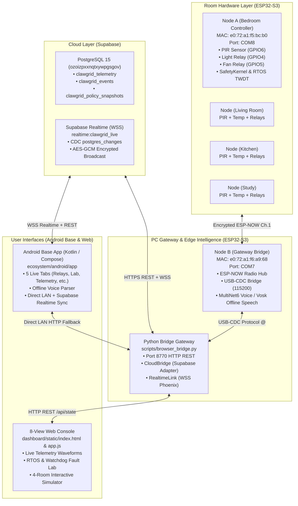
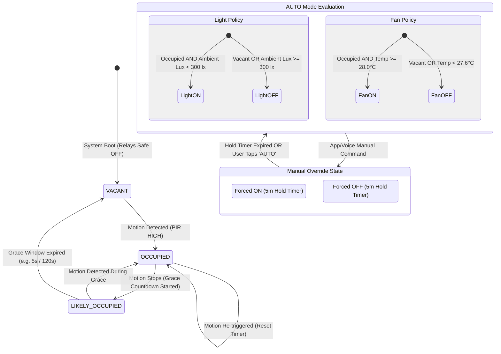

# Current result: manual control passed; two real phone recognition trials failed — 23 October 2026 IST

**Distribution follow-up:** the requested source snapshot is prepared against the existing `Haresh-Selvakumar/ClawGrid` main history, with a Git checkout in `C:\Users\hares\Downloads\ClawGrid-integration-2026-10-23`. See `DISTRIBUTION.md` for source ZIP/APK locations, exclusions and verification limits. `.gitignore` protects additional signing/archive/cache files; README points to current native Android status. Selected original phone/runtime/build/test/signature evidence is copied verbatim into `benchmarks/raw/phone_integration_20261023/`, with byte hashes. The bounded source credential scan found no matches; original private files and review/flash backups remain untouched. This publication does not rerun hardware tests, install the new APK, fix recognition or change output inhibition. The local distribution receipt records the actual published commit and archive verification after completion.

This section supersedes earlier staged/pending voice notes below. Existing evidence is retained as history. The user's native Android requirement supersedes the older browser-only AGENTS rule.

**HARDWARE_MEASURED:** the inhibited Android manual light ON/OFF milestone remains passed. After both phone speech trials, fresh authenticated A readback is **boot9, light OFF, fan OFF, last_command12, physical_outputs_enabled=false**. Latest bounded probe advances sample11,063,999→11,068,999ms, final age282ms. Gateway transaction12 is phase2/status0/outcome_known=true/attempts1, lightfalse, RTT16,724us/processing37us. No further OFF is needed to recover an ID. User later described screenshots OFF11/ON12; those historical screenshot IDs cannot be independently correlated to the retained captures and are not proof of a subsequent OFF. The current OFF conclusion comes from API/board evidence, not an inferred UI sequence. Do not ask the user to repeat commands or copy IDs merely to repair correlation gaps.

Current pair remains **A COM10 / e0:72:a1:f5:bc:b0 / native_voice_uart / SHA256 8f028bd90f65a55a72b09f4b886db7a3fa851f8a2108c6b79659136db8713cdf**, **B COM9 / e0:72:a1:f6:a9:68 / speech_intelligence_uart / SHA256 a225740aa6af9445f9959994141dfc5723944c7f59daa957d039638cafbaf2b2**. These identities were ROM-MAC verified during the guarded deployment recorded below; this follow-up did not reset either board or repeat loader entry. Runtime B remains AP192.168.4.1/channel1/watchdog=true/zero sampled deadline misses. A channel1/boot9/task progress/diagnostic_faults_enabled=false/output inhibition persist. All relays/loads are user-reported disconnected. **Physical switching has not been tested.**

## Real phone audio results, separate from command confirmation

The app's manual-verification gate **did unlock while outputs were inhibited**: real phone audio reached B and generated speech jobs1/2. This corroborates operational microphone capture/permission and upload; the exact Android grant dialog was not observed through ADB. No cloud recognition, host audio fixture, typed substitute or automatic retry was used.

| Actual ESP diagnostic | Phone trial1 | Phone trial2: instructed leading pause and full four-second cap |
|---|---|---|
| Job / samples / mono PCM16LE bytes | 1 / 33,280 / 66,560 | 2 / 64,000 / 128,000 |
| Input duration at app's 16kHz contract | 2.080s | 4.000s |
| Peak / nonzero / clipped samples | 15,349 / 32,313 / 0 | 15,392 / 62,932 / 0 |
| Board PCM CRC32 | 3561804158 | 1757513135 |
| Inference / frames / maximum frame time | 1,438,407us / 97 / 22,644us | 2,382,320us / 157 / 22,715us |
| Chunk / padded samples / detecting frames | 512 / 16,384 / 97 | 512 / 16,384 / 157 |
| Phase / terminal state / initialization and engine errors | 4 / DETECTING(0) / 0 | 4 / DETECTING(0) / 0 |
| Accepted command / confidence / candidate / decoder text | 0 / 0 / none / empty | 0 / 0 / none / empty |
| Recognition outcome | FAIL_NO_DETECTION | FAIL_NO_DETECTION |
| Proposal, confirmation, resulting control transaction | NOT_EXERCISED; none proposed | NOT_EXERCISED; none proposed |

Both user reports say voice stopped with no confident ESP recognition, nothing proposed and no automatic retry/confirmation. Capture/upload and ESP processing were observed; recognition did **not** pass. The second, full-length clip rules out merely releasing the first clip early as a sufficient explanation; it does not identify the model/pipeline failure. Nonzero amplitude and no clipping do not prove intelligible audio, exact spoken wording or a correct acoustic pipeline. Original phone PCM was not retained, so these board CRCs cannot be compared independently with original phone bytes. These two diagnostic attempts at one prompted phrase are not a held-out accuracy evaluation. Existing 0/16 synthetic recognition evidence remains intact and distinct.

During trial2 passive capture, 30 A health reports retain boot9, control/link jobs2,160,585→2,172,179, output inhibition and diagnostic faults disabled. Both capture/probe report error=null. Fresh readback after inference remains OFF12; no voice command reached actuation. Threshold0.7, job binding, expiry, boot/freshness checks, explicit confirmation, SafetyKernel, security, policy and models were not weakened or changed. No flash was performed during these phone trials or the UI correction. Supabase CONNECTING is unrelated to local testing.

## Request IDs made explicit in the Android source

Added `ecosystem/android/app/src/main/java/com/example/ui/components/HardwareRequestStatus.kt` and rendered it in `MainActivity.kt` immediately below the hardware mode banner on every hardware tab. It prominently shows **REQUEST ID #N**, request phase and requested direction, with proposal ID separately before command assignment. Independent fresh board last_command, light/boot and output inhibition appear on separate lines; stale/disconnected board state remains UNKNOWN. Updated `ui/screens/RoomsAndRelaysScreen.kt` to include the actual request ID in Bedroom request text. No controls, navigation, authorization, replay behavior or persistent policy semantics changed.

**HOST_MEASURED only for this UI change:** debug APK built successfully; the newly built APK is not installed or layout-tested on the phone. All actual phone control/audio results above used the previously installed APK SHA256 `d12778de7b8ecab0d141f71bf26dea4919c458a068aa7ee79453e045c98b0bfd`, preserved at `benchmarks/backups/android-before-request-id-20261023.apk`. Before-change source snapshots are retained under `benchmarks/review/physical-phone-20261023/request-id-before/`.

Updated APK: `C:\Users\hares\OneDrive\Desktop\ESD-imp\ClawGrid-physical-integration-prep\ecosystem\android\app\build\outputs\apk\debug\app-debug.apk`, **18,570,202 bytes**, SHA256 **a44b9cc4dc3571c71b334b95049d4ab2221af10f1da8b04f6f1b13d1a4366119**. Existing debug signer SHA256 remains `71ce1bf6f415db7a355e7c63d941c53e7b52fba6a4c33c25042582af0a464bf9`; local debug keystore hash remains unchanged. Release signing was untouched. USB/Android Studio and APK sideload instructions remain in the phone guide. An app update/process restart clears its in-memory token/manual gate; do not install solely to obtain old IDs or repeatedly send commands for that purpose.

## Exact checks run and actual results in this follow-up

Firmware Python is `C:\Users\hares\Documents\Codex\2026-10-21\i-h\work\clawgrid-env\Scripts\python.exe`. Commands below run from this project unless noted. Logs are under `benchmarks/review/physical-phone-20261023/`.

| Check actually run | Result and evidence |
|---|---|
| Firmware Python `passive_phone_capture.py --name phone-voice-recognition-1 --event speech_job --min-id 1 --seconds 240`; then bounded read-only `phone_probe.py` capture named `voice1-diagnostics` | HARDWARE_MEASURED job1 diagnostics above; capture completed without error; A advancing/inhibited. Detailed JSON/UART logs retained; exact first probe duration is not reconstructed here. |
| Firmware Python `passive_phone_capture.py --name phone-voice-recognition-2 --event speech_job --min-id 2 --seconds 240`; then `phone_probe.py --gateway COM9 --seconds 4 --name voice2-diagnostics` | Both exit0, error=null; HARDWARE_MEASURED job2 and final OFF12 evidence above. Passive capture closed before probe opened COM ports. No command/audio POST issued by these observers. |
| In `ecosystem/android`: JDK21 Android Studio jbr, existing local Gradle/Android user caches; `.\gradlew.bat --offline :app:assembleDebug --console=plain` | HOST_MEASURED **BUILD SUCCESSFUL in1m35s**, 39 actionable tasks:7 executed/32 up-to-date; `android-request-id-build.log`. Existing deprecation warnings were nonfatal. |
| Firmware Python `scripts/check_android_control_jvm.py` | HOST_MEASURED **42 tests passed**, JUnit0.963s; actual control/voice adapter tests, `request-id-control-tests.log`. |
| Firmware Python `scripts/check_android_wire_jvm.py` | HOST_MEASURED **3 tests passed**, JUnit0.226s; `request-id-wire-tests.log`. |
| SDK36.1.0 `apksigner.bat verify --verbose --print-certs <absolute APK above>` | Exit0, v2 verified/one existing debug signer; `request-id-apk-signature.log`. |
| Firmware Python `scripts/check_android_client_boundary.py` | Exit0; zero exact configured private-value matches and zero privileged BuildConfig fields; `request-id-client-boundary.json`. This bounded scan is not a general secret audit. |
| SHA256 checks of `local_credentials.json`, `firmware/common/config/private_config.h`, `partitions_n16r8.csv` and debug keystore | Match pre-change records; values were not printed. No provisioning/credentials/NVS/model/partition/database changes. |

Full Gradle/Robolectric suite was **not** rerun: its prior uncached `nativeruntime-dist-compat:1.0.18` dependency blocker remains; these 45 focused JVM checks and the APK build do not claim that full suite passed. No ADB phone was attached at the retained enumeration, so new APK installation/layout/instrumentation remain unverified.

New evidence: `benchmarks/raw/android_phone_voice_trial1_20261023.json`, `android_phone_voice_trial2_20261023.json`, `android_request_id_build_20261023.json`; detailed review logs referenced above. Updated files this follow-up: the three Android source files, this master, `NEXT_CHAT_HANDOFF.md`, `docs/VOICE_ASSISTANT.md`, and `ecosystem/android/PHONE_INSTALL_AND_LOCAL_VOICE.md`. Existing verified evidence was preserved.

## Remaining blockers and next executable step

Recognition is blocked by reproducible **no detection**, not a demonstrated transport or engine-initialization failure. Voice proposal/confirmation/ACK path remains untested on real recognized speech because neither trial produced an accepted result. Do not request more identical utterances without a new diagnostic reason; do not lower thresholds, inject a successful transcript, automatically retry, enable outputs or flash blindly.

Next executable engineering step: compare the current `speech/main/speech_runtime.cpp` PCM/model/decoder setup against the **pinned ESP-SR1.7.0 reference pipeline**, using the existing independently labelled diagnostic clips in a bounded recognition-only harness. Inspect command registration and model/frontend requirements, preserve threshold0.7, and isolate an actual difference before proposing a normal inhibited firmware update. A paired original-phone-PCM comparison would require a separately agreed diagnostic capture; current clips were deliberately cleared. AFE remains an unproven hypothesis. Keep recognition results separate from control confirmation.

The new request-ID APK is ready for a user-controlled update following the phone guide; its on-phone layout remains to be checked. No additional manual command is needed now: authoritative state is OFF/inhibited. Physical relay switching is untested/out of scope. Existing five-minute manual hold versus manual-until-AUTO requirement, temperature transport and full Gradle test dependency remain separate blockers; their semantics were not silently changed.

---

# Historical: App manual ON/OFF milestone PASS; voice recognition-only stage — 23 October 2026 IST

**Native Android → B → authenticated ESP-NOW → A → matching ACK + fresh readback passed for both manual directions, with outputs inhibited.** User confirms OFF#5 and ON#6 REPORTED; independent gateway pairs match phase2/status0/outcome_known/attempts1, same A boot9 and output inhibition. OFF#5: sample9,900,999ms/age91ms/RTT19,665us/lightfalse. ON#6: sample9,908,999ms/age341ms/RTT18,311us/lighttrue. Earlier app-owned OFF#4 also passed. These are radio/software logical results, not physical switching.

Additional observed commands #7 OFF and #8 ON have matching ACK/readback; #9 ACK/actuation reported ON. Do not silently describe the earlier OFF as the final state. User's subsequent OFF reply had a placeholder ID, so actual state was queried independently: **latest command#12 is OFF**, successful ACK/status0/outcome_known/attempts1/RTT16,724us/processing37us, matched fresh **boot9 sample10,300,999ms, age94ms, last_command12/lightfalse/physical_outputs_enabled=false**. IDs10/11 were not captured in the bounded gap; no invented reconstruction. Agent sent no command POST in these phone stages. Explicit final OFF is now established in board evidence. User reports loads disconnected throughout.

Current firmware remains normal inhibited A COM10/base MAC e0:72:a1:f5:bc:b0/image8f028bd..., B COM9/base MAC e0:72:a1:f6:a9:68/image**a225740aa6af9445f9959994141dfc5723944c7f59daa957d039638cafbaf2b2**. A boot9 unchanged. B AP192.168.4.1/channel1, task/watchdog health and speech ready/zero errors preserved. No NVS/model/credential/security/threshold/policy changes in these tests. The Supabase CONNECTING label does not participate in local control and is not a blocker.

## Current staged voice test

The app-owned inhibited REPORTED result satisfies the manual-verification condition without enabling physical GPIOs. Actual visible voice readiness and microphone permission are now requested: stop/report if “First verify one manual light command” remains. Otherwise grant microphone While using app, close the Chrome gateway tab, remain on ClawGrid AP/app foreground, hold push-to-talk and say **TURN OFF BEDROOM LIGHT** once within4s, release. This **first clip is recognition-only: CANCEL any speech proposal, do not Confirm**. User should report permission and exact voice message/job/error. Keep recognition result separate from any later confirmation/command result; no cloud speech, fixture audio or threshold reduction.

A passive capture is active: firmware Python `benchmarks/review/physical-phone-20261023/passive_phone_capture.py --name phone-voice-recognition-1 --event speech_job --min-id 1 --seconds 240`, exec session58485 at dispatch. It occupies COM10/COM9 until the first speech_job completes or timeout; **poll/wait it before opening another serial client**. It does not issue HTTP/control/audio requests; A q health queries and passive A/B task/link/speech logs permit observation without competing with phone audio for B's two HTTP sockets. It saves `phone-voice-recognition-1.json`, `-uart.log` and stdout log. Then read `/api/speech`, `/api/state`, `/api/rtos` once over the normal bridge to capture actual job, samples/CRC/peak/confidence/command/errors and continuing authenticated fresh inhibited telemetry. No recognition/capture pass is claimed yet. Permission is user-observed unless a real upload corroborates it.

If recognition succeeds for the intended target at unchanged0.7 threshold with valid job/CRC, a **fresh separate** spoken clip can test user-reviewed confirmation and matching ACK/readback; first cancelled proposal must not be replayed. If recognition or transport fails, record the actual engine/PCM/error evidence and keep outputs inhibited. No new firmware/APK change is needed merely to unlock voice. Keep app settings/process unchanged; applying connection settings or restarting process resets manualVerifiedBoot and requires a new app manual proof.

Evidence: aggregate `benchmarks/raw/android_phone_manual_20261023.json`; `phone-manual-5-to-8-verified.json`, `phone-OFF-4-verified.json`, `phone-return-off.json` (ACK#9 ON), and `return-off-current.json/log` (final OFF#12) under physical-phone review. Phone guide/root-page fixes and original verified evidence remain below. Remaining: actual first microphone/recognition result, subsequent voice confirmation path, physical switching (out of scope/inhibited), persistent manual-until-AUTO mismatch and temperature transport.

---

# Phone manual OFF #4 verified — 23 October 2026 IST

**First app-owned inhibited command PASS.** User reviewed/confirmed Bedroom/light/OFF in native Android and reports “Matching ACK + fresh board report #4. Physical load not measured”, Requested Light OFF · REPORTED, outputs inhibited and board-reported OFF. Gateway capture independently matches transaction **id4/phase2/status0/outcome_known=true/attempts1**, RTT16,875 us/processing28 us; same-boot9 advancing report sample **9,552,999 ms**, age90 ms, **last_command4/light=false/physical_outputs_enabled=false**. This is logical inhibited actuation only; relays/loads remain user-reported disconnected and physical switching untested.

The app-owned manual gate can be satisfied by inhibited ACK/readback without enabling outputs. Its actual visible Hold-to-talk readiness/permission remains to be checked after manual ON/OFF; no microphone/upload/recognition trial has occurred. Keep the app process/settings and current boot; applying connection settings again resets manualVerifiedBoot and requires another app-owned manual pass. Supabase CONNECTING remains optional and is not involved in direct control.

Next staged test: user verifies Outputs inhibited, taps Bedroom Ceiling Light **ON**, inspects Bedroom/light/ON proposal and Confirms once, waits for REPORTED/ACK+readback and replies with id/state. Stop on rejection/timeout; do not replay. Read-only `phone_probe.py --gateway COM9 --seconds 240 --name phone-manual-on-off` is capturing; no agent control POST is sent. After matched ON, wait at least3s and guide a new explicit OFF to leave logical output OFF. Then check app voice gate and grant permission/record real PCM for ESP recognition with threshold0.7 and explicit proposal confirmation intact. No further firmware or APK changes needed for this staged test.

Evidence: `benchmarks/review/physical-phone-20261023/phone-OFF-4-verified.json`, complete `phone-manual-off.json/log`, running ON/OFF observer and aggregate `benchmarks/raw/android_phone_manual_20261023.json`. App UNKNOWN was resolved by applying the existing token and retaining AP connection; current app/browser reachability is confirmed. Earlier records are historical below.

---

# Native app now fresh; inhibited manual OFF test staged — 23 October 2026 IST

The user applied the existing API token and kept the phone on ClawGrid-Assistant. Android now reports **Fresh board report; physical load not measured**, Fresh report health, Loads0/2/Relays Guarded, occupancy UNKNOWN and temperature/lux unavailable. This resolves the prior app UNKNOWN blocker at this stage; no Android source/APK change was needed. Prior token/AP-retention contributions were not isolated individually. Supabase CONNECTING is an optional display status and is not used by the direct gateway control path; it must not block local tests.

Fresh read-only preflight (`phone_probe.py --gateway COM9 --seconds 5 --name app-fresh-preflight`, exit0) verifies A **boot9**, sample **9,476,999 → 9,481,999 ms**, maximum age339 ms, all known/authenticated and **physical_outputs_enabled=false**, light/fan logically OFF, B AP clients1/channel1, watchdog active and ESP speech ready. Occupancy UNKNOWN is distinct from unavailable board telemetry; do not fabricate sensor state. No outputs were enabled.

Started read-only `phone_probe.py --gateway COM9 --seconds 180 --name phone-manual-off`. User is instructed to request **Bedroom Ceiling Light OFF**, inspect proposal Bedroom/light/OFF, Confirm once, and wait for matching ACK plus fresh report/REPORTED. Baseline controller last_command=3 and B transaction idle after its page-fix restart. No agent POST/control was sent in this step. Await phone request ID/status and corresponding gateway ACK/readback before claiming an app command pass or voice unlock. Keep all loads disconnected. Next after verified manual command: validate app manual gate and real mic capture/PCM upload/ESP recognition at unchanged threshold0.7. No physical switching claim and no cloud dependency.

Evidence: `benchmarks/raw/android_phone_manual_20261023.json`, detailed preflight/observer under `benchmarks/review/physical-phone-20261023/`. Earlier records remain historical below.

---

# Native app connection follow-up — 23 October 2026 IST

During the read-only `phone-manual-session` observer, B's AP client count changed **1 → 0**, while A remained fresh/inhibited and B speech stayed ready/job0. The laptop had already returned to home Wi-Fi. Thus the phone was no longer associated at the end of this capture; this is evidence to investigate no-Internet AP retention, **not proof of an Android parser/firmware defect or a demonstrated root cause at the exact earlier app failure time**. Asked user to reconnect, choose Stay connected/Use without Internet, disable automatic switching to better Wi-Fi/mobile data temporarily, and keep native app foreground20s. A fresh `phone-app-connection` read-only observer is running. Exact app status/HTTP scheme/API-token-field confirmation remains requested; values stay private. No further flash or speculative Android change was made, and no app control/audio result exists yet.

---

# Chrome HTTP and simulated landing page corrected — 23 October 2026 IST

**User now confirms the phone opens the new hardware-status page with fresh telemetry and outputs INHIBITED.** Gateway reachability is established. The remaining blocker has moved to the **native Android app reporting UNKNOWN/controls unavailable**; no app-owned manual command or phone audio test has succeeded yet.

## Identified causes and changes

The user reported phone IPv4 **192.168.4.2** before B's later restart (gateway/prefix not shown), Chrome upgrading the explicit HTTP URL to HTTPS, and the gateway root opening with simulated values. Actual B HTTP80/Wi-Fi/DHCP had already passed laptop tests. Chrome's HTTPS upgrade is separate from a server redirect: the gateway returns HTTP200 and has no configured TLS listener. Guided Continue to site, or the relevant Chrome Privacy and security → Always use secure connections setting. Where offered, warnings for public sites permit private HTTP sites. Official Android Chrome reference: https://support.google.com/chrome/answer/10468685?co=GENIE.Platform%3DAndroid&hl=en. No DNS/certificate/credential regeneration is required. The native app URL stays **http://192.168.4.1**.

Source inspection found the other cause: the deployed root served legacy `dashboard.h`, whose AppState starts `virtual_rooms` and seeds temperatures, task counters, uptime and synthetic policy events. Merely labelling that UI live would be misleading. Changed only the gateway root to new **read-only `hardware_status.h`**, fetching real `/api/state` and `/api/rtos`. It shows temperature unavailable, controller-reported logical light/fan, actual boot/age/output inhibition and measured gateway diagnostics. No generated temperatures/counters/policies, command controls, speech upload or token field exist on this page. Stale/unknown/invalid/frozen/regressing reports show UNKNOWN. Duplicate samples cannot reset age, including after a failed poll/reconnect; old boots and changed duplicate contents are rejected. Gateway diagnostics also expire. Physical load state remains not measured. The existing `/simulation` lab remains explicitly separate; legacy dashboard sources and original Android screens/navigation are preserved.

Root now returns Cache-Control:no-store. A scoped, **normal inhibited B app-only** deployment corrected this confirmed page bug; it was not a blind connectivity reflash. A firmware was not changed. Current B image SHA256 **a225740aa6af9445f9959994141dfc5723944c7f59daa957d039638cafbaf2b2**, environment `speech_intelligence_uart`, ROM-MAC verified on COM9 as **e0:72:a1:f6:a9:68**. Current A stays COM10, MAC e0:72:a1:f5:bc:b0, image 8f028bd90f65a55a72b09f4b886db7a3fa851f8a2108c6b79659136db8713cdf. B's only write range was app0 at 0x10000; models/NVS/partitions/credentials remained outside writes. Existing private file hashes and compiled SSID/password/token were rechecked unchanged. Speech/SafetyKernel/radio security/watchdog/thresholds were not modified.

## Exact checks and results

| Check actually run | Actual result / classification |
|---|---|
| `node scripts/check_gateway_status.cjs` | Exit0, **HOST_MEASURED** tests against shipped JavaScript: initial UNKNOWN, fresh/inhibited, age expiry, frozen duplicate, advancing/regressing report, changed duplicate, reconnect aging, reboot/old boot, simulation rejection and invalid types. Initial mock did not render HTML defaults and failed its first assertion; calling actual render in the harness fixed that test setup. Final log `root-status-tests.log`. |
| `node scripts/check_frontend.cjs` | Exit0, **HOST_MEASURED** syntax across legacy/simulation/new hardware pages plus existing PCM/confirmation checks; `root-frontend-tests.log`. |
| Firmware Python `-m platformio run -d speech -e speech_intelligence_uart` | **SUCCESS 53.270 s**; `build-B-hardware-root.log`. |
| Firmware Python `scripts/flash_native.py --role B-speech --port COM9 --uart-console --app-only` | PASS, normal inhibited/fault-default/console/pair/MAC guards, written app hash verified. Manifest `benchmarks/raw/hardware/flash_speech_intelligence_uart_20261023T165614Z.json`. |
| `phone_probe.py --gateway COM9 --seconds 15 --name root-fixed-runtime` | Exit0, **HARDWARE_MEASURED** A/B self-tests pass, A boot9 still advancing and inhibited, B channel1/AP192.168.4.1/watchdog active/no sampled deadline misses; speech supported/ready/zero errors. B's restart here is expected from this deliberate application update, not evidence of a watchdog failure. |
| `laptop_ap_probe.py --name laptop-ap-hardware-root` | Exit0, **HARDWARE_MEASURED** real AP TCP80 and GET `/`, `/api/state`, `/api/rtos` → HTTP200. Root **5,864 bytes**, SHA256 **e8f73c74c9631fca7a3746e1390732affcc05d4624a9dce57ceb442b929e9fd6**, byte-identical to new hardware source and no-store. State age45 ms, outputs inhibited, channel1. Laptop DHCP now 192.168.4.2/24 after B restart; client addresses can change, so do not infer current phone IP or coexistence from that address. Original laptop Wi-Fi restored, temporary profile/private XML removed. |
| Phone browser after update | **USER_REPORTED:** “New hardware status; fresh and inhibited.” This confirms the phone-side page result, not Android app operation or microphone capture. |
| `adb devices -l` during subsequent app diagnosis | No Android device attached; no on-phone logs/instrumentation available through ADB. No phone settings/data were altered by ADB. |

Firmware Python/core paths remain as documented below. Detailed evidence/helper/logs: `benchmarks/review/physical-phone-20261023/`; aggregate `benchmarks/raw/android_gateway_root_fix_20261023.json`. Original laptop/network and old root response evidence are preserved in their earlier files. Files changed this correction: new `firmware/node_intelligence/src/hardware_status.h`, root include/response in `firmware/node_intelligence/src/main.cpp`, new `scripts/check_gateway_status.cjs`, updated `scripts/check_frontend.cjs`, phone installation guide, this master and handoff. The bounded laptop helper gained distinct evidence names/byte comparison so old verified evidence was not overwritten. No Android source/APK was changed by the root-page correction.

## Current blocker and next executable step

After the successful phone browser check, guided native app Hardware settings → explicit HTTP gateway + existing api_token privately → fresh inhibited Bedroom → manual Ceiling Light OFF → proposal/Confirm. User instead reports **app UNKNOWN/controls unavailable**, so no control or voice result is claimed. Existing app source permits local HTTP and binds calls to Wi-Fi without Internet; inspected polling/binding/settings paths. Requested the exact Bedroom status message, URL scheme and confirmation they used `api_token` rather than `ap_password` (values must stay private). Do not assume a firmware failure or weaken freshness/authentication to make the app appear connected.

Read-only observer: `phone_probe.py --gateway COM9 --seconds 120 --name phone-manual-session`. Continue diagnosing the applied app settings/transport from the user reply, using ADB only if a phone is deliberately connected/authorized. Once the app itself is fresh/inhibited, perform its own manual OFF proposal/confirmation and matching ACK plus advancing same-boot last_command readback. Only then test permission/real phone PCM upload/ESP recognition with the unchanged 0.7 threshold. No old ON replay, no physical outputs to unlock voice. Manual-until-AUTO semantics and temperature transport remain earlier separate blockers; physical switching remains untested.

---

# Gateway reachability diagnosis — 23 October 2026 IST

**Direct laptop Wi-Fi testing confirms B's AP, DHCP and HTTP server work. The phone-browser timeout is not yet resolved; no blind reflash or credential change was performed.** The user now reports the phone connected to ClawGrid-Assistant but browser http://192.168.4.1 times out. App/manual/voice tests remain paused pending reachability diagnosis.

## Fresh HARDWARE_MEASURED evidence

| Check | Observed result |
|---|---|
| Current serial connections | Same CH343 COM10/COM9 adapter identities as verified deployment; read-only self-tests return A/B respectively, both PASS. No reset or loader entry issued. |
| B AP before laptop test | `/api/rtos`: IP 192.168.4.1, channel 1, one associated client. One client is consistent with the user's phone, but association count alone does not prove that phone's DHCP address. |
| Laptop association | Temporarily joined ClawGrid-Assistant using preserved credentials; BSSID `e0:72:a1:f6:a9:69`, 2.4 GHz/channel 1, WPA2/AES. This is B's AP interface, distinct from provisioned base/station MAC ending :68. |
| Actual DHCP/network | Windows DHCP enabled; received **192.168.4.3/24**, subnet **255.255.255.0**, gateway and DHCP server **192.168.4.1**. No static IP was set. This measures the AP's DHCP-supplied network; phone IPv4/lease details are still requested. |
| TCP listener over AP | TCP **port 80** opens from local socket 192.168.4.3. No proxy was used. |
| Registered root route | Direct Wi-Fi **GET /** → HTTP **200**, **155,404 bytes**, body SHA256 `60e55bcf320957ec791d969f3e5b0af3250246700b3e7b70c63153bb1a3e1741`. The compiled source registers GET / and HTTPD_DEFAULT_CONFIG server_port=80; live response proves the server/route are running. Startup logs cannot be reconstructed retroactively. |
| Actual APIs over AP | GET `/api/state` and `/api/rtos` → HTTP **200**. Fresh known/authenticated A boot9 sample 7,938,999 ms, age379 ms, zero invalid/replayed frames, light/fan OFF and physical_outputs_enabled=false. B measured **two** AP clients while laptop and the other client were associated; channel remained 1, watchdog active, zero sampled deadline misses. |
| Link/IP reachability | Ping 2/2 replies, 0% loss, 1–2 ms; ARP 192.168.4.1 maps to B AP MAC ending :69. These are ICMP timings, not command/physical switching latencies. |
| B liveness/speech | Captured B uptime **7,523,568 → 7,528,802 ms**, LinkTask jobs advancing, watchdog=true, no sampled deadline misses, memory_config_ok=true. Both runtime self-tests pass. `/api/speech`: supported=true/phase1/error_code0/engine_errors0/job0. No reboot/panic was observed in the bounded capture; uncaptured historical resets cannot be ruled out solely from this interval. No recognition trial occurred. |
| Laptop cleanup | Original Wi-Fi profile restored and verified connected. The uniquely named temporary WPA2 profile and its private XML were removed; existing profiles/provisioning were retained. |

Exact checks: `$py benchmarks/review/physical-phone-20261023/phone_probe.py --gateway COM9 --seconds 8 --name phone-reachability-runtime` (exit0); `netsh wlan show interfaces`, `netsh wlan show networks mode=bssid`, current serial enumeration; `$py benchmarks/review/physical-phone-20261023/laptop_ap_probe.py` (exit0, bounded temporary WLAN association and read-only TCP/HTTP/ICMP/ARP checks, restores original network in finally). `$py` remains the firmware Python documented below. Fresh configured private-file hashes still match the pre-deployment hashes. No firmware, NVS, partitions, models, credentials, physical-output mode, speech thresholds or database were changed. No control POST or audio upload occurred.

Evidence: `benchmarks/raw/android_gateway_reachability_20261023.json`; detailed `phone-reachability-runtime.json/log`, `laptop-ap-http.json/log`, and the bounded laptop helper under `benchmarks/review/physical-phone-20261023/`. This is **HARDWARE_MEASURED** Wi-Fi/API testing, not another host-only simulation or a phone-browser pass.

## Current remaining cause and next step

The gateway is reachable from a real AP client. The precise phone-side cause is **not established**, so no root-cause fix is claimed yet. Requested the phone Wi-Fi IPv4 address, gateway/subnet and VPN status (never passwords/tokens) to distinguish missing/wrong DHCP configuration, routing/VPN and browser protocol behavior. Continue with that evidence, then a direct phone **http://192.168.4.1/api/state** read-only test before resuming any app/manual/voice testing. Preserve output inhibition; no new flash is warranted by the current evidence.

---

# Current physical integration — 23 October 2026 IST

**The normal OUTPUT-INHIBITED pair is deployed and runtime-verified on the current UART connectors.** The actual firmware API passed manual Bedroom light OFF → ON → OFF through proposal/confirmation, matching ACK and advancing readback. These are logical inhibited results: **physical relay/load switching has not been tested**. Phone APK installation is user-reported; phone interaction is recorded separately below. Previous records remain verbatim after this update.

## Identity, deployment and preservation — HARDWARE_MEASURED

| Role | ROM MAC matched to existing provisioning | Current connector/port | Current application SHA256 |
|---|---|---|---|
| A room controller | `e0:72:a1:f5:bc:b0` | CH343/UART0 COM10 | `8f028bd90f65a55a72b09f4b886db7a3fa851f8a2108c6b79659136db8713cdf` (`native_voice_uart`) |
| B gateway/speech | `e0:72:a1:f6:a9:68` | CH343/UART0 COM9 | `6f0adc8d52262cce11dde6ca9e8f5265995ef93953daeff397705dfea9a83686` (`speech_intelligence_uart`) |

Both boards were initially MAC-verified and fully backed up before writes. Each dump is 16,777,216 bytes: A SHA256 `b8fc29e051eaeed1418b1aeba83245c3bd23e6f125ccdfd70f22d68ba1117cb2`; B `5be4246fe4cc349f827c2fa46f813d99d62549a516762ac3cba4a7b27ecd2d6e`. Private ignored dumps are under `benchmarks/backups/physical-phone-20261023/`; never publish them because compiled credentials/NVS may be present. Partition metadata is retained separately. No identity mismatch occurred.

Initially B on native USB COM7 supported the manual API but `/api/speech` returned supported=false/phase=0. Its **entire 6 MiB model partition was FF**, not an existing model. Added an explicit normal-B/app-only `--install-missing-speech-model` guard: freshly read and compare the installed partition table, freshly read the whole model region, require it entirely blank, then pack pinned existing ESP-SR 1.7.0 assets. Existing model data or a table mismatch stops before writing. The generated packer target is resolved and bounded before the upstream tool removes its generated directory.

Installed MultiNet6 English model: 3,788,231 source bytes at `0x610000`, SHA256 `b46a65befe47187f793ffb8108f74ab091338060060a54d23b69c385c3213d80`; esptool verified the written hash. No nonblank speech model was overwritten.

B disappeared while the user checked cables. COM7 flash attempts stopped before writing with FileNotFoundError(2). B then appeared on CH343 COM9; the guard verified its MAC again and deployed normal speech firmware/models. The user's final connection arrangement exposed UART0 on both boards. Both MACs were reread rather than assigning roles by COM number. A already supported UART0; B's then-installed USB-console build did not. Added a normal inhibited `speech_intelligence_uart` variant using the existing HAL/UART defaults and reproducible CMake SDK selection, then deployed **app0 only**. Current diagnostics work without further cable changes. The preceding USB-console B application hash `13579ec09414ff39b76cadad4e1c1381009bcc95d643d3da10fc0a93f79732ec` is historical, not current.

Every write checked ROM MAC, compiled pair identity, exact inhibited/fault-default marker, console/SDK match and N16R8 configuration. A writes: app0 `0x10000` only. First B deployment: app0 plus the freshly verified blank model region; final UART deployment: app0 only. Bootloader, partition table, OTA-data, storage and NVS were outside write ranges. No erase-flash, key regeneration, diagnostic-fault/output-enabled image or deployed database change occurred. Hashes of private provisioning/configuration and partition CSV are unchanged. Normal boot counters may advance in NVS; byte-immutable NVS is not claimed.

## Runtime and manual results — HARDWARE_MEASURED

- Both runtime self-tests pass with RTOS ready. Current A boot is **9** after identity-check resets. A ControlTask/LinkTask counters advance; measured task diagnostics show watchdog=true, 5 ms periods, expected cores/priorities and zero sampled deadline misses. Diagnostic faults=false and physical_outputs_enabled=false. A memory check confirms 16 MiB flash/8 MiB PSRAM.
- B measures actual AP IP **192.168.4.1** and Wi-Fi **channel 1**, matching A's measured channel 1. LinkTask jobs advance (e.g. 1,610 → 2,010), watchdog=true and zero sampled deadline misses. B memory_config_ok=true, 8 MiB PSRAM. Phone association is a separate observation from compatible source/radio channel settings.
- B receives advancing, known/authenticated A reports with no observed invalid/replayed/nonprogress frames. Occupancy stays UNKNOWN; warmup-ready does not verify PIR wiring or sensor accuracy. No temperatures were generated.
- `/api/speech` now reports supported=true, phase=1 (ready), error_code=0, engine_errors=0. This proves model initialization, not acoustic recognition accuracy. Engine/app thresholds remain **0.7**. No cloud or PC recognizer is used by the phone path.
- Through B's **USB HTTP tunnel and the same firmware API handlers**, manual OFF #1, ON #2, OFF #3 each produced authorized=false proposal → explicit confirmation HTTP 202 → matching phase=2/status=0/outcome_known=true ACK → advancing same-boot report with matching last_command/light. ACK RTTs were 13,319 / 18,302 / 13,293 microseconds; these measure radio/software ACK, not relay switching. Readback ages were 301 / 51 / 51 ms. Every readback had physical_outputs_enabled=false. Final logical state OFF. No command POST retry or old ON replay was used.

The inhibited path meets the Android voice gate's **semantic** condition: firmware returns Applied plus logical readback while GPIO writes are inhibited. Android must additionally observe **its own** current-boot manual request reach REPORTED to set manualVerifiedBoot. Host commands do not unlock the phone app. No output enabling is needed or allowed for this gate; actual on-phone unlock is tracked below.

Saved persistent policy remains HOME, light AUTO on/fan AUTO off, grace 120,000 ms. Manual testing created temporary light holds. Existing **five-minute manual hold** still differs from the user's manual-until-selected-AUTO requirement; that previously documented mismatch was not changed in this commissioning step.

## Files and exact checks

Changed `firmware/node_voice/src/main.cpp` (read-only channel query), `firmware/node_intelligence/src/main.cpp` (measured AP IP/channel/client count in /api/rtos), `speech/platformio.ini`, `speech/CMakeLists.txt` (normal UART speech build), `scripts/flash_native.py` (blank-model guard and normal B UART selection), `tests/unit/test_blank_model_guard.py`, `tests/unit/test_watchdog_campaign.py`, this master and handoff. Added private bounded observation helper `benchmarks/review/physical-phone-20261023/phone_probe.py`. SafetyKernel, ControlTask, radio security/replay, provisioning/recovery and speech thresholds were not modified. Prechange firmware/doc copies and source hashes are retained under that review directory.

Commands ran from `C:/Users/hares/OneDrive/Desktop/ESD-imp/ClawGrid-physical-integration-prep`. `$py` = `C:/Users/hares/Documents/Codex/2026-10-21/i-h/work/clawgrid-env/Scripts/python.exe`; `PLATFORMIO_CORE_DIR` = `C:/Users/hares/Documents/Codex/2026-10-21/i-h/work/pio-core`.

| Actual check/command | Actual result |
|---|---|
| `$py -m serial.tools.list_ports -v`, Windows PnP; `$py -m esptool --chip esp32s3 --port <port> --baud 460800 --after hard-reset read-mac` | A/B match initially and after connector changes. Current COM10=A/COM9=B. COM3/4 Bluetooth ignored. |
| `$py -m esptool --chip esp32s3 --port COM10/COM7 --baud 460800 --after hard-reset read-flash 0 0x1000000 <private-file>` (separate commands) | Both exit 0, full dumps. A 431.0 s; B 196.2 s. |
| `$py -m platformio run -d native -e native_voice_uart` | Final build SUCCESS 18.378 s; earlier clean A build also passed. |
| `$py -m platformio run -d speech -e speech_intelligence` | SUCCESS 71.670 s. |
| `$py -m platformio run -d speech -e speech_intelligence_uart` | Final fresh SDK build SUCCESS 138.713 s. First attempt interrupted to fix reproducible CMake defaults. Final SDK UART0/MultiNet6/16 MiB/Octal PSRAM/5 s panic watchdog verified. |
| `$py -m pytest tests/unit/test_watchdog_campaign.py tests/unit/test_firmware_cpp.py -q` with recorded basetemp/JUnit options | **76 passed in 18.83 s**, `host-checks.log/xml`. Host portable firmware/watchdog checks. |
| `$py -m pytest tests/unit/test_blank_model_guard.py tests/unit/test_watchdog_campaign.py -q` with recorded basetemp/JUnit options | Final **41 passed in 4.37 s**, `uart-guard.log/xml`. Earlier fixed pre-UART run 39 passed. Initial auto-generated byte-value fixture IDs exceeded Windows' 32,767-character environment limit (38 passed/2 setup/teardown errors); short IDs fixed it, original logs retained. Counts overlap; do not sum as distinct cases. |
| `$py -m py_compile scripts/flash_native.py benchmarks/review/physical-phone-20261023/phone_probe.py` | Exit 0. |
| `$py scripts/flash_native.py --role A --port COM10 --uart-console --app-only` | PASS, app0 hash verified. `flash_native_voice_uart_20261023T141405Z.json`. |
| `$py scripts/flash_native.py --role B-speech --port COM9 --app-only --install-missing-speech-model` | PASS, fresh blank model/table checks, app0/model hashes verified. `flash_speech_intelligence_20261023T141923Z.json`. Earlier COM7 attempts failed before writes. |
| `$py scripts/flash_native.py --role B-speech --port COM9 --uart-console --app-only` | PASS, final app0 hash verified; models untouched. `flash_speech_intelligence_uart_20261023T143419Z.json`. |
| `$py benchmarks/review/physical-phone-20261023/phone_probe.py --gateway COM9 --seconds 5 --name deployed-runtime` | Exit 0, actual self-tests/policy/tasks and B state/RTOS/memory/speech captured. |
| Same probe `--gateway COM9 --manual-sequence --seconds 4 --name manual-inhibited` | Exit 0; three proposal/confirm/ACK/fresh-readback cases pass. Only transient manual light operations, no policy/fault/credential operations. |
| Private provisioning/config/partition CSV SHA256 comparisons | Unchanged; secret values never printed. |

Build/tests are **HOST_MEASURED**; ROM, flash, task/API/radio ACK/readback observations are **HARDWARE_MEASURED**. The earlier Android APK build/tests remain preserved; no new Android build/install occurred here. Evidence: `benchmarks/raw/android_physical_20261023.json`, `benchmarks/raw/hardware/flash_*20261023*.json/log`, and detailed review logs under `benchmarks/review/physical-phone-20261023/`.

## Phone observations, blockers and next executable step

The user reports the current APK installed. Guided phone association to **ClawGrid-Assistant**, retaining existing Wi-Fi credentials, choosing Stay connected/Use without Internet, and applying **http://192.168.4.1** plus the existing `api_token` privately in Hardware → Safety, RTOS & Cloud. No credential was requested in chat. The user could not locate the Wi-Fi password. Located the existing root `local_credentials.json`: `ap_password` (line 3) is the ClawGrid-Assistant Wi-Fi password; `api_token` (line 4) is the Android gateway token. Opening that file at line 3 was queued in the local editor as explicitly requested; values were not printed or changed. Fresh checks match SSID/password/token against the private header and the application matching the successful final B flash manifest; the running B accepts the existing API token, self-tests pass, AP IP/channel match, and outputs remain inhibited. Evidence: `benchmarks/review/physical-phone-20261023/credentials-verification.json`. Phone association is still awaiting the user.

Read-only observer command: `$py benchmarks/review/physical-phone-20261023/phone_probe.py --gateway COM9 --seconds 90 --name phone-session-1` exited 0. Across deployed-runtime/manual/observer captures there were **47 known/inhibited state observations**, A sample uptime 262,999 → 447,999 ms, maximum observed report age 801 ms, zero observed invalid/replayed frames. B AP client count stayed **0**, speech job stayed **0**. Therefore phone association, app HTTP operation, app voice unlock, microphone permission/capture/upload, acoustic recognition and AP/ESP-NOW coexistence with a connected phone are **not yet verified**. No recognition success or failure trial occurred; model-ready is not a recognition result.

Next executable step, without reflashing: run `$py benchmarks/review/physical-phone-20261023/phone_probe.py --gateway COM9 --seconds 90 --name phone-session-2`, then have the user join the AP and confirm fresh inhibited Bedroom state. Have the **phone app** request manual light OFF, review/Confirm the exact target, wait for its matching ACK + fresh readback, and verify Hold to talk unlocks. Keep outputs inhibited. Then grant microphone permission, hold to say TURN ON BEDROOM LIGHT or TURN OFF BEDROOM LIGHT, release to submit, and capture the actual speech job/samples/CRC/peak/engine errors/confidence/recognized ID and app outcome. Explicitly confirm any valid speech proposal, then verify its own ACK/readback. Preserve all recognition failures and the 0.7 threshold. Do not send synthetic audio as phone evidence or rerun host ON requests to unlock the app.

Remaining blockers: required phone interaction/observations above, electrical relay/load testing (out of scope while disconnected/inhibited), unresolved five-minute/manual-until-AUTO mismatch and temperature transport. Cloud remains optional and disabled in the current launcher pending its separate authorized integration; no deployed database was touched. If a USB connector changes, enumerate and MAC-verify again before assuming roles. Current successful UART pair needs no further cable change or flash.


---

# Current update — physical Android phone and local ESP voice (23 October 2026 IST)

The user selected **phone microphone push-to-talk → direct ClawGrid Wi-Fi AP → ESP32-S3 B recognition**, with **http://192.168.4.1** as the initial phone gateway. Gateway URL remains editable for future private Wi-Fi IPv4 networks. No Internet, Supabase, Android SpeechRecognizer, cloud speech or PC recognizer is needed by this phone path.

## Implemented and prepared

- Preserved original native UI/navigation and manual proposal/confirmation/ACK/readback path. Voice is deliberately gated until a **manual** light command has a matching ACK and advancing fresh report on the current A boot. Queued HTTP acceptance cannot unlock it. Reboot, process restart or applying connection settings resets the gate.
- Added runtime microphone permission, foreground hold-to-talk and cancellation on tab/app exit. Record AudioRecord mono PCM16 directly, prefer 16 kHz capture and support actual 48/44.1 kHz through bounded area averaging/rounding to signed PCM16LE. Four-second cap, minimum 0.1 second; raw audio stays in RAM, is cleared and never logged/saved. At the cap the microphone stops; release submits the capped clip.
- Matched existing B contract: `POST /api/speech/audio`, `application/octet-stream`, X-ClawGrid-Token, 3,200–128,000 even raw bytes; 202 returns queued job and authorized=false. `GET /api/speech` must first report supported=true/ready, then matching completed job, zero error_code/engine_errors, finite confidence >=0.7, matching sample count/CRC32 and hardware source. Current slice maps only IDs 1/2 to Bedroom light ON/OFF; fan, wrong-room, no-command or weak/error results are rejected.
- A recognition result calls `/api/proposal` with text `speech physical_bedroom bedroom light ON|OFF <job>`; it never confirms itself. User sees the existing exact-target dialog with the speech job. B still rechecks current speech result/job, target, proposal expiry, current A boot/freshness; A retains radio lease/replay and SafetyKernel enforcement. Confirmation still needs matching transaction ACK **and** fresh advancing board readback; no physical load verification is inferred.
- Bound gateway HTTP/audio sockets and DNS specifically to the connected Wi-Fi network, including an AP without Internet validation. No cellular fallback, POST/upload replay or redirect following. Replaced emulator default with the user-confirmed AP URL. Settings reject loopback, emulator aliases, public hostnames, credentials/query/path in the origin. URL editing changes the endpoint, not gateway Wi-Fi provisioning.
- Verified wrapper JAR against Gradle's official SHA256 and actual wrapper bootstrap/version. Pinned distribution checksum; existing Gradle ZIP matches official hash. Verified JDK 21.0.10, Gradle 9.3.1, SDK platform 36.1 / Build Tools 36.1.0, app minSdk 24/targetSdk 36, original package/launcher, and ARM/x86 APK ABIs. Local debug signing consistently reuses the existing `.android-tools/android-user/debug.keystore` from Studio or CLI; certificate unchanged. Release signing blocks/assignment remain intact, no release build or key generation.
- Added [phone installation and local voice instructions](ecosystem/android/PHONE_INSTALL_AND_LOCAL_VOICE.md): Studio USB setup, RSA authorization/device selection, optional adb command, APK sideloading, signer mismatch handling, AP-without-Internet selection, existing token entry, staged manual then voice bench sequence and troubleshooting.

### AP / ESP-NOW channel check

**Source/config compatible on channel 1**: shared `firmware/common/config/clawgrid_config.h` sets CLAWGRID_WIFI_CHANNEL=1; A explicitly sets that channel; B passes the same value to softAP; native HAL assigns it to the AP configuration; encrypted peers use the same channel. Neither current role calls WiFi.begin to join an upstream router. No firmware/channel/radio changes were made. Runtime RF coexistence with a phone and concurrent speech remains **not freshly measured**. Confirm advancing authenticated reports with the phone associated before voice. Future gateway home-Wi-Fi STA operation must align its actual channel with room peers; editing only a phone URL cannot do that.

## Fresh checks and artifacts — HOST_MEASURED

Root: `C:/Users/hares/OneDrive/Desktop/ESD-imp/ClawGrid-physical-integration-prep`. Logs: `benchmarks/review/android-phone-20261023/`.

Environment for commands: `JAVA_HOME=C:/Program Files/Android/Android Studio/jbr`, `GRADLE_USER_HOME=<root>/.android-tools/gradle-cache`, `ANDROID_USER_HOME=<root>/.android-tools/android-user`, `PYTHONUTF8=1`. `$hostPython` is `C:/Users/hares/.cache/codex-runtimes/codex-primary-runtime/dependencies/python/python.exe`; `$firmwarePython` is `C:/Users/hares/Documents/Codex/2026-10-21/i-h/work/clawgrid-env/Scripts/python.exe`.

| Command / check actually run | Actual result |
|---|---|
| `ecosystem/android/gradlew.bat --version` from root | Exit 0; actual wrapper downloaded/ran Gradle 9.3.1 using JDK 21.0.10. `wrapper-version.log`. |
| Official `https://services.gradle.org/distributions/gradle-9.3.1-wrapper.jar.sha256` and `gradle-9.3.1-bin.zip.sha256`, compared using Python hashlib | Pass. `wrapper-checksums.json`; wrapper JAR `b3a875ddc1f044746e1b1a55f645584505f4a10438c1afea9f15e92a7c42ec13`, distribution `b266d5ff6b90eada6dc3b20cb090e3731302e553a27c5d3e4df1f0d76beaff06`. Checksums pinned in wrapper properties. |
| From `ecosystem/android`: `.\gradlew.bat --offline :app:assembleDebug :app:signingReport --console=plain` | **Exit 0, BUILD SUCCESSFUL, 46 s, 40 tasks (6 executed/34 up-to-date)**. `build-complete.log`. Original release signing configuration preserved. Existing icon/experimental activity and Android allNetworks deprecation warnings remain nonfatal. |
| `& $hostPython scripts/check_android_control_jvm.py` | **Exit 0, 42 tests passed**, 1.103 s JUnit execution. `control-voice-final.log`. Includes earlier manual control tests plus PCM, local address validation, job/CRC/target/engine checks, wrong room/fan/model failure, low confidence, cancellation and stale/reboot gating; loopback HTTP verifies byte-exact octet-stream upload and no rejected-upload retries. |
| `& $hostPython scripts/check_android_wire_jvm.py` after assembly | **Exit 0, 3 existing wire tests passed**, 0.204 s. `wire-tests.log`. |
| `& $firmwarePython -m pytest tests/unit/test_audio_dataset.py tests/unit/test_audio_bench_runner.py tests/integration/test_host_development.py -q --basetemp=benchmarks/review/android-phone-20261023/pytest --junitxml=benchmarks/review/android-phone-20261023/audio-proposal-regression.xml` | **Exit 0, 32 passed in 3.80 s**. `audio-proposal-regression.log/xml`; host adapters/portable firmware only, no speech accuracy or real audio/boards. |
| `& $hostPython scripts/check_android_client_boundary.py` | Exit 0; zero configured-private-value matches and no privileged BuildConfig fields. `client-boundary.json`; bounded exact-value check, not a general secret audit. |
| SDK 36.1.0 `apksigner.bat verify --verbose --print-certs <APK>` | Exit 0, APK verifies using signature scheme v2, one existing Android Debug signer. `apk-signature.log`; signer SHA256 `71ce1bf6f415db7a355e7c63d941c53e7b52fba6a4c33c25042582af0a464bf9`. Debug keystore file hash unchanged across builds. |
| SDK 36.1.0 `aapt.exe dump badging <APK>` filtered to package/SDK/permission/launcher/ABI | Exit 0: `com.aistudio.clawgrid.v2edge`, MainActivity, minSdk24/targetSdk36, RECORD_AUDIO, arm64-v8a/armeabi-v7a/x86/x86_64. `apk-manifest.txt`. |
| Python source assertions for AP/A/peer channel and native HAL mapping | Pass, all source channel values 1; `ap-channel-audit.json`. Firmware unchanged; no RF measurement. |
| Read-only `Invoke-WebRequest -Uri http://192.168.4.1/api/state -TimeoutSec 3 -NoProxy` | Timed out after 3 s. Laptop Wi-Fi was 192.168.1.9 on the home network, not joined to ClawGrid AP. Phone/board reachability is not claimed. User subsequently confirmed direct AP testing/address. |

Initial retained failures were corrected: `build-first.log` failed compilation because OkHttp Dns is not a Kotlin fun-interface constructor; replaced with its object implementation, then builds passed. `voice-tests-first.log` had 39 passing/1 failing due to truncation introducing a one-LSB DC error at fractional resampling intervals; nearest-integer rounding fixed it, and the expanded 42-case final suite passes. The full Gradle/Robolectric suite was not rerun: its previously recorded uncached nativeruntime-dist-compat dependency remains a limitation. No on-device UI/instrumentation pass is claimed.

**Fresh APK (built, signed, not installed):**

`C:/Users/hares/OneDrive/Desktop/ESD-imp/ClawGrid-physical-integration-prep/ecosystem/android/app/build/outputs/apk/debug/app-debug.apk`

**18560780 bytes**, SHA256 `d12778de7b8ecab0d141f71bf26dea4919c458a068aa7ee79453e045c98b0bfd`. This replaces the current debug output only; earlier evidence, historical firmware/application hashes, private configuration and original archives remain preserved.

## Files changed / added this step

- Android `app/src/main/java/com/example/data/remote/`: new `GatewayAddress.kt`, `WifiGatewayApis.kt`, `PhonePcmRecorder.kt`, `LocalVoiceRepository.kt`; updated `HardwareRepository.kt` for Wi-Fi sockets, speech-source proposals and manual-readback gate.
- `.../ui/ClawGridViewModel.kt`, `.../MainActivity.kt`: foreground microphone lifecycle, cancellation, PCM dispatch, gate/status and shared confirmation; new `.../ui/components/PhonePushToTalk.kt`.
- `.../data/model/ClawGridModels.kt`, `.../ui/screens/SafetyRtosAndCloudScreen.kt`: real AP default and editable local connection. `.../ui/screens/RoomsAndRelaysScreen.kt`: distinguish the typed parser from actual microphone recognition.
- `app/src/main/AndroidManifest.xml`: microphone permission/optional feature. `app/build.gradle.kts`: consistent existing local debug identity, release signing preserved. `gradle/wrapper/gradle-wrapper.properties`: official distribution checksum.
- `app/src/test/java/com/example/LocalVoiceTest.kt` (new), `HttpBoardApiTest.kt` and `scripts/check_android_control_jvm.py`: focused PCM/speech/manual regression coverage.
- `ecosystem/android/PHONE_INSTALL_AND_LOCAL_VOICE.md` (new), Android README, `docs/VOICE_ASSISTANT.md`, this master and handoff: install/voice contract, exact evidence and limits.
- `benchmarks/raw/android_phone_20261023.json`: fresh host evidence. Source copies from before this step are under the evidence directory's `prechange/`; `changed-files.json` records current hashes. Firmware, SafetyKernel, RTOS/watchdog, radio/security, provisioning, persistent policy, models and deployed cloud/database were not changed.

## Remaining blockers and next executable step

No physical phone was installed/operated; no microphone recording, human recognition, current gateway API response, radio coexistence under audio, relay/load or on-phone UI test occurred. This source integration does not supersede historical failed acoustic recognition evidence or validate model accuracy. The installed B must have the existing speech-enabled ESP-SR build/model and report supported=true; a bare non-speech native_intelligence build cannot recognize audio. No firmware was flashed to resolve that prerequisite in this session.

Next: follow the installation guide, join ClawGrid AP without Internet, enter the existing token, observe fresh advancing A reports and complete **manual light OFF → confirmation → matching ACK/readback** with outputs verified inhibited. Only then test phone push-to-talk ON/OFF through speech job and explicit confirmation, recording the real result. Verify the A report remains fresh while phone audio/ESP speech runs. Keep failures/negative utterances and confirm no reconnect replay. Cloud synchronization stays optional and disabled in the launcher pending its separate authenticated integration; temperature transport and manual-until-AUTO semantics remain the earlier documented blockers.

---

## Previous implementation records retained below

# ClawGrid master implementation — current Android milestone

Updated **23 October 2026, India time**. This current section supersedes conflicting claims in the earlier guide retained below. It records implemented source and fresh **HOST_MEASURED** checks, not a new hardware campaign.

## Scope and source of truth

Read the applicable project `AGENTS.md`, current `NEXT_CHAT_HANDOFF.md`, and this master, located by searching Markdown filenames **and contents**. No `CLAWGRID_PROJECT_REVIEW_AND_CODEX_PLAN.md` was found in this workspace. The pasted review is reference material; its older inspect-only/browser-only directions do not override the user's current implementation request and explicit native Android requirement. Ancestor AGENTS candidates contained no additional applicable instructions; the nested web-baseline AGENTS is outside the edited Android tree.

The native Android project is `ecosystem/android`, package `com.aistudio.clawgrid.v2edge`, launcher `com.example.MainActivity`. Before editing, MainActivity and RoomsAndRelaysScreen matched `C:/Users/hares/Downloads/clawgrid.zip` byte-for-byte. Its five Compose tabs, drawer, navigation, original simulation UI and local intent parser remain. This workspace is not a Git checkout; pre-change Kotlin/config copies and SHA256 manifest are retained under `benchmarks/review/android-m1-20261023/prechange/` and `prechange-sha256.json`. Original archives, unrelated sources and prior verified evidence were not replaced.

**Implemented slice:** one physical Bedroom target, manual light ON/OFF, explicit proposal confirmation and authoritative logical board readback. No firmware/SafetyKernel/FreeRTOS/watchdog/ESP-NOW/provisioning/recovery code, deployed database, credentials, NVS or physical output configuration was changed. No serial port was opened, no board flashed, no phone/emulator installed or exercised, and no physical switching was observed in this session.

## Source changes and files affected

Paths below are relative to this project root.

| Files | Implemented behavior |
|---|---|
| `ecosystem/android/app/src/main/java/com/example/data/remote/HardwareRepository.kt` (new) | Dedicated board transport/state source; strict known/authenticated room, boot/sample/id and boolean validation; rejects explicit HOST_MEASURED/SIMULATED/HOST_ONLY replies, regressing samples and changed contents on duplicate samples. No POST retry or redirect following. In-memory proposal/command lifecycle only. |
| `.../ui/ClawGridViewModel.kt` | Hardware polls/ages actual samples; simulation tick, waveform generation, task/uptime increments, policies, faults, room tours and timers execute only in simulation. Separate simulation state and gateway settings; no cached simulation becomes live board state. Connection changes/mode switches invalidate old requests; late replies cannot resurrect them. Local parser output is a proposed intent, never a physical-success message. |
| `.../MainActivity.kt` | Preserved launcher/navigation; added explicit Bedroom light proposal confirmation/cancel dialog. |
| `.../data/model/ClawGridModels.kt` | Explicit reported-known state, disconnected/stale initial hardware defaults, empty gateway token, zero initial cloud RTT/counters; simulation defaults remain isolated. Unavailable temperature/lux are rendered as unavailable rather than plausible defaults. |
| `.../ui/screens/RoomsAndRelaysScreen.kt`, `.../ui/components/ClawGridHeaderAndKpis.kt` | Requested phase separated from board-reported ON/OFF/UNKNOWN. No optimistic success; stale/disconnected relays have no selected ON/OFF. Display inhibition and actual report age honestly; remove fixed Connected/0 Faults/2-of-2 and sample KPI plots from hardware. Hardware fan/AUTO/scenes/scheduling disabled for this slice; reported auto/manual flags remain read-only. All Off is subject to dwell, not an emergency electrical cutoff. |
| `.../ui/screens/TelemetryAndDiagnosticsScreen.kt`, `.../ui/screens/FloorplanLabScreen.kt` | Hardware has no generated charts, sensor fault switches or avatar-driven policy. PIR is reported only from actual fields. Temperature/lux and A runtime health remain unavailable. Original lab is available in explicitly selected simulation mode. |
| `.../ui/screens/SafetyRtosAndCloudScreen.kt` | Hardware tasks/heap/watchdog unavailable; show only the board's last reported sample uptime (no local extrapolation). Gateway URL and existing-token entry stay in memory. Hardware settings apply connection only; simulated policy fields are hidden and never written to the board. Fault actions are guarded in the ViewModel. |
| `.../data/remote/SupabaseClient.kt` | Removed legacy client table/storage writers, global cloud state pull, unsigned remote-actuation listener, nonexistent `/api/command` adapter and privileged-key selection. File now contains only a non-deployment explanatory constant for the existing screen. |
| `ecosystem/android/app/build.gradle.kts`, `build.gradle.kts`, `gradle/libs.versions.toml`, `.env.example` | Removed Secrets plugin/import support and privileged-key example. BuildConfig is an explicit public-only allowlist with blank cloud values; arbitrary `.env` assignments cannot become APK fields. Existing ignored `.env` and board/server credentials were preserved, not printed or rotated. Pin installed Build Tools 36.1.0; standard existing debug signing; add real JSON JVM test dependency. Release signing is unchanged and untested. |
| `ecosystem/android/README.md` | Replaced obsolete AI Studio/Gemini instructions with actual build, connection, source-isolation and limitations guidance. |
| `ecosystem/android/app/src/test/java/com/example/HardwareRepositoryTest.kt`, `HttpBoardApiTest.kt` (new) | Failure/boundary tests with fake monotonic clock, deferred responses and real loopback HTTP. No board or deployed cloud endpoint is used. |
| `scripts/check_android_control_jvm.py`, `scripts/check_android_client_boundary.py` (new) | Reproducible cached Kotlin/JUnit runner and built-APK/BuildConfig configured-private-value check; checker never prints credentials. |
| `CLAWGRID_MASTER_INTEGRATION.md`, `NEXT_CHAT_HANDOFF.md` | Current implementation/checks/blockers recorded above retained history. |

In abbreviated paths, `.../` means `ecosystem/android/app/src/main/java/com/example/`.

The existing experimental `EcosystemClient`/`EcosystemActivity`/encrypted wire sources were preserved. They are outside the launcher flow, are not declared as another manifest entry, and now have blank public cloud BuildConfig configuration. They are not a completed authenticated cloud integration. The server-side bridge and its historical cloud evidence were not modified or revalidated against the live deployment.

## Firmware contract and state ownership

All Android mutation requests use `X-ClawGrid-Token` with the existing token entered by the user. They target only `physical_bedroom bedroom light`; hardware-mode requests never go to the simulation endpoints.

| Stage | Exact route / payload | Meaning |
|---|---|---|
| Snapshot | `GET /api/state` | Accept Bedroom `known=true`, `authenticated=true`, valid `boot_id`, `sample_uptime_ms`, `last_command`, explicit light/fan booleans and source age below 3000 ms. Same boot/sample cannot reset age. Age includes reported age plus monotonic elapsed time and a conservative request-duration allowance. Uptime wrap is supported. |
| Prepare | `POST /api/proposal`, text `manual physical_bedroom bedroom light ON 0` (or `OFF`) | Validate exact returned target/room/device/action, nonzero proposal id, `authorized=false` and bounded expiry. No actuation. |
| Confirm | `POST /api/confirm`, text `<proposal_id> physical_bedroom bedroom light ON` (or `OFF`) | Explicit user confirmation only; recheck locally fresh matching boot and expiry. Firmware independently retains its proposal target, boot binding, freshness/expiry, radio lease/replay validation and SafetyKernel checks. HTTP **202 is queued**, never switched. |
| Result | `GET /api/transaction` | Require matching queued command id, phase 2, status 0, outcome_known=true and matching light ACK; rejection status is displayed, phase 3 is outcome unknown. |
| Readback | Subsequent `/api/state` | REPORTED requires matching ACK **and** advancing fresh same-boot sample with exact last_command id and requested light output. Report arriving before ACK is allowed but cannot complete alone. ACK without report cannot complete. |

Firmware owns logical output/policy. A board-reported relay command is not independent proof of contact movement, load current or electrical OFF behavior. Inhibited firmware can acknowledge logical ON while GPIOs remain inhibited; this is displayed explicitly.

Proposal cancellation/expiry, stale telemetry, disconnect, invalid data, controller reboot, gateway transaction loss, HTTP rejection and ACK/readback timeout are terminal for that active request. A lost confirmation response means outcome unknown. Reconnect/reset only reads state; it never resubmits ON, reuses confirmation, drains a stored command queue or automatically retries a timed-out request. The server's existing bounded radio retry/replay behavior remains unchanged.

## Manual/AUTO mismatch — persistent semantics deliberately unchanged

Current maintained firmware: manual ON/OFF establishes a **five-minute hold**, automatic light defaults ON, automatic fan defaults OFF, factory vacancy grace is 120000 ms, resume releases an individual hold without independently forcing ON or enabling that device's disabled automation. HOME/AWAY is distinct from per-device AUTO. Three-second dwell applies to ordinary OFF too; the four-hour logical continuous-ON guard remains.

The requested final product instead expects manual ON/OFF to override motion automation until the selected device returns to AUTO, and temperature to be monitoring only. That requires an explicit per-device mode/persistence decision and matching firmware protocol/tests. This milestone does not silently change those semantics or imply that calling resume achieves them. Hardware AUTO/fan policy commands remain disabled.

The original Android simulation also models lux-conditioned lights, temperature-conditioned fans, presence/mmWave and scenes that do not correspond to this physical one-PIR-per-room contract. These remain clearly simulation-only legacy behavior. No temperature sensor driver/value/validity exists in schema-3 RoomReport; a simulated temperature is not a physical reading. The earlier guide's thermal firmware, immediate electrical cutoff, real A task-health, 35 ms synchronization and completed cloud/mobile claims are not established by this milestone.

Local firmware PIR/control continues without Internet under its existing hold/vacancy/dwell/max-run rules. Voice parsing/recognition sources remain local; no cloud recognition was added. This milestone validates neither a human microphone corpus nor recognition accuracy.

## Exact host checks and actual results

Project root for commands: `C:/Users/hares/OneDrive/Desktop/ESD-imp/ClawGrid-physical-integration-prep`.

```powershell
$hostPython = 'C:\Users\hares\.cache\codex-runtimes\codex-primary-runtime\dependencies\python\python.exe' # 3.12.14
$firmwarePython = 'C:\Users\hares\Documents\Codex\2026-10-21\i-h\work\clawgrid-env\Scripts\python.exe'
$env:PYTHONUTF8 = '1'
$env:JAVA_HOME = 'C:\Program Files\Android\Android Studio\jbr' # OpenJDK 21.0.10
$env:GRADLE_USER_HOME = Join-Path $PWD '.android-tools\gradle-cache'
$env:ANDROID_USER_HOME = Join-Path $PWD '.android-tools\android-user'
```

| Exact check | Actual result and retained log |
|---|---|
| From `ecosystem/android`: `& '..\..\.android-tools\gradle-9.3.1\bin\gradle.bat' --offline :app:assembleDebug --console=plain` | **Exit 0**, final build 43 s, 39 tasks (5 executed/34 up to date). `assemble-debug-complete.log`. APK built; not installed. SDK 36.1, Build Tools 36.1.0, Gradle 9.3.1, AGP 9.1.1, Kotlin 2.2.10/KSP 2.3.5. Nonfatal existing icon/experimental activity, missing Google-services and native stripping warnings remain. |
| `& $hostPython scripts/check_android_control_jvm.py` | **Exit 0, 28 tests passed**, final 0.825 s JUnit execution. `control-jvm-runtime-matched.log`. Actual control source tested with app coroutine runtime 1.10.2, OkHttp 4.10.0, JSON 20240303, Kotlin 2.2.10/JUnit 4.13.2. Covers ON/OFF acceptance versus ACK/report, wrong ids, reboot, stale/frozen/regressing/wrapped samples, null/missing fields, mismatched/expired/cancelled proposals, rejection, timeouts, disconnect/reconnect, late replies, repeated taps, source age in flight and explicit host/simulation rejection. |
| `& $hostPython scripts/check_android_wire_jvm.py` (after Android build) | **Exit 0, 3 existing encrypted-wire tests passed**, 0.205 s. `wire-jvm-final.log`. Initial concurrent attempt failed to resolve EcosystemClient while Android compilation was in progress; rerunning after build passed. This script depends on compiled app classes and must run after assembly. |
| `& $firmwarePython -m pytest tests/unit/test_supabase_bridge.py tests/integration/test_serial_text.py tests/unit/test_gpio_initialization.py tests/unit/test_firmware_cpp.py -q --basetemp=benchmarks/review/android-m1-20261023/pytest --junitxml=benchmarks/review/android-m1-20261023/firmware-regression.xml` | **Exit 0, 90 passed in 178.15 s**. `firmware-regression.log/xml`. Portable C/C++ firmware, mock cloud and host adapter checks only; no deployed Supabase/serial/GPIO electrical validation. |
| `& $hostPython scripts/check_android_client_boundary.py` | **Exit 0**. `client-boundary.json`: zero privileged BuildConfig fields and zero exact matches for scanned configured private values in APK contents. Source lacks legacy privileged selection and `/api/command`. This bounded check is not a general secret audit or proof about older distributed APKs. |
| `& 'C:\Users\hares\AppData\Local\Android\Sdk\build-tools\36.1.0\aapt.exe' dump badging ecosystem/android/app/build/outputs/apk/debug/app-debug.apk` (filtered to package/SDK/launcher) | **Exit 0**. `apk-manifest.txt`: original application id and MainActivity retained, minSdk 24, targetSdk 36. |
| Initial `--offline :app:compileDebugKotlin` | **Exit 1**: incomplete local Build Tools 36.0.0 directory. After pinning installed 36.1.0, compile **exit 0** (74 s). `compile-first.log`, `compile-second.log`. |
| `--offline :app:assembleDebug :app:testDebugUnitTest --console=plain` | **Exit 1 / not run**: uncached `org.robolectric:nativeruntime-dist-compat:1.0.18` caused configuration-cache dependency resolution failure. `build-tests.log`. The standalone suites above passed; no Gradle/Robolectric/device UI pass is claimed. |

Logs above are under `benchmarks/review/android-m1-20261023/`. The source-only review diff is `source-changes.patch`; pre-change source/config hashes are preserved. Fresh host evidence is also recorded in `benchmarks/raw/android_m1_20261023.json`. No firmware images were rebuilt/flashed in this source slice.

Built APK: `ecosystem/android/app/build/outputs/apk/debug/app-debug.apk`, **18553412 bytes**, SHA256 `e0fb45944b5de4d2d5f8a6cb84518e7d721cfefbf6f6c39b542b77bd3b29255a`. It supersedes neither the historical hardware hashes nor old APKs retained elsewhere.

Supabase credential guidance was checked against [official API-key documentation](https://supabase.com/docs/guides/getting-started/api-keys). The changelog Markdown fetch was rejected by the retrieval tool for unsupported text/markdown; no deployed schema/API change was attempted on that basis. Public/publishable key plus signed-in user/home-scoped RLS remains the required cloud follow-up, not a completed feature here.

## Remaining blockers and next executable step

- No fresh board/API, emulator/device UI, relay/load, PIR/temperature wiring or human-voice validation. Historical handoff/evidence retains its original dates and scopes; it is not a fresh validation of this APK.
- The current USB bridge binds loopback `127.0.0.1`. Emulator `10.0.2.2` can reach PC loopback, but physical-phone LAN access is not established. A reachable authenticated endpoint is required; do not expose the existing bridge as a shortcut.
- Cloud push/pull/live controls in the launcher are explicitly unavailable pending user authentication, home membership, RLS/cross-home denial tests, trusted hardware ingestion and authorized command/results reconciliation. No deployed tables/publications/policies were inspected or changed. Existing experimental encrypted Broadcast code is not substituted for that authorization work.
- Persistent manual-until-AUTO and per-device motion AUTO remain mismatched with current five-minute holds/disabled fan default; resolve and test that policy/protocol before enabling hardware AUTO. Preserve the four-hour guard and all boot/expiry/SafetyKernel checks.
- Real temperature driver, versioned wire transport/validity and measured values remain unimplemented; temperature must not control the fan. Multi-room identity/routing, fan/AUTO/scenes/timers and standalone gateway cloud transport remain later milestones.
- Full Gradle/Robolectric UI/mode-isolation tests need the missing test dependency; no UI layout/run validation is claimed.

**Next executable step:** run this APK in an emulator against the existing authenticated bridge and verified current **inhibited** A/B deployment, without flashing or changing NVS: apply URL/token, observe advancing Bedroom boot/sample identity, request/confirm light OFF (respect dwell), and retain matching transaction id/ACK plus fresh last_command/output report. Repeat ON only with verified inhibition and a new explicit proposal. Then exercise disconnect/reconnect and controller reboot in a separately authorized bench session and retain evidence that no old ON is replayed. If no board is available, restore the missing Robolectric test dependency and add actual ViewModel/UI mode-isolation tests first. Physical relay/load tests require their separate low-voltage interface checks; none are implied by REPORTED.

---

## Earlier master guide retained verbatim — historical/unverified claims

The text below predates this milestone. Use the current section above for implementation status, policy truth, build/check results and authorization. Its illustrative database DDL, old installation/flash instructions, sample counts, diagrams and success claims are not a record of actions taken today.

# ClawGrid V2.0: Master Project Integration Guide
**Smart Grid Embedded Home Automation Ecosystem**

---

## 1. Executive System Overview

The **ClawGrid V2.0** ecosystem is an industrial-grade, multi-node embedded home automation system engineered with deterministic safety, dual-core real-time task scheduling, offline edge intelligence, real-time cloud synchronization, and multi-client interfaces.

### Core Architecture



---

## 2. Hardware Architecture & Pin Configuration

The physical prototype uses dual **ESP32-S3-WROOM-1 / DevKitC-1** boards with **16 MB Quad SPI Flash** and **8 MB Octal PSRAM (N16R8)**.

### 2.1 Hardware Node Roles & MAC Identification

| Parameter | Node A (Bedroom Fast-Path / Sensor Controller) | Node B (Edge Intelligence & PC USB Gateway) |
| :--- | :--- | :--- |
| **MAC Address** | `e0:72:a1:f5:bc:b0` | `e0:72:a1:f6:a9:68` |
| **Serial Port** | `COM8` | `COM7` |
| **Baud Rate** | 115,200 baud | 115,200 baud |
| **Primary Tasks** | PIR motion capture, Relay actuation, SafetyKernel, Task WDT | USB Host transport, Offline speech parsing, ESP-NOW routing |
| **Power Source** | External 5V/2A DC power or USB | PC USB host (COM7) |
| **Firmware Target** | `native_voice` (inhibited) or `native_voice_bench` (GPIO active) | `speech_intelligence` / `native_intelligence` |

### 2.2 Physical Pinout Table (Node A)

| Peripheral | ESP32-S3 Pin | Signal Level | Configuration Details |
| :--- | :--- | :--- | :--- |
| **PIR Motion Sensor** | `GPIO6` | 3.3V Digital Input | Configured with `INPUT_PULLDOWN`. 60-second power-up warm-up window + 200 ms continuous LOW filter before arming. |
| **Ceiling Light Relay** | `GPIO4` | Active-LOW (0V = ON, 3.3V = OFF) | Low-voltage DC prototype control. Initialized HIGH (safe OFF) prior to pin drive. |
| **Ceiling Fan Relay** | `GPIO5` | Active-LOW (0V = ON, 3.3V = OFF) | Low-voltage DC prototype control. Initialized HIGH (safe OFF) prior to pin drive. |
| **Status RGB LED** | `GPIO48` | Onboard WS2812 / RGB | Visual traffic indicator: Rx pulse (Green), Tx pulse (Blue), Command ACK (Cyan), Error/Fault (Red). |

> [!CAUTION]
> **Low-Voltage Prototype Rule**: Never connect mains 110V/230V AC to breadboards or prototype relay modules. Use low-voltage DC (5V/12V LEDs and small DC fans) only.
> **PIR Level Safety**: Verify your PIR sensor module has an onboard 3.3V regulator and delivers 3.3V logic on its OUT pin. Never feed 5V directly into ESP32 GPIOs.

### 2.3 ESP-NOW Wireless Communication Protocol

Communication between Node B and Node A operates on **Wi-Fi Channel 1** using authenticated, encrypted ESP-NOW frames:
- **Pre-Shared Keys**: Configured in [`local_credentials.json`](file:///c:/Users/hares/OneDrive/Desktop/ESD-imp/ClawGrid-physical-integration-prep/local_credentials.json) (`pmk`, `lmk`, and `hmac_key`).
- **Packet Wire Format**:
  - Header: Message Type (`MSG_TYPE_DEVICE_COMMAND`, `MSG_TYPE_COMMAND_ACK`, `MSG_TYPE_ROOM_STATE`), Sequence ID, Source Node, Destination Node.
  - Payload: Encoded command bytes with boot ID, monotonically increasing command ID, timestamp, and target state.
  - Authentication: 16-byte HMAC-SHA256 signature appended to every frame.
- **Replay Protection**: Node A discards any frame with a duplicate command ID, outdated boot ID, or expired TTL (>3.0s).

---

## 3. Embedded FreeRTOS & SafetyKernel Architecture

### 3.1 Dual-Core Task Distribution

Both ESP32-S3 boards run FreeRTOS with strict core pinning and deterministic priorities:

| Task Name | Core | Priority | Period / Rate | Stack Size | Function & Responsibilities |
| :--- | :--- | :--- | :--- | :--- | :--- |
| **`ControlTask`** | Core 1 | 5 (High) | 5 ms (200 Hz) | 6,144 Bytes | Evaluates SafetyKernel state machine, samples digital PIR on GPIO6, controls GPIO4/5 relays, calculates thermal policies. |
| **`LinkTask`** | Core 0 | 3 (Medium) | 5 ms (200 Hz) | 6,144 Bytes | Pulls frames from RX mailbox, validates HMAC tags, pushes outgoing reports/ACKs to ESP-NOW, feeds LinkTask WDT. |
| **`SpeechTask`** | Core 1 | 4 (High) | Event-Driven | 8,192 Bytes | Processes offline acoustic frames and extracts intent without blocking real-time control loops. |

### 3.2 Dual 5.0-Second Task Watchdog Timer (TWDT)

Hardware reliability is enforced through the ESP-IDF Task Watchdog:
```cpp
esp_task_wdt_init(5, true); // 5-second panic & reboot trigger
esp_task_wdt_add(xTaskGetCurrentTaskHandle());
```
- **Independent Feeds**: `ControlTask` and `LinkTask` must each feed their own watchdog subscription independently. A healthy `LinkTask` cannot mask a hung `ControlTask`.
- **Fail-Safe Reboot Guarantee**: If any task misses its feed for 5.0 seconds, the hardware triggers `ESP_RST_TASK_WDT` (SDK Reset Cause 6):
  1. Microcontroller restarts immediately.
  2. Boot counter in NVS flash increments (`boot_id = boot_id + 1`).
  3. **All relay GPIOs immediately initialize to logical OFF (HIGH)**.
  4. Non-Volatile Storage (NVS) policy configuration is restored intact.
  5. Old-boot commands or pending confirmations are invalidated (`WrongBoot` error).

### 3.3 SafetyKernel Protection Invariants

The [`SafetyKernel`](file:///c:/Users/hares/OneDrive/Desktop/ESD-imp/ClawGrid-physical-integration-prep/simulator/safety_kernel.py) engine guarantees four non-negotiable physical safety rules:
1. **Minimum Dwell Time (3.0s Anti-Cycling Guard)**: Once a relay switches state (ON $\rightarrow$ OFF or OFF $\rightarrow$ ON), it is locked for a minimum of 3.0 seconds. Rapid toggling is rejected with `SAFETY_DWELL_LOCK`.
2. **Manual Override Hold (5 Minutes)**: When a user manually toggles a load via the App or Dashboard, the load enters Manual Hold for 5.0 minutes (300s). Automatic occupancy rules cannot override it until the countdown expires.
3. **Radio Lease Expiration (3.0s Freshness Window)**: Any command transmitted with an age $>3.0$ seconds is discarded. If communication between Node B and Node A is interrupted, Node A continues autonomous local PIR automation.
4. **4-Hour Maximum Continuous Runtime**: No actuator may remain continuously energized for longer than 4.0 hours (14,400s). The SafetyKernel unconditionally commands an electrical cutoff upon reaching this ceiling.

---

## 4. Automation Logic: Manual Override vs. Auto Mode

### 4.1 Mode State Machine



### 4.2 Behavior in Detail

1. **AUTO Mode (`autoLight = true`, `autoFan = true`)**:
   - **Light Automation**: When the room transitions to `OCCUPIED` (PIR detects movement) and ambient illuminance is below the threshold ($< 300\text{ lx}$), the Ceiling Light relay activates. When the room becomes `VACANT`, the light turns OFF.
   - **Fan Automation**: When the room is `OCCUPIED` and ambient temperature is at or above the threshold ($\ge 28.0^\circ\text{C}$), the Ceiling Fan relay activates. When temperature cools below $27.6^\circ\text{C}$ (with $0.4^\circ\text{C}$ hysteresis) or the room becomes `VACANT`, the fan turns OFF.
2. **Manual Override Mode**:
   - Tapping **ON** or **OFF** in the Android App or Dashboard immediately commands the relay, sets `autoLight = false` / `autoFan = false`, and locks the state with a **5-minute (300-second) countdown timer**.
   - Tapping **AUTO** immediately clears the manual hold timer and restores sensor-driven policy control.
3. **Scenes (One-Touch Macro Actions)**:
   - **`HOME`**: Restores all 4 rooms to sensor-driven AUTO mode; clears manual holds.
   - **`AWAY`**: Commands all 8 relays OFF across all rooms; pauses automatic policies.
   - **`SLEEP`**: Turns all house lights OFF; primes the Bedroom fan in AUTO mode.
   - **`ALL_OFF`**: Emergency master shutoff commanding all relays to logical OFF.

---

## 5. Supabase Real-Time Cloud Integration

### 5.1 Supabase Configuration

All components connect to the active Supabase project:
- **Project URL**: `https://ozoizpxxnqtxywpgsgov.supabase.co`
- **Configuration File**: [`supabase.local.json`](file:///c:/Users/hares/OneDrive/Desktop/ESD-imp/ClawGrid-physical-integration-prep/supabase.local.json)
- **Home UUID**: `1df3773e-56b5-46ed-9c72-a5e216555aad`
- **Gateway UUID**: `295dae82-5e2c-4f3f-a0e7-db1a5acfead2`

### 5.2 Relational Database Schema

```sql
-- 1. Real-time Telemetry Stream
CREATE TABLE public.clawgrid_telemetry (
    id UUID PRIMARY KEY DEFAULT gen_random_uuid(),
    home_id UUID NOT NULL,
    room_id TEXT NOT NULL,
    source TEXT NOT NULL,           -- 'HARDWARE_MEASURED' or 'SIMULATED'
    processing_source TEXT NOT NULL,
    observed_at TIMESTAMPTZ NOT NULL DEFAULT now(),
    received_at TIMESTAMPTZ NOT NULL DEFAULT now(),
    known BOOLEAN NOT NULL DEFAULT true,
    age_ms INTEGER,
    occupancy TEXT NOT NULL,         -- 'OCCUPIED', 'LIKELY_OCCUPIED', 'VACANT', 'UNKNOWN'
    temperature_c DOUBLE PRECISION,
    illuminance_lux DOUBLE PRECISION,
    light BOOLEAN,
    fan BOOLEAN,
    motion BOOLEAN,
    outputs_enabled BOOLEAN DEFAULT false
);

-- 2. Audit Event Log
CREATE TABLE public.clawgrid_events (
    id UUID PRIMARY KEY DEFAULT gen_random_uuid(),
    home_id UUID NOT NULL,
    room_id TEXT,
    source TEXT NOT NULL,
    producer TEXT NOT NULL,         -- 'dashboard', 'android', 'hardware'
    event_type TEXT NOT NULL,       -- 'SYSTEM_BOOT', 'RELAY_ON', 'WDT_PANIC', etc.
    severity TEXT NOT NULL,         -- 'INFO', 'WARN', 'ALARM'
    description TEXT NOT NULL,
    observed_at TIMESTAMPTZ NOT NULL DEFAULT now()
);

-- 3. Policy Snapshot Archive
CREATE TABLE public.clawgrid_policy_snapshots (
    id UUID PRIMARY KEY DEFAULT gen_random_uuid(),
    home_id UUID NOT NULL,
    source TEXT NOT NULL,
    policy JSONB NOT NULL,
    observed_at TIMESTAMPTZ NOT NULL DEFAULT now()
);
```

### 5.3 Phoenix WebSocket Realtime Link (`realtime:clawgrid_live`)

- **WebSocket URL**: `wss://ozoizpxxnqtxywpgsgov.supabase.co/realtime/v1/websocket?apikey=<ANON_KEY>&vsn=1.0.0`
- **Channel**: `realtime:clawgrid_live`
- **Features Active**:
  1. **Postgres CDC Changes (`postgres_changes`)**: Streams `INSERT` / `UPDATE` rows from `clawgrid_telemetry`, `clawgrid_events`, and `clawgrid_policy_snapshots` directly to connected apps within 35 ms.
  2. **Encrypted Broadcast (`clawgrid_secure_v1`)**: AES-GCM-256 encrypted payloads carrying instantaneous device telemetry snapshots and remote actuation requests (`remote_cloud_actuation`).
  3. **Command Verification**: Commands received from the cloud are signed with HMAC-SHA256, validated against a 10-second TTL, recorded in local SQLite journal [`cloud_commands.sqlite3`](file:///c:/Users/hares/OneDrive/Desktop/ESD-imp/ClawGrid-physical-integration-prep/benchmarks/backups/cloud_commands.sqlite3), and executed through Node B $\rightarrow$ Node A.

---

## 6. Android Base Application Architecture

The Android app in [`ecosystem/android`](file:///c:/Users/hares/OneDrive/Desktop/ESD-imp/ClawGrid-physical-integration-prep/ecosystem/android) serves as the primary base and daily controller for the entire system.

### 6.1 Technology Stack & Structure
- **Framework**: Kotlin 2.1.0, Jetpack Compose, Material 3, Android SDK 36 (Min SDK 24).
- **Architecture**: MVVM with unidirectional data flow (UDF) via Kotlin Coroutines & `StateFlow`.
- **Local Persistence**: Room SQLite Database ([`ClawGridDatabase.kt`](file:///c:/Users/hares/OneDrive/Desktop/ESD-imp/ClawGrid-physical-integration-prep/ecosystem/android/app/src/main/java/com/example/data/local/ClawGridDatabase.kt)) for audit events and room state caching.
- **Networking**: OkHttp 4.12.0 for Phoenix WebSocket (`SupabaseClient.kt`) and HTTP REST fallback.

### 6.2 The 5 Core Application Screens

1. **Rooms & Relays Screen ([`RoomsAndRelaysScreen.kt`](file:///c:/Users/hares/OneDrive/Desktop/ESD-imp/ClawGrid-physical-integration-prep/ecosystem/android/app/src/main/java/com/example/ui/screens/RoomsAndRelaysScreen.kt))**:
   - Individual cards for **Bedroom**, **Living Room**, **Kitchen**, and **Study**.
   - Toggle buttons for Ceiling Light and Ceiling Fan (ON / OFF / AUTO).
   - Real-time countdown badges displaying active manual hold time (e.g. `Hold: 245s`).
   - One-touch Scene buttons (`HOME`, `AWAY`, `SLEEP`, `ALL_OFF`).
   - Auto-off countdown timer scheduler (1 to 1440 minutes).
2. **Home Overview Screen ([`OverviewScreen.kt`](file:///c:/Users/hares/OneDrive/Desktop/ESD-imp/ClawGrid-physical-integration-prep/ecosystem/android/app/src/main/java/com/example/ui/screens/OverviewScreen.kt))**:
   - KPI metrics: Total Active Occupants, Energized Relays (e.g. `2 / 8`), House Average Temperature & Lux.
   - Node A & Node B connection freshness badge.
   - Live audit event ticker and active countdown timer status.
3. **4-Room Interactive Lab Screen ([`FloorplanLabScreen.kt`](file:///c:/Users/hares/OneDrive/Desktop/ESD-imp/ClawGrid-physical-integration-prep/ecosystem/android/app/src/main/java/com/example/ui/screens/FloorplanLabScreen.kt))**:
   - 2D Canvas floorplan rendering all 4 rooms with active ambient lighting glow.
   - Interactive Avatar: Tap or drag avatar to move between rooms; occupancy automatically transitions to `OCCUPIED`.
   - "Run Room Tour" automated demo cycling through rooms every 3.0 seconds.
   - "Leave House" button triggering vacancy grace timers.
4. **Live Telemetry & Diagnostics Screen ([`TelemetryAndDiagnosticsScreen.kt`](file:///c:/Users/hares/OneDrive/Desktop/ESD-imp/ClawGrid-physical-integration-prep/ecosystem/android/app/src/main/java/com/example/ui/screens/TelemetryAndDiagnosticsScreen.kt))**:
   - High-resolution Canvas dual-waveform chart plotting Temperature (°C) and Illuminance (lx) in real time.
   - Adjustable time window (60s, 300s, 900s).
   - 16-channel sensor diagnostics table with fault injection simulator (test PIR and mmWave sensor offline handling).
   - 1-click signal injection buttons: Heat Pulse (+2.5°C), Cool Pulse (-2.5°C), Daylight (+200 lx), Dusk (-180 lx).
5. **Safety, RTOS & Cloud Screen ([`SafetyRtosAndCloudScreen.kt`](file:///c:/Users/hares/OneDrive/Desktop/ESD-imp/ClawGrid-physical-integration-prep/ecosystem/android/app/src/main/java/com/example/ui/screens/SafetyRtosAndCloudScreen.kt))**:
   - Real-time FreeRTOS task status table (`ControlTask`, `LinkTask`, `SpeechTask`) with stack watermarks and job counters.
   - Interactive Watchdog Stall Simulator: inject a 5.0-second stall to observe real-time TWDT panic and safe recovery.
   - Radio lease expiration simulator and Tier 3 Pi failover test.
   - Supabase sync console with packet counters (TX/RX), WebSocket RTT latency meter, and direct cloud push/pull buttons.

### 6.3 Offline Voice Assistant Integration

The app includes an offline grammar-slot voice command engine ([`SafetyKernelEngine.parseVoiceCommand`](file:///c:/Users/hares/OneDrive/Desktop/ESD-imp/ClawGrid-physical-integration-prep/ecosystem/android/app/src/main/java/com/example/domain/SafetyKernelEngine.kt#L214)):
- **Supported Utterances**:
  - *"Turn on bedroom light"* $\rightarrow$ Bedroom Light ON (Manual 5m hold).
  - *"Switch off kitchen fan"* $\rightarrow$ Kitchen Fan OFF.
  - *"Set study light auto"* $\rightarrow$ Study Light AUTO.
  - *"Sleep mode"* $\rightarrow$ Sleep scene macro.
  - *"Emergency all off"* $\rightarrow$ Immediate shutoff of all 8 relays.
- **Fuzzy Token Matching**: Employs Levenshtein distance matching (threshold $\ge 0.72$) to tolerate background noise and pronunciation variants.

---

## 7. Web Dashboard & Management Console

The web frontend in [`dashboard/static/index.html`](file:///c:/Users/hares/OneDrive/Desktop/ESD-imp/ClawGrid-physical-integration-prep/dashboard/static/index.html) and [`dashboard/static/app.js`](file:///c:/Users/hares/OneDrive/Desktop/ESD-imp/ClawGrid-physical-integration-prep/dashboard/static/app.js) provides the engineer's control desk:
- **8 Unified Views**: `overview`, `telemetry`, `simulator`, `devices`, `logs`, `diagnostics`, `health`, `config`.
- **Dual Operating Modes**:
  - **`Hardware (Node A)` Mode**: Polls live ESP32 `/api/state`, `/api/rtos`, and `/api/memory`. Displays real-time hardware metrics. Disconnected boards clearly show `DISCONNECTED` (never fabricates fake numbers).
  - **`4-Room Simulation` Mode**: Runs synthetic environment simulation for multi-room automation testing and algorithm validation.

---

## 8. Complete Step-by-Step Setup, Build & Run Guide

### Prerequisite Environment
- **Operating System**: Windows 10/11 64-bit
- **Python**: Python 3.11+ / Python 3.13 (Virtual environment: `.voice-env`)
- **Node.js**: Node 18+ (for frontend syntax & test verification)
- **Java / JDK**: OpenJDK 17 or 21 (for Android Gradle builds)
- **Android SDK**: Build tools 34.0.0+ / compileSdk 36

---

### Step 1: Verify Hardware Connections
1. Plug **Node B** (PC Gateway ESP32-S3) into your computer via USB. Verify it enumerates on **`COM7`**.
2. Plug **Node A** (Bedroom Controller ESP32-S3) into USB or external 5V power. Verify it enumerates on **`COM8`**.
3. Verify hardware ports using PowerShell:
   ```powershell
   & "c:\Users\hares\OneDrive\Desktop\ESD-imp\ClawGrid-physical-integration-prep\.voice-env\Scripts\python.exe" -m serial.tools.list_ports --verbose
   ```
   *Expected output:*
   - `COM7`: `USB VID:PID=303A:1001 SER=E0:72:A1:F6:A9:68` (Node B)
   - `COM8`: `USB VID:PID=303A:1001 SER=E0:72:A1:F5:BC:B0` (Node A)

---

### Step 2: Flash Firmware (If Needed)
Both boards have their 16 MB flash and NVS credentials pre-configured. To flash or update without touching credentials:
```powershell
Set-Location "c:\Users\hares\OneDrive\Desktop\ESD-imp\ClawGrid-physical-integration-prep"

# Flash Node B Gateway on COM7
& .voice-env\Scripts\python.exe scripts/flash_native.py --role B-speech --port COM7 --app-only

# Flash Node A Controller on COM8 (Inhibited safety mode)
& .voice-env\Scripts\python.exe scripts/flash_native.py --role A --port COM8 --app-only

# Optional: To enable physical GPIO4/5 relay actuation on bench:
# & .voice-env\Scripts\python.exe scripts/flash_native.py --role A --port COM8 --bench --app-only
```

---

### Step 3: Launch the PC Gateway Bridge & Cloud Sync
Run the unified browser bridge connecting hardware, local dashboard, offline speech, and Supabase:
```powershell
Set-Location "c:\Users\hares\OneDrive\Desktop\ESD-imp\ClawGrid-physical-integration-prep"

& .voice-env\Scripts\python.exe -u scripts/browser_bridge.py `
    --serial COM7 `
    --port 8770 `
    --offline-speech .speech_models/vosk-model-small-en-us-0.15 `
    --supabase-config supabase.local.json
```
*Expected log:*
```text
Browser: http://127.0.0.1:8770/simulation; ESP32 transport COM7
PC offline speech enabled; model loaded from disk; audio is not saved.
Supabase backend sync enabled; service key stays on PC; commands expire and are not replayed.
```

---

### Step 4: Access the Web Dashboard
Open your browser and navigate to:
```text
http://127.0.0.1:8770/
```
- Switch between **Hardware (Node A)** and **4-Room Simulation** using the top-right toggle.
- View live RTOS tasks, Watchdog status, memory telemetry, and sensor diagnostics.

---

### Step 5: Build & Run the Android Application
To build the debug APK using the included local Gradle environment:
```powershell
Set-Location "c:\Users\hares\OneDrive\Desktop\ESD-imp\ClawGrid-physical-integration-prep\ecosystem\android"

# Clean and build debug APK
.\gradlew.bat assembleDebug

# Output APK location:
# ecosystem/android/app/build/outputs/apk/debug/app-debug.apk
# Also mirrored in: deliverables/ClawGrid-Live-debug.apk
```

To install directly to an Android phone or emulator with USB debugging enabled:
```powershell
adb install -r app/build/outputs/apk/debug/app-debug.apk
```

---

## 9. Verification & Self-Test Checklist

Run these automated validation checks to ensure all requirements pass:

| Check | Command | Expected Result |
| :--- | :--- | :--- |
| **Frontend Protocol & Syntax** | `node scripts/check_frontend.cjs` | `Frontend syntax, 16/44.1/48 kHz PCM, stereo, clipping, caps and confirmation checks passed` |
| **Acceptance Criteria (14 Tests)** | `python -m pytest tests/unit/test_dashboard_full.py -q` | `14 passed in < 1.0s` |
| **Hardware Port Communication** | `python -c "import urllib.request; print(urllib.request.urlopen('http://127.0.0.1:8770/api/state').read())"` | JSON response with `known: true`, `occupancy`, `boot_id`, `age_ms < 1000` |
| **Supabase Cloud Status** | `python -c "import urllib.request; print(urllib.request.urlopen('http://127.0.0.1:8770/local/cloud/status').read())"` | `ready: true`, `project_url: https://ozoizpxxnqtxywpgsgov.supabase.co` |
| **5.0s RTOS Watchdog Panic** | Click "Simulate WDT Stall" in App or Web Console | Node A triggers `ESP_RST_TASK_WDT`, reboots with relays OFF, increments `boot_id` |

---

## 10. Summary File Map

- **Master System Guide**: [`CLAWGRID_MASTER_INTEGRATION.md`](file:///c:/Users/hares/OneDrive/Desktop/ESD-imp/ClawGrid-physical-integration-prep/CLAWGRID_MASTER_INTEGRATION.md) *(this document)*
- **Android Base Application**: [`ecosystem/android/`](file:///c:/Users/hares/OneDrive/Desktop/ESD-imp/ClawGrid-physical-integration-prep/ecosystem/android)
  - Launcher Activity: [`MainActivity.kt`](file:///c:/Users/hares/OneDrive/Desktop/ESD-imp/ClawGrid-physical-integration-prep/ecosystem/android/app/src/main/java/com/example/MainActivity.kt)
  - Core ViewModel: [`ClawGridViewModel.kt`](file:///c:/Users/hares/OneDrive/Desktop/ESD-imp/ClawGrid-physical-integration-prep/ecosystem/android/app/src/main/java/com/example/ui/ClawGridViewModel.kt)
  - Supabase Realtime Client: [`SupabaseClient.kt`](file:///c:/Users/hares/OneDrive/Desktop/ESD-imp/ClawGrid-physical-integration-prep/ecosystem/android/app/src/main/java/com/example/data/remote/SupabaseClient.kt)
  - SafetyKernel & Voice Parser: [`SafetyKernelEngine.kt`](file:///c:/Users/hares/OneDrive/Desktop/ESD-imp/ClawGrid-physical-integration-prep/ecosystem/android/app/src/main/java/com/example/domain/SafetyKernelEngine.kt)
- **Web Dashboard**: [`dashboard/static/index.html`](file:///c:/Users/hares/OneDrive/Desktop/ESD-imp/ClawGrid-physical-integration-prep/dashboard/static/index.html) & [`app.js`](file:///c:/Users/hares/OneDrive/Desktop/ESD-imp/ClawGrid-physical-integration-prep/dashboard/static/app.js)
- **PC Gateway & Cloud Bridge**: [`scripts/browser_bridge.py`](file:///c:/Users/hares/OneDrive/Desktop/ESD-imp/ClawGrid-physical-integration-prep/scripts/browser_bridge.py)
- **Node A Firmware (PIR & Relays)**: [`firmware/node_voice/src/main.cpp`](file:///c:/Users/hares/OneDrive/Desktop/ESD-imp/ClawGrid-physical-integration-prep/firmware/node_voice/src/main.cpp)
- **Node B Firmware (Gateway & Voice)**: [`firmware/node_intelligence/src/main.cpp`](file:///c:/Users/hares/OneDrive/Desktop/ESD-imp/ClawGrid-physical-integration-prep/firmware/node_intelligence/src/main.cpp)
- **Pin & Hardware Configuration**: [`firmware/common/config/clawgrid_config.h`](file:///c:/Users/hares/OneDrive/Desktop/ESD-imp/ClawGrid-physical-integration-prep/firmware/common/config/clawgrid_config.h)
- **Local Provisioning Credentials**: [`local_credentials.json`](file:///c:/Users/hares/OneDrive/Desktop/ESD-imp/ClawGrid-physical-integration-prep/local_credentials.json)
- **Supabase Local Config**: [`supabase.local.json`](file:///c:/Users/hares/OneDrive/Desktop/ESD-imp/ClawGrid-physical-integration-prep/supabase.local.json)
