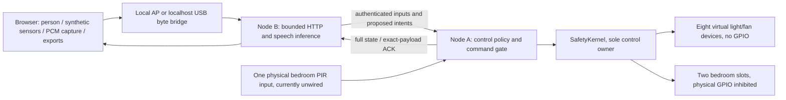

# Current native architecture

21 October 2026. See [simulation lab](SIMULATION_LAB.md) for the detailed execution boundary and [embedded design](EMBEDDED_SYSTEM_DESIGN.md) for scheduling.

Both boards use native ESP-IDF 4.4.7 builds. Speech uses pinned ESP-SR 1.7.0 MultiNet6 English. The Arduino build is historical compatibility source, not the active measured target. The two 8 MiB PSRAM heaps are independent.

A has ControlTask core 1 priority 5, LinkTask core 0 priority 3, and low-priority Diagnostics. B has LinkTask core 0 priority 3, HTTP, Diagnostics and SpeechTask core 1 priority 2. Static queues carry proposals/ACKs; depth-one mailboxes replace stale telemetry/inputs; SDK network queues remain separately allocated. The Wi-Fi receive callback only copies bounded frames.

The browser generates raw synthetic sensor values and formats captured PCM. It performs no recognition, occupancy/control policy or inference fallback. B returns speech proposals only; explicit confirmation traverses the ordinary authenticated command gate. A applies safety constraints even to AI proposals. The offline preview returns HTTP 503 for every API and displays unknown outputs.

Policy and a monotonic boot counter use NVS; transient output/timer/hold state is not restored ON. Authentication, command TTL/order, cached duplicate outcomes and bounded retry protect the software command path. ACKs never claim physical electrical verification.

Confirmed target proposals now distinguish physical bedroom from virtual rooms. B validates the exact target, current speech job where applicable, A boot/freshness, and a 15-second one-shot confirmation. Physical mode never redirects other rooms to the bedroom. The wire command/ACK security remains unchanged; room report schema 3 carries A's actual output mode and polarity assumption. Deploy both roles together when hardware returns.

The explicit `--host-dev` bridge mode compiles/runs portable routing, Automation, HouseSimulation and SafetyKernel on the laptop with mock pins. It has a persistent simulation banner, separate fault/command fixtures, no speech engine, and HOST_MEASURED/SIMULATED events. It never replaces a failed real connection. Ordinary real transport and offline-preview behavior remain distinct.

No AFE/WakeNet/I2S microphone, learned occupancy predictor, tensor splitting, cloud inference, MQTT/database, signed OTA service or physical metering is implemented. No hardware is currently available. Raw-PCM command recognition remains unresolved on the retained target evidence; browser conversion, portable framing and target diagnostics are repaired and host-tested as described in the current handoff. The evidence monitor remains shadow-only, without physical feedback or GPIO authority.
