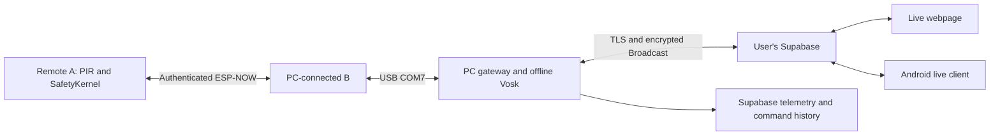

# ESP, website and Android ecosystem — 22 October 2026

The three components are the current ESP/PC project, the supplied web ZIP and the supplied Android ZIP. Originals in Downloads were left intact. Working copies are in `ecosystem/web-baseline` and `ecosystem/android`.

**Current hardware blocker:** After the successful cloud ON/OFF campaign, B's native USB stopped returning bytes. A manual reconnect/reset and BOOT-mode check did not restore it. Windows now reports error 31, "A device attached to the system is not functioning", when configuring COM7. A Windows device restart was denied by OS permissions. The PC gateway remains running and both clients correctly receive UNKNOWN/unavailable hardware state. Do not describe the earlier PASS as proof that the USB connection is currently healthy. The next hardware action is a known-working USB data cable/direct laptop port for bare B, followed by release BOOT and RESET. No firmware was erased or uploaded during these recovery attempts.

## What the analysis found

The original files did not form a verified hardware ecosystem. The old website mixed synthetic room inputs with real board processing. The Android launcher ran a local simulation loop, seeded temperature/lux/history and task counters, and could update actuator state before a remote ESP acknowledgement. Its environment also included a service-role key. Merely joining a Supabase channel did not establish that an ESP executed a command.

The current gateway now publishes actual board observations over encrypted Supabase Broadcast. The new web entry point and Android `EcosystemActivity` consume the same protocol. Legacy simulation sources remain for reference but are not the Android launcher or the new live website entry point. A simulation is never promoted to a physical sensor reading.



The PC must stay on, B must remain connected, A must remain powered, and the PC needs internet for cloud clients. Offline voice recognition still runs locally. Supabase is not a hard realtime transport: snapshots target one second, B diagnostics five seconds, durable A telemetry ten seconds. Radio/USB/cloud delays can extend these intervals.

## Exact data mapping

| Display / stored field | Authoritative source | Meaning and limits |
|---|---|---|
| A expected MAC | Private gateway role configuration | Expected identity, not a second measured MAC field |
| A boot, uptime, reports, invalid, replayed | B `/api/state`, authenticated A radio report | Actual firmware counters; uptime ms, age ms |
| Bedroom occupancy, motion | A GPIO6 PIR and A occupancy policy | One physical bedroom zone only |
| Bedroom light / fan | A reported controller output state | Commanded state; relay contacts and electrical load are not measured |
| GPIO outputs enabled | A report build/output marker | Currently false: switching remains inhibited |
| Mode, automation/manual flags, timers | A `/api/state` report | Preserved in the encrypted snapshot; timer values ms |
| B internal free/min/largest heap, PSRAM, drops | B `/api/memory` | Measured bytes and counter values; diagnostic timestamp included |
| B LinkTask core, priority, jobs, period, execution, lateness, misses, stack, watchdog | B `/api/rtos` | Actual firmware task observations; period ms, execution/lateness us, stack bytes |
| A heap and RTOS task metrics | Not exposed through the current A radio protocol | Null / UNKNOWN, never copied from B |
| Temperature / illuminance | No installed sensor in this setup | Null / not installed, never 0 or a seeded value |
| Living room, kitchen, study physical evidence | No physical sensor assigned | Unavailable; virtual room commands are explicitly labelled |
| History graph/list | Received actual snapshots only | No generated waveform; last 60 samples in client memory |
| Persistent telemetry | `clawgrid_telemetry` bedroom rows | HARDWARE_MEASURED, with known/age and null absent sensors |
| Command history | `clawgrid_events` | Signed CLOUD_COMMAND_REQUESTED and actual CLOUD_COMMAND_RESULT receipts |

Clients reject old, future, duplicate, out-of-order and wrong-scope snapshots. They lose live status after four seconds without a snapshot. A must additionally be known, authenticated and under 3000 ms report age. B diagnostics become unavailable after ten seconds. A telemetry's commanded OFF value is not a measurement that a physical lamp is off.

The existing SQL schema requires a non-null `outputs_enabled` boolean even for `known=false` rows. In those rows its conservative false placeholder is not a current hardware observation; consumers must gate the entire row on `known` and freshness. Light, fan, motion, temperature and lux stay null when unavailable. Event rows use the schema's `producer=dashboard, source=HOST_MEASURED` pairing for the PC audit; the actual A ACK and its HARDWARE_MEASURED evidence label remain in the receipt JSON. Receipts are retried idempotently after a network failure, without retrying actuation.

## Commands and credentials

Both clients send explicit light/fan ON or OFF with a UUID and ten-second expiry. The PC stores the signed request, checks its exact target, requests B's immutable proposal, confirms it, and observes A's matching application ACK. A's SafetyKernel remains authoritative. A persistent local journal prevents duplicate execution across reconnects/restarts; an uncertain outcome is never automatically repeated. Commands received before a cloud reconnect are discarded.

The existing Supabase tables and RLS were preserved. No anonymous table read/write permissions were granted. The public channel carries AES-256-GCM envelopes, not plaintext telemetry or commands. The key is derived from the existing high-entropy ClawGrid control token, with home/gateway scope authenticated as additional data. Only holders of that token can decode/control this home. Public metadata consists of the Supabase URL, anon key, home UUID and gateway UUID. The service-role key is PC-only in ignored `supabase.local.json`; it is absent from browser assets, ESP firmware and the new app configuration. Rotate the service-role credential exposed in the earlier chat and update that local file.

## Start and connect

From this project directory:

```powershell
.\Start-Voice.ps1 -SerialPort COM7
```

Open `http://127.0.0.1:8770/ecosystem` for the shared live view, or `/voice` for continuous offline speech. Copy the existing control token privately:

```powershell
(Get-Content .\local_credentials.json -Raw | ConvertFrom-Json).api_token | Set-Clipboard
```

Paste into the website/app's control-token field and choose **Connect live**. The Supabase anon key and service-role key are not the control token. Leave the default virtual target selected for a software test. No new ESP upload is required for this PC/cloud/client change.

The Android project is `ecosystem/android`; its launcher is `app/src/main/java/com/example/EcosystemActivity.kt`. The clean standalone website is exported to `deliverables/ClawGrid-live-web.zip`; serve its extracted assets through localhost or HTTPS, not file://. Both connect to the same configured home and gateway. No app has been installed on the user's phone.

## Wiring retained

| Board | Connection |
|---|---|
| A (COM8 when programming) | Bedroom PIR OUT to GPIO6, relay-control signals GPIO4 light / GPIO5 fan through a verified compatible interface |
| B (COM7) | PC USB data/power; ESP-NOW radio link to A |

The SRD-05VDC-SL-C marking identifies a 5 V relay coil, not the module's input circuit. Do not supply its VCC from ESP 3.3 V or assume direct GPIO compatibility. A's physical outputs remain inhibited pending a verified low-voltage interface and wiring test. See `PROGRAM_AND_WIRE.md` for the existing full wiring instructions. No mains switching is authorized in this prototype.

## Verification

`benchmarks/raw/hardware/ecosystem_realtime_20261022T084316Z.json` is HARDWARE_MEASURED evidence: an independent public-key subscriber received three different encrypted live snapshots, verified A authentication and B real memory/RTOS diagnostics, then sent virtual light ON and OFF through Supabase. Both received A phase-2/status-0 ACKs and corresponding virtual state. Physical GPIOs remained inhibited before and after. This verifies cloud transport and firmware command processing, not physical relay/load operation or a phone installation.

`scripts/check_ecosystem_crypto.cjs` verifies browser WebCrypto decrypts a Python-produced fixture and rejects wrong keys, tampering and wrong scope. Python also successfully decrypted browser-produced ciphertext. Android `RealtimeWireTest` uses the same fixture: the actual Kotlin/JCE code passed three host JUnit tests via `scripts/check_android_wire_jvm.py` (no phone or emulator required). The cloud, serial gate and USB integration suite passed 24 tests, including expiry, exact-target checks, journal restart/duplicate protection, missed ACKs, audit recovery, immediate processing after durable storage, and an unavailable USB device at startup.

`benchmarks/raw/ecosystem_web_client_live.json` verifies the exact web client code against live Supabase WSS; it received two encrypted snapshots and honestly reported hardware unavailable. `benchmarks/raw/hardware/ecosystem_history_and_disconnect_20261022.json` verifies persisted ACK receipts and null unavailable readings in the actual database. The initial APK build succeeded; the final delivery build is recorded in `benchmarks/raw/android-delivery-build.log`. No phone installation or physical relay/load operation is claimed.

The original failed/expired test captures are retained as diagnostic history; the timestamped PASS above is the completed cloud campaign. Later USB/timeout captures describe the current connection fault. See the delivery manifest for package hashes and build/test outcomes.
